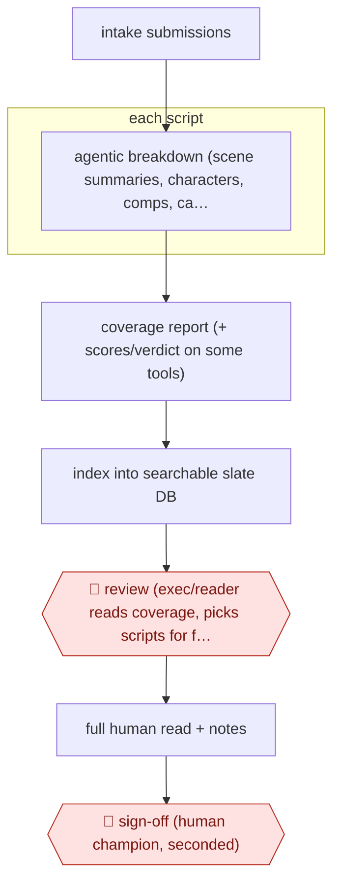

# AI-first script triage

`CRE › WRI › SCREEN` · checkpointed · evidence B · **draft: needs a reference example** ([how to add one](../../../../../CONTRIBUTING.md#1-add-an-example-run))

**Shape:** `intake submissions → each script: agentic breakdown (scene summaries, characters, comps, casting ideas) → coverage report (+ scores/verdict on some tools) → index into searchable slate DB → 🛑 review (exec/reader reads coverage, picks scripts for full read) → full human read + notes → 🛑 sign-off (human champion, seconded)`
**Variants:** `scriptsense` · `greenlight-coverage` · `screenplayiq`

<!-- shape diagram: generated by scripts/build_diagrams.py from `shape`; don't edit -->

<!-- end shape diagram -->

## Background

Film and television companies, agencies and contests receive far more screenplays than anyone can read. The usual first filter is a reader, called a story analyst, who reads a script and writes coverage: a short report with a summary, notes on the characters and a recommendation. Most scripts, especially those from writers nobody knows, never get read at all. Here the agent writes the coverage for every submitted script and files it where it can be searched, so an executive can see the whole pile and choose which scripts deserve a full read. A person still reads the chosen scripts and writes the notes, and a person must back a script before it advances, because the decision to develop or buy a script commits money and a writer's career to one person's taste, and in the reported tests the agent was too kind to weak scripts.

**Terms:**
- **Coverage**: a reader's short report on a script: summary, character notes, comparable titles and sometimes a verdict.
- **Story analyst, reader**: the person who writes coverage.
- **Logline**: a one-sentence summary of a script's story.
- **Comps (comparable titles)**: existing films or series the script resembles, used to place it in the market.
- **Slate**: the collection of scripts a company is considering or developing.
- **Content mandate**: what a buyer is currently looking for, such as a subgenre or a setting.
- **Champion, second**: the person who argues for a script, and another who agrees to it, before it moves ahead.
- **Pass / consider / recommend**: the three verdicts a reader gives a script: reject it, keep considering it, or push it forward.

## Build it with an agent

**Form:** `skill`. A reader or executive hands the agent a batch of scripts and stays in the conversation to choose from the results, so one skill that holds the coverage template is enough; for a very large pool it can use subagents in parallel, one script each.

**You need:** the scripts as text or PDF files; a skill with the coverage template (scene summaries, characters, comparable titles, optional casting ideas) and the rule against verdicts; a searchable index, for example a database file or a folder of coverage files with a table of contents, that the skill updates; a setup your organisation has approved for unpublished scripts, since writers expect their work not to be used for training. Do not connect a mail or contract tool.

| Step | Built as |
|---|---|
| intake submissions | A person drops scripts into a folder; the skill lists what it will process. |
| each script: agentic breakdown (scene summaries, characters, comps, casting ideas) | The skill reads each script in stages (scenes, then characters, then themes) and writes a coverage file. Subagents take one script each when the pile is large. |
| coverage report (+ scores/verdict on some tools) | The coverage file. The skill gives no score or verdict, following the tool that declines to; it quotes each claim from the script's own text. |
| index into searchable slate DB | The skill adds each script's subgenre, setting, themes, character types and storyline to the index. |
| 🛑 review | See Checkpoints. |
| full human read + notes | People. The agent writes no notes. |
| 🛑 sign-off | See Checkpoints. |

**Checkpoints:** `review`: the skill ends by presenting the slate and the coverage and stops; the executive or reader picks the scripts for a full read, and the skill does nothing further to the others. `sign-off`: the agent has no tool to advance a script, contact a writer or record a decision; a human champion and a second person make and record that decision themselves.

**Since the sources:** The dated source is Variety, 2025-10; the Anthropic customer story and the INTERDEPENDENT rules page are undated. The newest dated source is more than 12 months old, so a search in 2026-11 found: the vendor of ScriptSense, Jumpcut, was acquired by Cinelytic, announced 2025-03-12 ([SiliconANGLE](https://siliconangle.com/2025/03/12/cinelytic-acquires-jumpcut-media-expand-ai-powered-entertainment-analytics-platform/)), and search results describe it as now part of The Cinelytic Group; no 2026 account of its steps was found. The customer story names Claude 3 Opus, an older model. The Anthropic page and the vendor-linked tools describe products without showing their prompts, and the INTERDEPENDENT rules page refused to open in 2026-11, so its step rests on the entry text. The build is a design that follows the reported steps with a general agent, and the sources do not report a general agent doing it. The build leaves out scores and verdicts, since the Variety test found the tools biased toward the writer, and it keeps the notes human.

*A design based on this entry's steps and the tool documentation as of 2026-11, not a reported run.*

## Steps

*As reported by the sources.*

1. A team uploads scripts, either the unread pile or a contest or submission pool [[1]](#sources)[[2]](#sources).
2. A multi-step agentic breakdown, run by the tool, splits each script into plot, character and thematic components and produces coverage: scene summaries, character breakdowns, similar titles. Some tools add casting suggestions; others add 1–10 grades and a pass/consider/recommend verdict [[1]](#sources)[[2]](#sources).
3. The tool indexes the uploaded material so teams can search thousands of scripts by subgenre, setting, theme, character type or storyline against a content mandate [[1]](#sources).
4. 🛑 **Review**: an executive, agent or reader reads the coverage and decides where to focus a full read. ScriptSense deliberately makes no recommendation ('we're not going to make the decision for you') [[2]](#sources).
5. A human reads the full script and writes notes. In the Editors Guild test, AI notes were 'an almost total fail across the board', so notes stay human [[2]](#sources).
6. 🛑 **Sign-off**: at INTERDEPENDENT, a script first read by its in-house AI 'must be then be championed by a human, and seconded by another' before it advances [[3]](#sources).

**Output:** Coverage reports and a searchable slate. Shortlisted scripts go on to full human reads and development decisions.
**Failure modes → guards:** AI coverage is sycophantic and tends to 'recommend' weak scripts → don't trust verdicts; humans read the shortlist [2]. On complex scripts it misattributes action between characters and hallucinates plot points → check synopses against the script before quoting them [2]. Notes need analysis AI lacks → keep notes human [2].
**How it differs:** Nearest are AWF-0013 (Beat-to-scene screenplay) and AWF-0014 (Hook-cadence drama script). Both write scripts. This one reads other people's scripts and outputs coverage that feeds a human greenlight or read decision. The deliverable and the checkpoint (triage, not draft review) both differ.

## Public runs

Coverage as of 2026-11-13: **Weak**: only anonymous, vendor-linked or journalist-told accounts. Collected and re-checked in [Third collection pass](../../../../../research/2026-11-third-pass.md).

- [Variety, Hollywood Script Readers Fear They Could be Replaced by AI](https://variety.com/2025/film/news/hollywood-script-readers-replaced-by-ai-test-1236552756/) (2025-10-14). Indie producer uses AI coverage on his stack; WME agents use ScriptSense; Editors Guild test of six platforms. "He found the AI more honest than human feedback — even his own — while it doubled his reading pace.". *First-hand: interview; confidence: med.*
- [Anthropic, Jumpcut customer story](https://www.anthropic.com/customers/jumpcut) (undated). Multi-step script breakdown into coverage, used across studios, agencies and production companies. "35,000+ hours saved in script reading time"; "200+ companies using ScriptSense". *First-hand: vendor; confidence: low.*

## Sources

1. Anthropic customer story, Jumpcut helps Hollywood find the next big script with Claude (vendor). https://www.anthropic.com/customers/jumpcut
2. Gene Maddaus, Hollywood Script Readers Fear They Could be Replaced by AI. They Set Up a Test to See Who Gives Better Feedback, Variety, 2025-10-14. https://variety.com/2025/film/news/hollywood-script-readers-replaced-by-ai-test-1236552756/
3. INTERDEPENDENT Studio 1 call for entries (FilmFreeway rules page). https://filmfreeway.com/interdependent-studio-1
