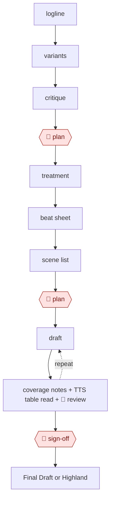

# Beat-to-scene screenplay

`CRE › WRI › SCREEN` · assist · evidence A · **draft: needs a reference example** ([how to add one](../../../../../CONTRIBUTING.md#1-add-an-example-run))

**Shape:** `logline → variants → critique → 🛑 plan → treatment → beat sheet → scene list → 🛑 plan → (draft ⟲ coverage notes + TTS table read + 🛑 review) → 🛑 sign-off → Final Draft or Highland`

<!-- shape diagram: generated by scripts/build_diagrams.py from `shape`; don't edit -->

<!-- end shape diagram -->

**Compliance (WGA 2023 MBA, in effect through May 1, 2026; check successor terms):**
- AI-generated material is not "literary material" or "source material."
- Companies must disclose AI-generated material given to writers.
- Writers can't be required to use AI, but may choose to with company consent [[13]](#sources).

Log AI-assisted portions in each example.

## Public runs

Coverage as of 2026-11-06: **Partial**: first-hand runs that cover part of the shape or put checkpoints elsewhere. From [Where are the real runs?](../../../../../research/2026-11-real-runs.md); every number was re-checked against its page.

- [Russell S.A. Palmer, *We Wrote a 100-Page Movie Script in 10 Days*](https://russellsapalmer.medium.com/we-wrote-a-100-page-feature-film-in-10-days-using-saga-and-chatgpt-316f45e0f4ad) (2025-10-28). Logline → 40-beat outline → scenes drafted with a tool, then edited by people. "a 100-page first draft, written part-time over 10 days". *First-hand: yes (reads like tool promotion); confidence: med.*
- [Peter & David Luisi, *The Last Screenwriter*](https://lastscreenwriter.com/the-screenplay/) (2024). The AI wrote the screenplay; people only selected and shortened scenes. (none). *First-hand: yes; confidence: low.*

## Sources

13. WGA, *Know Your Rights: Artificial Intelligence*. https://www.wga.org/contracts/know-your-rights/artificial-intelligence
