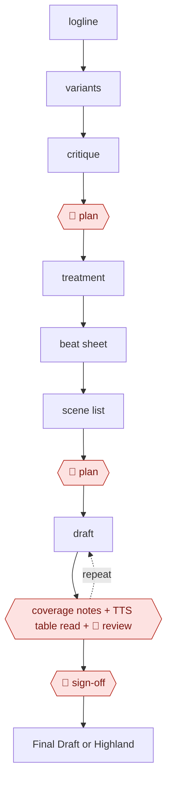

# Beat-to-scene screenplay

`CRE › WRI › SCREEN` · assist · evidence A · **draft: needs a reference example** ([how to add one](../../../../../CONTRIBUTING.md#1-add-an-example-run))

**Shape:** `logline → variants → critique → 🛑 plan → treatment → beat sheet → scene list → 🛑 plan → (draft ⟲ coverage notes + TTS table read + 🛑 review) → 🛑 sign-off → Final Draft or Highland`

<!-- shape diagram: generated by scripts/build_diagrams.py from `shape`; don't edit -->

<!-- end shape diagram -->

**Compliance (WGA 2026 MBA, term 2026-05-02 to 2030-05-01):**
- AI-generated material is not "literary material" or "source material."
- Companies must disclose AI-generated material given to writers.
- Writers can't be required to use AI, but may choose to with company consent.
- A company that licenses writers' scripts, or produced projects based on them, to train a commercial AI system must give the Guild written notice [[13]](#sources).

Log AI-assisted portions in each example.

## Background

A feature screenplay is written in stages, and the stages exist to stop a writer from discovering in act three that the story does not work. A logline is one sentence that holds the idea; a treatment is the story in prose; a beat sheet lists the turns; a scene list breaks each beat into scenes with an objective, a conflict and a turn; only then is dialogue written. Screenwriters now use a model inside that process, most usefully to generate alternatives and to give notes on what they have written, and least usefully to write the draft for them, because a scene written by a model tends to be about the idea of the scene rather than two people who want incompatible things. This workflow keeps the writer at the decisions: the logline and the beats are locked before anything is drafted, each sequence is read back with coverage-style notes and aloud, and the finished draft is signed with a record of which parts came from a model. The labour contract matters here too: a script generated by a model is not literary material, and a writer handed one is treated as its first writer.

**Terms:**
- **logline**: one or two sentences carrying the premise and the emotional hook.
- **treatment**: the story written out in prose, before scene form.
- **beat**: one story turn; a beat sheet is the list of them.
- **coverage**: professional notes on a script — structure, character, dialogue, pacing.
- **table read**: reading the script aloud, usually with different voices per part.
- **literary material / source material**: the contract terms that decide credit and payment; AI output is neither.
- **sign-off**: the writer's acceptance of the draft as theirs.
- **TTS**: text-to-speech, used here to hear the dialogue rather than read it silently.

## Build it with an agent

**Form:** `skill`. One writer works one screenplay in a conversation, with the outline locked before drafting and the draft reviewed sequence by sequence; nothing about the work needs a running service or a repository of shared state.

**You need:** the writer's own premise and characters; the beat sheet and scene list as files, so they can be locked and referred to; a text-to-speech route for the table read; a place to keep the coverage notes; the final format, which is a screenplay file for Final Draft or Highland; and, if the writer is working under a union contract, the AI-use record which the sign-off step requires. The agent needs no access to the production system: the script leaves as a file.

| Step | Built as |
|---|---|
| logline → variants → critique | The Skill generates several loglines from the premise and then criticises each one — what it promises, what it leaves vague — and the writer picks; the critique is written down so the choice is argued rather than felt. |
| 🛑 plan | The writer locks the logline, characters and, after the treatment, the beat sheet; the Skill does not draft scenes until the locked files exist, and it is told to treat them as fixed. |
| treatment → beat sheet → scene list | The Skill expands the beats into a treatment, then a scene list with an objective, a conflict and a turn per scene; short briefs on purpose, with style added later. |
| 🛑 plan | The writer approves the beat sheet and scene list, which is the cheapest place to change the story. |
| draft ⟲ coverage notes + TTS table read | Drafting in daily chunks, then two independent reads: the Skill writes coverage-style notes on structure, character, dialogue and pacing, and the pages are read through text-to-speech, which exposes flabby dialogue that reads fine on the page. |
| 🛑 review | The writer works the notes and keeps tone and continuity; late passes recheck setups against payoffs and fix the geography of action scenes. |
| 🛑 sign-off | The writer's final read, then the AI-use record: which portions were generated, so the disclosure the contract requires exists before the draft leaves. |
| export | A scene-numbered file for Final Draft or Highland. |

**Checkpoints:** `plan`: twice — the concept before the treatment, and the beats before any scene — because a model asked to draft without a locked spine will invent one, and rewriting beats is cheaper than rewriting pages. `review`: the writer reads each sequence as it is written and holds tone, pacing and continuity, which the coverage notes can flag but not decide. `sign-off`: the writer accepts the draft and records what was AI-assisted, which is a contractual obligation rather than a courtesy, and the build makes the record a step rather than an afterthought.

**Since the sources:** Sources date from 2024 to 2025-10, plus the union's own AI page. The WGA page was opened this month and the contract question in the old note is now settled: the 2026 MBA runs from 2026-05-02 to 2030-05-01, [keeps every 2023 AI protection and adds a notice requirement when a company licenses writers' scripts, or produced projects based on them, to train a commercial AI system](https://wga.org/contracts/know-your-rights/artificial-intelligence). The compliance note above is updated to that. What has not changed: the drafting tools the 2025 account describes, and the fact that no source documents the logline-variant, coverage-note and table-read steps as separate tool steps — the entry says so, and the build presents them as a design rather than a reported practice.

*A design based on this entry's steps and the tool documentation as of 2026-11, not a reported run.*

## Steps

*As reported by the sources.*

1. Write the premise as one or two sentences that hold the core idea and emotional hook, and lock the logline and key characters on day one [[14]](#sources). Have the model generate logline variants and critique them before the writer picks one.
2. 🛑 **Plan**: the writer locks the concept and logline. Beats are locked early, before any scene generation [[14]](#sources).
3. Expand into a treatment and a beat sheet. In one run this meant a 40-beat outline across Acts 1–3, with each beat expanded to a short paragraph and the major arcs, emotional through-lines and visual motifs named [[14]](#sources). Then derive a scene list from the beats.
4. 🛑 **Plan**: the writer approves the beat sheet and scene list. Keep scene briefs simple (objective → conflict → turn) and stylize later [[14]](#sources).
5. Draft scene by scene, in daily chunks of 5–20 pages. Feed each beat to the scene generator (Saga's "Generate Scene" on the Script page, guided by its Act and Beat tabs), then edit and expand the draft into full sequences. Start each session by rereading yesterday's pages [[14]](#sources).
6. Loop each sequence through coverage-style notes (structure, character, dialogue, pacing) and a TTS table read, reading aloud for rhythm and dialogue length [[14]](#sources).
7. 🛑 **Review**: the writer reviews each scene as they go, holding tone, pacing and emotional continuity. Late passes recheck setups against payoffs and fix "geography" (location continuity, transitions) [[14]](#sources).
8. 🛑 **Sign-off**: after a final read-through to tighten dialogue, cut filler and check tone, the writer signs off the draft and logs which portions were AI-generated, per the WGA terms above [[13]](#sources) [[14]](#sources).
9. Export a scene-numbered draft to Final Draft or Highland for the next phase (storyboards, animatics, festival submissions) [[14]](#sources).

**Output:** A scene-numbered, export-ready feature draft (about 100 pages in the one documented run), plus a log of AI-generated portions, ready for production prep or a rewrite [[14]](#sources).
**Failure modes → guards:** Over-prompting drifts the tone → short scene briefs (objective → conflict → turn), with style added later [[14]](#sources). Dialogue inflates in Act II → word limits and read-aloud passes [[14]](#sources). Action geography is unclear → a 10-minute pre-visualization pass, then a rewrite with concrete verbs and clear blocking [[14]](#sources). AI-written material is treated as source material, or used without disclosure → follow the WGA terms and log AI portions [[13]](#sources). Not supported by the sources: how logline variants, coverage notes and TTS table reads perform in practice. The one first-hand run documents none of them as separate tool steps.
**How it differs:** None close in the catalog. AWF-0014 Hook-cadence drama script writes a 60–100 episode series paced for a paywall; this one develops a feature screenplay through the classical stages.

## Public runs

Coverage as of 2026-11-06: **Partial**: first-hand runs that cover part of the shape or put checkpoints elsewhere. From [Where are the real runs?](../../../../../research/2026-11-real-runs.md); every number was re-checked against its page.

- [Russell S.A. Palmer, *We Wrote a 100-Page Movie Script in 10 Days*](https://russellsapalmer.medium.com/we-wrote-a-100-page-feature-film-in-10-days-using-saga-and-chatgpt-316f45e0f4ad) (2025-10-28). Logline → 40-beat outline → scenes drafted with a tool, then edited by people. "a 100-page first draft, written part-time over 10 days". *First-hand: yes (reads like tool promotion); confidence: med.*
- [Peter & David Luisi, *The Last Screenwriter*](https://lastscreenwriter.com/the-screenplay/) (2024). The AI wrote the screenplay; people only selected and shortened scenes. (none). *First-hand: yes; confidence: low.*

## Sources

13. WGA, *Know Your Rights: Artificial Intelligence*. https://www.wga.org/contracts/know-your-rights/artificial-intelligence
14. Russell S.A. Palmer, *We Wrote a 100-Page Movie Script in 10 Days Using ChatGPT and Saga*, 2025-10-28. https://russellsapalmer.medium.com/we-wrote-a-100-page-feature-film-in-10-days-using-saga-and-chatgpt-316f45e0f4ad
