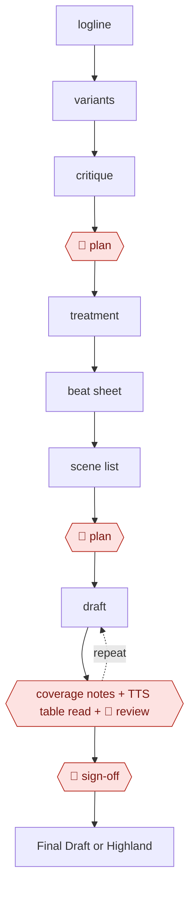

# Beat-to-scene screenplay

`CRE › WRI › SCREEN` · assist · evidence A · **draft: needs a reference example** ([how to add one](../../../../../CONTRIBUTING.md#1-add-an-example-run))

**Shape:** `logline → variants → critique → 🛑 plan → treatment → beat sheet → scene list → 🛑 plan → (draft ⟲ coverage notes + TTS table read + 🛑 review) → 🛑 sign-off → Final Draft or Highland`

<!-- shape diagram: generated by scripts/build_diagrams.py from `shape`; don't edit -->

<!-- end shape diagram -->

**Compliance (WGA 2023 MBA, in effect through May 1, 2026; check successor terms):**
- AI-generated material is not "literary material" or "source material."
- Companies must disclose AI-generated material given to writers.
- Writers can't be required to use AI, but may choose to with company consent [[13]](#sources).

Log AI-assisted portions in each example.

## Steps
1. Write the premise as one or two sentences that hold the core idea and emotional hook, and lock the logline and key characters on day one [[14]](#sources). Have the model generate logline variants and critique them before the writer picks one.
2. 🛑 **Plan**: the writer locks the concept and logline. Beats are locked early, before any scene generation [[14]](#sources).
3. Expand into a treatment and a beat sheet. In one run this meant a 40-beat outline across Acts 1–3, with each beat expanded to a short paragraph and the major arcs, emotional through-lines and visual motifs named [[14]](#sources). Then derive a scene list from the beats.
4. 🛑 **Plan**: the writer approves the beat sheet and scene list. Keep scene briefs simple (objective → conflict → turn) and stylize later [[14]](#sources).
5. Draft scene by scene, in daily chunks of 5–20 pages. Feed each beat to the scene generator (Saga's "Generate Scene" on the Script page, guided by its Act and Beat tabs), then edit and expand the draft into full sequences. Start each session by rereading yesterday's pages [[14]](#sources).
6. Loop each sequence through coverage-style notes (structure, character, dialogue, pacing) and a TTS table read, reading aloud for rhythm and dialogue length [[14]](#sources).
7. 🛑 **Review**: the writer reviews each scene as they go, holding tone, pacing and emotional continuity. Late passes recheck setups against payoffs and fix "geography" (location continuity, transitions) [[14]](#sources).
8. 🛑 **Sign-off**: after a final read-through to tighten dialogue, cut filler and check tone, the writer signs off the draft and logs which portions were AI-generated, per the WGA terms above [[13]](#sources) [[14]](#sources).
9. Export a scene-numbered draft to Final Draft or Highland for the next phase (storyboards, animatics, festival submissions) [[14]](#sources).

**Output:** A scene-numbered, export-ready feature draft (about 100 pages in the one documented run), plus a log of AI-generated portions, ready for production prep or a rewrite [[14]](#sources).
**Failure modes → guards:** Over-prompting drifts the tone → short scene briefs (objective → conflict → turn), with style added later [[14]](#sources). Dialogue inflates in Act II → word limits and read-aloud passes [[14]](#sources). Action geography is unclear → a 10-minute pre-visualization pass, then a rewrite with concrete verbs and clear blocking [[14]](#sources). AI-written material is treated as source material, or used without disclosure → follow the WGA terms and log AI portions [[13]](#sources). Not supported by the sources: how logline variants, coverage notes and TTS table reads perform in practice. The one first-hand run documents none of them as separate tool steps.

## Public runs

Coverage as of 2026-11-06: **Partial**: first-hand runs that cover part of the shape or put checkpoints elsewhere. From [Where are the real runs?](../../../../../research/2026-11-real-runs.md); every number was re-checked against its page.

- [Russell S.A. Palmer, *We Wrote a 100-Page Movie Script in 10 Days*](https://russellsapalmer.medium.com/we-wrote-a-100-page-feature-film-in-10-days-using-saga-and-chatgpt-316f45e0f4ad) (2025-10-28). Logline → 40-beat outline → scenes drafted with a tool, then edited by people. "a 100-page first draft, written part-time over 10 days". *First-hand: yes (reads like tool promotion); confidence: med.*
- [Peter & David Luisi, *The Last Screenwriter*](https://lastscreenwriter.com/the-screenplay/) (2024). The AI wrote the screenplay; people only selected and shortened scenes. (none). *First-hand: yes; confidence: low.*

## Sources

13. WGA, *Know Your Rights: Artificial Intelligence*. https://www.wga.org/contracts/know-your-rights/artificial-intelligence
14. Russell S.A. Palmer, *We Wrote a 100-Page Movie Script in 10 Days Using ChatGPT and Saga*, 2025-10-28. https://russellsapalmer.medium.com/we-wrote-a-100-page-feature-film-in-10-days-using-saga-and-chatgpt-316f45e0f4ad
