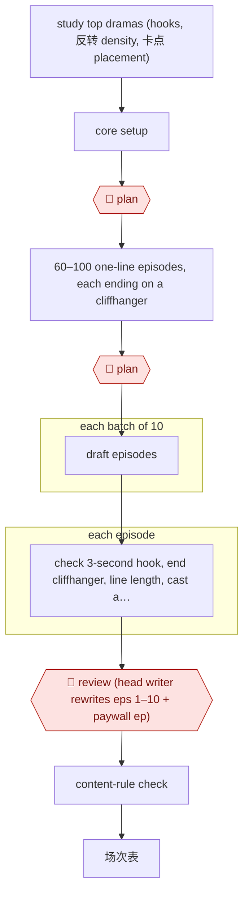

# Hook-cadence drama script

`CRE › WRI › SCREEN` · checkpointed · evidence A · **draft: needs a reference example** ([how to add one](../../../../../CONTRIBUTING.md#1-add-an-example-run))

**Shape:** `study top dramas (hooks, 反转 density, 卡点 placement) → core setup → 🛑 plan → 60–100 one-line episodes, each ending on a cliffhanger → 🛑 plan → each batch of 10: draft episodes → each episode: check 3-second hook, end cliffhanger, line length, cast and location budget → 🛑 review (head writer rewrites eps 1–10 + paywall ep) → content-rule check → 场次表`
**Agent kit:** [run this in Claude Code](variants/claude-code.md)
**How it differs from Beat-to-scene screenplay:** the deliverable is a 60–100-episode series with a paywall episode to pace toward, and episodes are drafted in parallel batches.
**Tags:** domestic releases go through the NRTA's tiered review, with three categories by budget and subject. Platforms may not carry micro-dramas without a license or filing number [[14]](#sources). **Feeds into:** AWF-0015, AWF-0016.

<!-- shape diagram: generated by scripts/build_diagrams.py from `shape`; don't edit -->

<!-- end shape diagram -->

## Background

A 微短剧 is told in 60 to 100 episodes of about 90 seconds each, watched on a phone and paid for by the episode after a free opening. That format dictates the writing. Every episode has to open with something that stops a thumb within three seconds and end on a cut that makes the next one feel necessary, and the platform earns nothing until a viewer reaches the paywall, so episodes one to ten and the paywall episode carry the whole business. Producers therefore start from data: which endings the top dramas used, where their paywalls sat, how often the reversal came. This workflow turns that study into a hook table — one line per episode, with the ending-hook type named and the paywall flagged — then drafts in batches of ten with a recap of the previous episode in every prompt, checks each episode mechanically for the hook, the ending, the line length and the cast budget, and hands the result to the head writer, who rewrites the opening and the paywall episode by hand. The writing that decides whether anyone pays stays human; what the model provides is volume against a fixed form.

**Terms:**
- **微短剧**: a short-form serial for mobile, under twenty minutes an episode, usually 60–100 episodes.
- **钩子 (hook)**: the opening beat that stops a viewer scrolling.
- **反转**: a reversal — new information that turns the situation.
- **卡点 (paywall point)**: the episode where free viewing stops and payment starts.
- **钩子密度表**: the hook table: one line per episode with its event, ending-hook type, paywall flag and cost.
- **场次表**: the scene breakdown handed to production.
- **伏笔 (setup and payoff)**: a detail planted early and used later; the entry keeps a register of both ends.
- **备案 / 许可**: the filing or distribution licence a domestic release needs.

## Build it with an agent

**Form:** `project`. The scripts, the hook table, the character database and the continuity ledger have to persist across dozens of sessions and stay in one version — the sources' main failure is a model that forgets the setting after a dozen episodes — which is a repository with `CLAUDE.md` and skills, and a Claude Code kit is provided.

**You need:** the market study as a table — for the top dramas, the ending-hook type per early episode and the paywall position; the character base, each entry three fields in under 50 字; the hook table and the setup/payoff register as files under version control; the check scripts (length, line length, scene count, first-three-second conflict, ending cut, red-line words); the platform's content rules and the classification the drama falls into. The agent must not invent a hook type outside the fixed five, and must not overwrite an approved episode without a new version.

| Step | Built as |
|---|---|
| study top dramas | A data pull from a third-party spend ranking plus an assistant tagging each ending into the five fixed hook types; the output is a frequency table, which is what the next step argues from. |
| core setup | The Skill turns the idea into an outline and a character base; `CLAUDE.md` fixes the three-field, 50-字 character format so the cast stays small and readable. |
| 🛑 plan | The producer and head writer choose the emotion the audience will pay for before any episode is outlined; nothing is drafted until that choice is written into the hook table's header. |
| 60–100 one-line episodes | The Skill lays out the hook table with the paywall flagged and the free episodes marked, plus a setup/payoff register so a reversal can be traced to what planted it. |
| 🛑 plan | Producer, writer and director read the hook table together and find the weak endings; per-episode scene outlines are confirmed before any full episode is written. |
| each batch of 10: draft episodes | Batches of ten with the previous episode's recap and this episode's task in every prompt, and a continuity ledger beside the scripts; the batch size is the model's memory limit made explicit. |
| each episode: check hook, ending, line length, cast and location budget | Scripts run the mechanical checks — first-three-second conflict, cut-off ending, 180–250 字 of dialogue per minute, 10–12 字 lines, at most three scene changes — so the head writer reads for what a script cannot measure. |
| 🛑 review (head writer rewrites eps 1–10 + paywall ep) | The head writer rewrites by hand the episodes that decide revenue, and the strongest reversals are moved into the paywall episodes; the build keeps the rewritten version as the version of record. |
| content-rule check → 场次表 | A red-line scan plus the classification check, then the 场次表 and episode cards are exported under a dated version name. |

**Checkpoints:** `plan`: twice — the paid emotion before the outline, and the hook table before any episode is written — because both are cheap to change and expensive to discover later. `review`: the head writer's rewrite of episodes 1–10 and the paywall episode is the editorial gate, and it is deliberately placed where the money is; the build keeps the rewrite as a separate version so the original and the rewrite can be compared.

**Since the sources:** Sources date from 2026-07 to 2026-10: a producer's process review, a writer's interview, a magazine feature and an open-source Codex skill. They were not re-opened on this pass; the regulation was. The tiered review this entry's tags describe is no longer anticipated — the 微短剧发展管理办法 [took effect on 2026-09-01](https://www.news.cn/20260731/9d0579e4587648fb83580e0fec008e12/c.html), with the three classes by budget and subject, the filing and licence system, eleven content red lines and a per-episode AI label for generated work. That makes the content-rule check a compliance step rather than a precaution, and it should be run against the drama's classification, which is decided before production rather than at submission.

*A design based on this entry's steps and the tool documentation as of 2026-11, not a reported run.*

## Steps

*As reported by the sources.*

1. Study the market before choosing a story: pull the top 50 dramas by 7-day spend from third-party data platforms (the producer uses 新红 and 灰豚), and record the ending-hook type of each of eps 1–5 and the emotional peak of the paywall episode. An assistant tags hook labels (身份反转, 情感绑架, 生死危机, 打脸爽点) in Excel and counts their frequency [[15]](#sources).
2. Build the core setup. The AI turns the story idea into a mind map and outline [[16]](#sources). Character sheets stay under 50 字 each, in three fields (身份标签, 核心软肋, 触发动作), kept in a 飞书多维表格 character base [[15]](#sources). Keep the cast small and the relationships readable at a glance [[18]](#sources).
3. 🛑 **Plan**: the producer and head writer pick the emotion the audience will pay for (for example 虐渣复仇 over 母子相认 as the main line) before any episode is outlined [[15]](#sources).
4. Lay out the series one line per episode in a 钩子密度表 (episode, event, ending-hook type from five fixed categories, paywall flag, estimated cost, notes). Eps 1–3 are free and must end on strong suspense; eps 8–12 are the usual paywall and are highlighted [[15]](#sources). Add a section-by-section climax table and a 伏笔登记表 (where each setup is planted and paid off) [[18]](#sources).
5. 🛑 **Plan**: producer, writer and director read the hook table together to find weak endings. Ask the model for each episode's 分场大纲 and confirm it before the full episode is written [[15]](#sources) [[18]](#sources).
6. Draft in batches of 10. Every prompt carries a recap of the previous episode and this episode's task, or the model starts forgetting settings after a dozen episodes; after each 10 episodes, check that the main suspense is still rising [[18]](#sources). One open-source Codex skill runs this as `/分集规划 1-10` and `/连写 1-10` with a cross-episode continuity ledger [[19]](#sources).
7. Check every episode: conflict in the first 3 seconds, a cut-off on the ending hook, about 180–250 字 of dialogue per minute, lines of 10–12 字, timed by reading aloud [[15]](#sources); no more than 3 scene changes per episode [[18]](#sources). The same skill ships scripts that check length, line length, scene count, first-3-second conflict, ending cut and red-line words [[19]](#sources).
8. 🛑 **Review**: the head writer rewrites eps 1–10 and the paywall episode. Lines, the nuance of relationships and the timing of 爽点 stay human work [[16]](#sources), and the strongest reversals go into the paywall episodes [[15]](#sources).
9. Run the content-rule check, then export the 场次表 and per-episode cards (hook type, word count, key image) under a dated version name [[15]](#sources). Platforms run an AI review first and then a human one; one company saw nearly 70% of its AI dramas fail, mostly for violence or a face drifting into a celebrity's likeness [[17]](#sources). Domestic releases also need the NRTA filing or license [[14]](#sources).

**Output:** a 60–100-episode script with a hook table, 场次表 and episode cards, handed to production (AWF-0015 or AWF-0016). Scripts for AI production need more scene and character description, roughly 5万 to 8万 字 [[17]](#sources).
**Failure modes → guards:** A weak ending gets used as ad material and the click rate collapses → every ending gets a named hook type in the table [[15]](#sources). Viewers leave before the paywall → shoot eps 1–5, run a small ad test, and pull a reversal one episode earlier (ROI "回升了0.2左右") [[15]](#sources). The model forgets settings mid-series → recap and episode task in every prompt, plus a check every 10 episodes [[18]](#sources). Writers and storyboard artists work from different versions → one shared doc and a version-naming rule [[15]](#sources). Faster output without better quality ("产能确实提高了，但质量未必提高") → humans keep dialogue and 爽点 timing [[16]](#sources). Review rejection → screen for violence and likeness drift before submission [[17]](#sources).

## Public runs

Coverage as of 2026-11-06: **Weak**: only anonymous, vendor-linked or journalist-told accounts. From [Where are the real runs?](../../../../../research/2026-11-real-runs.md); every number was re-checked against its page.

- [光影联盟编辑部, lunxiao.com](https://www.lunxiao.com/article.html?id=23310) (Producer's review of a micro-drama script process, 2026-09-21). Study top dramas → hook-density table → paywall at eps 8–12 → ad-test eps 1–5 → rewrite. "台词通常在180到250字之间"; "ROI回升了0.2左右". *First-hand: anon; confidence: low.*
- [小树 for GPLP, NetEase](https://m.163.com/dy/article/LAJ3VILB05118D5B.html) (A writer torn between AI and herself, 2026-10-31). The AI makes the mind map and outline; lines and 爽点 timing stay human. "半个月上线一部AI短剧" (title). *First-hand: interview; confidence: med.*
- [新民周刊 p.41](https://img1.xinmin.cn/xmzk/2026-07-13/410713.pdf) (Xinmin Weekly, 2026-07-13). AI review before human review; scripts expanded for AI production. "近七成都无法过审"; "5万字…可能要补充到8万字". *First-hand: interview; confidence: med.*

## Sources

14. 新华网, 微短剧分类分层审核 (February 2025). https://www.news.cn/politics/20250205/3fbf8abbfa344641b01f799ae42a6318/c.html · 新华网, 《微短剧发展管理办法(征求意见稿)》 (June 2026). https://www.news.cn/politics/20260624/5794e5cd877e440cb678a7f27112ffc7/c.html · IT之家. https://www.ithome.com/0/984/306.htm
15. 光影联盟, 微短剧剧本从选题到分镜：制片人复盘一套带付费卡点和具体参数的流程, 2026-09-21. https://www.lunxiao.com/article.html?id=23310
16. 小树 for GPLP (via NetEase), 半个月上线一部AI短剧，编剧却在AI和自己之间反复, 2026-10-31. https://m.163.com/dy/article/LAJ3VILB05118D5B.html
17. 新民周刊 p.41, 2026-07-13. https://img1.xinmin.cn/xmzk/2026-07-13/410713.pdf
18. 老陈的 AI 知识库, 短剧剧本怎么写：从全剧架构到单集卡点的完整教程, 2026-08-24. https://www.cpengx.cn/video/d-script.html
19. hongguo-shortdrama-screenwriting (GitHub, Codex skill, MIT), README, 2026-09. https://github.com/zhu5859243-free/hongguo-shortdrama-screenwriting
