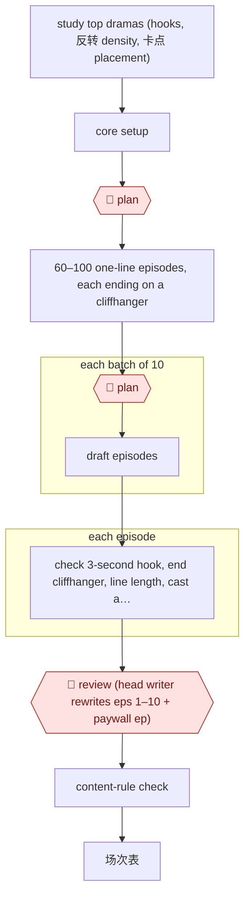

# Hook-cadence drama script

`CRE › WRI › SCREEN` · checkpointed · evidence A · **draft: needs a reference example** ([how to add one](../../../../../CONTRIBUTING.md#1-add-an-example-run))

**Shape:** `study top dramas (hooks, 反转 density, 卡点 placement) → core setup → 🛑 plan → 60–100 one-line episodes, each ending on a cliffhanger → 🛑 plan → each batch of 10: draft episodes → each episode: check 3-second hook, end cliffhanger, line length, cast and location budget → 🛑 review (head writer rewrites eps 1–10 + paywall ep) → content-rule check → 场次表`
**How it differs from Beat-to-scene screenplay:** the deliverable is a 60–100-episode series with a paywall episode to pace toward, and episodes are drafted in parallel batches.
**Tags:** domestic releases go through the NRTA's tiered review, with three categories by budget and subject. Platforms may not carry micro-dramas without a license or filing number [[14]](#sources). **Feeds into:** AWF-0015, AWF-0016.

<!-- shape diagram: generated by scripts/build_diagrams.py from `shape`; don't edit -->

<!-- end shape diagram -->

## Public runs

Coverage as of 2026-11-06: **Weak**: only anonymous, vendor-linked or journalist-told accounts. From [Where are the real runs?](../../../../../research/2026-11-real-runs.md); every number was re-checked against its page.

- [光影联盟编辑部, lunxiao.com](https://www.lunxiao.com/article.html?id=23310) (Producer's review of a micro-drama script process, 2026-09-21). Study top dramas → hook-density table → paywall at eps 8–12 → ad-test eps 1–5 → rewrite. "台词通常在180到250字之间"; "ROI回升了0.2左右". *First-hand: anon; confidence: low.*
- [小树 for GPLP, NetEase](https://m.163.com/dy/article/LAJ3VILB05118D5B.html) (A writer torn between AI and herself, 2026-10-31). The AI makes the mind map and outline; lines and 爽点 timing stay human. "半个月上线一部AI短剧" (title). *First-hand: interview; confidence: med.*
- [新民周刊 p.41](https://img1.xinmin.cn/xmzk/2026-07-13/410713.pdf) (Xinmin Weekly, 2026-07-13). AI review before human review; scripts expanded for AI production. "近七成都无法过审"; "5万字…可能要补充到8万字". *First-hand: interview; confidence: med.*

## Sources

14. 新华网, 微短剧分类分层审核 (February 2025). https://www.news.cn/politics/20250205/3fbf8abbfa344641b01f799ae42a6318/c.html · 新华网, 《微短剧发展管理办法(征求意见稿)》 (June 2026). https://www.news.cn/politics/20260624/5794e5cd877e440cb678a7f27112ffc7/c.html · IT之家. https://www.ithome.com/0/984/306.htm
