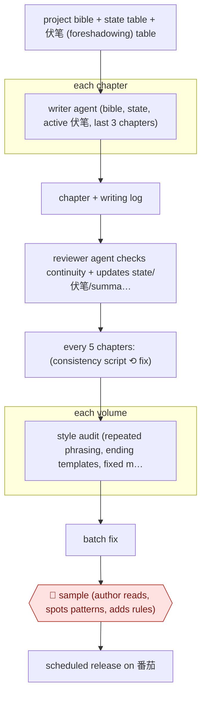

# Agent-crew serial with volume audits

`CRE › WRI › SERIAL` · sampled · evidence A · **draft: needs a reference example** ([how to add one](../../../../../CONTRIBUTING.md#1-add-an-example-run))

**Shape:** `project bible + state table + 伏笔 (foreshadowing) table → each chapter: writer agent (bible, state, active 伏笔, last 3 chapters) → chapter + writing log → reviewer agent checks continuity + updates state/伏笔/summary files itself → every 5 chapters: (consistency script ⟲ fix) → each volume: style audit (repeated phrasing, ending templates, fixed metaphors) → batch fix → 🛑 sample (author reads, spots patterns, adds rules) → scheduled release on 番茄`
**Variants:** `claude-code-skill` · `sumeru-skills`

<!-- shape diagram: generated by scripts/build_diagrams.py from `shape`; don't edit -->

<!-- end shape diagram -->

## Background

网文 (Chinese web novels) are very long serial stories published chapter by chapter on reading platforms, often for months, with new chapters released on a fixed schedule. One author normally plans the plot, writes every chapter and keeps track of hundreds of facts: who knows what, what each character owns, which hints have been planted and not yet paid off. Over a hundred chapters or more, errors creep in unnoticed: a character's injury vanishes, a resource count jumps, and the same phrases and chapter endings start to repeat. Here one agent drafts each chapter and a second checks it and keeps the record of story facts up to date, while scripts check the numbers at fixed intervals. The author still reads samples of the finished text, because repetition across dozens of chapters and rules the agents have misunderstood are only visible to a reader, and because the author decides what goes out to paying readers under their name.

**Terms:**
- **网文 (web novel)**: a serial novel written for online reading platforms, released chapter by chapter.
- **Project bible**: the fixed reference for the story: world, characters, rules of the setting, plot plan.
- **State table**: a running record of facts that change from chapter to chapter, such as where each character is and what they hold.
- **伏笔 (foreshadowing)**: a hint planted early that the story must pay off later; the 伏笔 table lists the open ones.
- **Writing log**: a note the writer agent leaves with each chapter recording why it made its creative choices, not story facts.
- **Volume (卷)**: a block of chapters forming one arc; this run had 6 volumes.
- **Style audit**: a scan of a whole volume for repeated sentence patterns, template endings and fixed metaphors.
- **番茄 (番茄小说, Fanqie)**: a Chinese web-novel platform that releases chapters on a schedule, with a daily word limit.
- **字**: a Chinese character, the unit web-novel lengths are counted in.
- **段评 (paragraph comments)**: readers' comments attached to individual paragraphs of a chapter.

## Build it with an agent

**Form:** `project`. The author runs it from one conversation, but the reviewer must not have seen the draft and the 5-chapter script check must pass every time, which needs a custom subagent and a hook.

**You need:** a project folder with the bible, state table, active and archived 伏笔 tables, chapter summaries and chapters as files; a `CLAUDE.md` with the writing rules (ending rotation, body-reaction pool, scene rules); the consistency script and the style checklist as files beside the skill; the author's 番茄 account, which the agent does not get.

| Step | Built as |
|---|---|
| project bible + state table + 伏笔 table | Files in the project, with the rules in `CLAUDE.md`. The state table keeps the last 3 chapters in detail and older ones compressed; only the active 伏笔 file is loaded. |
| each chapter: writer agent → chapter + writing log | A skill that reads the bible, state, active 伏笔 and the last 3 chapters and writes the chapter file and its log. |
| reviewer agent checks continuity + updates state/伏笔/summary files itself | A custom subagent with its own context that gets the chapter, the log and the state files, checks continuity and edits the state, 伏笔 and summary files. |
| every 5 chapters: (consistency script ⟲ fix) | The script beside the skill. A `PreToolUse` hook blocks writing the next chapter file until the script's last result is PASS. |
| each volume: style audit → batch fix | The skill's volume step, using the checklist file; a subagent per checklist section can scan the volume in parallel. |
| 🛑 sample | See Checkpoints. |
| scheduled release on 番茄 | The author uploads and schedules chapters on the platform. |

**Checkpoints:** `sample`: after each volume's audit and batch fix, the skill stops and gives the author the audit report and the chapters to read; the next volume does not start until the author has read them and added any new rules to `CLAUDE.md` or the checklist. The agent has no tool that reaches 番茄, so nothing reaches readers without the author.

**Since the sources:** Sources date from 2026-05 to 2026-06; source 2 returned an empty page when this was written. Source 1 is filed under the tool `claude-code-skill` and the author packaged the method as a Claude Code skill run by asking for one step at a time; this build keeps that procedure and moves two parts out of the skill's text: the reviewer becomes a custom subagent so it reads the chapter without the writer's context, and the 5-chapter PASS rule becomes a hook. The layered state table and the active/archived 伏笔 split were the author's answer to the agent failing to find facts in a long file; the build keeps them. The sources report one author's novel, not a measured process, and the author's own rule fixes came from reading the text, which the build leaves with the author.

*A design based on this entry's steps and the tool documentation as of 2026-11, not a reported run.*

## Steps

*As reported by the sources.*

1. The author sets up a project bible, a state table and a 伏笔 table (later split into active and archived) as files the agents read [[1]](#sources).
2. The writer agent reads the bible, state table, active 伏笔 and the last 3 chapters, then writes one chapter plus a writing log. The log records creative decisions only, not facts [[1]](#sources).
3. The reviewer agent reads the chapter, log and all state files, checks continuity (character drift, setting contradictions, timeline regressions), and updates the state table, 伏笔 table and chapter summary itself, with no manual merge [[1]](#sources).
4. Every 5 chapters, a Python consistency script checks resource jumps, duplicated 伏笔 and over-length chapters. All checks must PASS before writing continues [[1]](#sources).
5. At the end of each volume, the agent runs a style audit that scans for repeated sentence patterns, template endings and fixed metaphors, then batch-fixes them [[1]](#sources).
6. 🛑 **Sample**: the author reads the output and catches systemic patterns the agents miss (e.g. the same body reaction 13 times in 180 chapters). Fixes become rules: a pool of 5–8 alternative reactions, a 6-way ending rotation, and rewording of misread rules [[1]](#sources).
7. The author releases the chapters on 番茄小说 on a schedule, within the platform's daily word limit [[1]](#sources).

**Output:** A long serial (180 chapters) released on a schedule, plus a reusable rule set packaged as a skill.
**Failure modes → guards:** Template endings and fixed phrasing pile up unnoticed over dozens of chapters → concrete checklists ('last 3 endings must differ') and rotation tables [1]. Rule wording gets misread (a 'food source' rule became an inventory line) → rewrite rules as scene instructions [1]. State table bloats past useful retrieval → layer the state (recent 3 chapters in detail, older compressed) and read only the active 伏笔 [1].
**How it differs:** Nearest is AWF-0012 (Daily web serial). There a human reviews every ~2,000-字 chapter before daily publish and adjusts from 段评. Here a writer/reviewer agent pair keeps state files itself, scripted gates run every 5 chapters, and the human samples at volume level. Autonomy is sampled, not checkpointed per chapter. AWF-0011 is assist-level, with per-scene human review.

## Public runs

Coverage as of 2026-11-13: **Partial**: first-hand runs that cover part of the shape or put checkpoints elsewhere. Collected and re-checked in [Third collection pass](../../../../../research/2026-11-third-pass.md).

- [Ying Zhu, AI写网文的总结和复盘](https://yingzhu.xyz/posts/ai-novel-journey/) (2026-06-03). Writer/reviewer agents, 5-chapter script gate, volume style audits; failures and rule fixes. "180章，6卷，约114万字符"; "180章里出现了13次". *First-hand: yes; confidence: med.*
- [xindoo, 我用 AI 写了一部 320 章的长篇网文](https://blog.51cto.com/xindoo/14622950) (2026-05-22). Modular skill pipeline with parallel chapter writing and review; author admits loose pacing and repetition. "一共 320 章，100w+ 字". *First-hand: yes; confidence: med.*

## Sources

1. Ying Zhu, AI写网文的总结和复盘 (Review of writing a web novel with AI), 2026-06-03. https://yingzhu.xyz/posts/ai-novel-journey/
2. xindoo, 当创作被 Skill 化：我用 AI 写了一部 320 章的长篇网文 (sumeru skills: worldbuilder/topic/outline/write/review/polish/finalize), 51CTO, 2026-05-22. https://blog.51cto.com/xindoo/14622950
