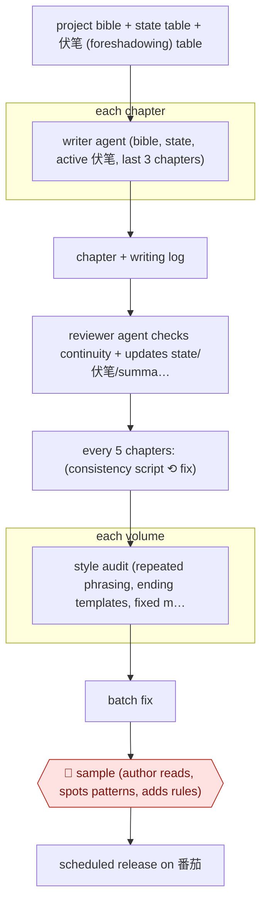

# Agent-crew serial with volume audits

`CRE › WRI › SERIAL` · sampled · evidence A · **draft: needs a reference example** ([how to add one](../../../../../CONTRIBUTING.md#1-add-an-example-run))

**Shape:** `project bible + state table + 伏笔 (foreshadowing) table → each chapter: writer agent (bible, state, active 伏笔, last 3 chapters) → chapter + writing log → reviewer agent checks continuity + updates state/伏笔/summary files itself → every 5 chapters: (consistency script ⟲ fix) → each volume: style audit (repeated phrasing, ending templates, fixed metaphors) → batch fix → 🛑 sample (author reads, spots patterns, adds rules) → scheduled release on 番茄`
**How it differs:** Nearest is AWF-0012 (Daily web serial). There a human reviews every ~2,000-字 chapter before daily publish and adjusts from 段评. Here a writer/reviewer agent pair keeps state files itself, scripted gates run every 5 chapters, and the human samples at volume level. Autonomy is sampled, not checkpointed per chapter. AWF-0011 is assist-level, with per-scene human review.
**Variants:** `claude-code-skill` · `sumeru-skills`

<!-- shape diagram: generated by scripts/build_diagrams.py from `shape`; don't edit -->

<!-- end shape diagram -->

## Steps
1. Set up a project bible, a state table and a 伏笔 table (later split into active and archived) as files the agents read [[1]](#sources).
2. Writer agent: reads the bible, state table, active foreshadowing and the last 3 chapters, then writes one chapter plus a writing log. The log records creative decisions only, not facts [[1]](#sources).
3. Reviewer agent: reads the chapter, log and all state files, checks continuity (character drift, setting contradictions, timeline regressions), and updates the state table, 伏笔 table and chapter summary itself, with no manual merge [[1]](#sources).
4. Every 5 chapters, a Python consistency script checks resource jumps, duplicated foreshadowing and over-length chapters. All checks must PASS before writing continues [[1]](#sources).
5. At the end of each volume, a style audit scans for repeated sentence patterns, template endings and fixed metaphors, then batch-fixes them [[1]](#sources).
6. 🛑 **Sample**: the author reads the output and catches systemic patterns the agents miss (e.g. the same body reaction 13 times in 180 chapters). Fixes become rules: a pool of 5–8 alternative reactions, a 6-way ending rotation, and rewording of misread rules [[1]](#sources).
7. Chapters are released on 番茄小说 on a schedule, within the platform's daily word limit [[1]](#sources).

**Output:** A long serial (180 chapters) released on a schedule, plus a reusable rule set packaged as a skill.
**Failure modes → guards:** Template endings and fixed phrasing pile up unnoticed over dozens of chapters → concrete checklists ('last 3 endings must differ') and rotation tables [1]. Rule wording gets misread (a 'food source' rule became an inventory line) → rewrite rules as scene instructions [1]. State table bloats past useful retrieval → layer the state (recent 3 chapters in detail, older compressed) and read only the active 伏笔 [1].

## Public runs

Coverage as of 2026-11-13: **Partial**: first-hand runs that cover part of the shape or put checkpoints elsewhere. Collected and re-checked in [Third collection pass](../../../../../research/2026-11-third-pass.md).

- [Ying Zhu, AI写网文的总结和复盘](https://yingzhu.xyz/posts/ai-novel-journey/) (2026-06-03). Writer/reviewer agents, 5-chapter script gate, volume style audits; failures and rule fixes. "180章，6卷，约114万字符"; "180章里出现了13次". *First-hand: yes; confidence: med.*
- [xindoo, 我用 AI 写了一部 320 章的长篇网文](https://blog.51cto.com/xindoo/14622950) (2026-05-22). Modular skill pipeline with parallel chapter writing and review; author admits loose pacing and repetition. "一共 320 章，100w+ 字". *First-hand: yes; confidence: med.*

## Sources

1. Ying Zhu, AI写网文的总结和复盘 (Review of writing a web novel with AI), 2026-06-03. https://yingzhu.xyz/posts/ai-novel-journey/
2. xindoo, 当创作被 Skill 化：我用 AI 写了一部 320 章的长篇网文 (sumeru skills: worldbuilder/topic/outline/write/review/polish/finalize), 51CTO, 2026-05-22. https://blog.51cto.com/xindoo/14622950
