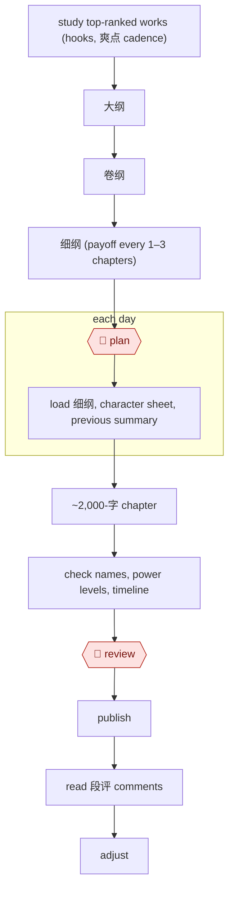

# Daily web serial

`CRE › WRI › SERIAL` · checkpointed · evidence C · **draft: needs a reference example** ([how to add one](../../../../../CONTRIBUTING.md#1-add-an-example-run))

**Shape:** `study top-ranked works (hooks, 爽点 cadence) → 大纲 → 卷纲 → 细纲 (payoff every 1–3 chapters) → 🛑 plan → each day: load 细纲, character sheet, previous summary → ~2,000-字 chapter → check names, power levels, timeline → 🛑 review → publish → read 段评 comments → adjust`
**How it differs from Bible-driven novel draft:** the deliverable is a daily chapter stream, not a manuscript, and reader comments feed back into every cycle.
**Tags:** `lang:zh`. Platform risk: 番茄小说 faced an author boycott in 2024 over an AI-training supplementary agreement and added a way to opt out. In February 2025 it banned accounts for low-quality "water" (水文) content [[12]](#sources). No explicit 起点 AI-content rule was found (§6). Status stays `draft` until a reference example with evidence A or B is added.

<!-- shape diagram: generated by scripts/build_diagrams.py from `shape`; don't edit -->

<!-- end shape diagram -->

## Public runs

Coverage as of 2026-11-06: **Weak**: only anonymous, vendor-linked or journalist-told accounts. From [Where are the real runs?](../../../../../research/2026-11-real-runs.md); every number was re-checked against its page.

- [提效录, *AI写小说进阶2026*](https://www.tixiaolu.com/posts/ai-novel-writing-advanced-2026/) (Advanced AI web-novel writing, 2026-03-28). A claimed 180-day serial: 大纲 → 卷纲 → daily 细纲 → AI drafts → comment-driven plot changes. "总字数218万字，总收入达到了38万元". *First-hand: anon; confidence: low.*
- [老高的AI研究室, WeChat](https://mp.weixin.qq.com/s/i2_RA8tdSVGy6LEf15Krdw) (Author with 570k readers reveals AI workflow, undated). 章纲 → segment drafting → AI review → light human edit. "单月稿费成功突破 3 万元". *First-hand: interview (unnamed author; carries a tool referral code); confidence: low.*

## Sources

12. 人人都是产品经理, 番茄小说 AI 争议. https://www.woshipm.com/ai/5988474.html · 澎湃新闻. https://m.thepaper.cn/newsDetail_forward_28167849
