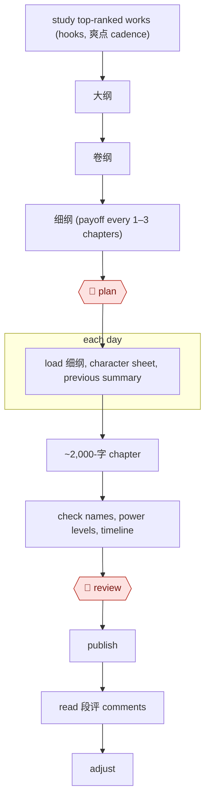

# Daily web serial

`CRE › WRI › SERIAL` · checkpointed · evidence C · **draft: needs a reference example** ([how to add one](../../../../../CONTRIBUTING.md#1-add-an-example-run))

**Shape:** `study top-ranked works (hooks, 爽点 cadence) → 大纲 → 卷纲 → 细纲 (payoff every 1–3 chapters) → 🛑 plan → each day: load 细纲, character sheet, previous summary → ~2,000-字 chapter → check names, power levels, timeline → 🛑 review → publish → read 段评 comments → adjust`
**Tags:** `lang:zh`. Platform risk: 番茄小说 faced an author boycott in 2024 over an AI-training supplementary agreement and added a way to opt out. In February 2025 it banned accounts for low-quality "water" (水文) content [[12]](#sources). No explicit 起点 AI-content rule was found (§6). Status stays `draft` until a reference example with evidence A or B is added.

<!-- shape diagram: generated by scripts/build_diagrams.py from `shape`; don't edit -->

<!-- end shape diagram -->

## Background

网文 (Chinese web novels) are long serial stories published on reading platforms a chapter at a time, and a daily serial means a new chapter of about 2,000 字 (Chinese characters, the unit lengths are counted in) every day. The author plans the book in layers: a 大纲 (whole-book outline), 卷纲 (an outline for each volume, a block of chapters forming one arc) and 细纲 (the detailed outline for the next few chapters), then writes from the 细纲. The pace is hard to keep up by hand, and over a long book names, power levels and the timeline drift. Readers also expect a 爽点 (a moment of payoff or thrill) every chapter or two. The agent drafts each chapter from the 细纲 and the character sheet and checks it against the settings. The author approves the plan before launch and edits and publishes every chapter, because the chapters go out under the author's name and the platform has acted against low-quality or heavily AI-written content.

**Terms:**
- **网文 (web novel)**: a serial novel written for online reading platforms, released chapter by chapter.
- **大纲 / 卷纲 / 细纲 / 章纲**: the outline of the whole book / of one volume / of the next few chapters / of one chapter (core conflict, beats, emotional turn, 爽点 position, planted 伏笔).
- **关键句 (key line)**: the author's note of the key action line, where the emotion breaks and where the reversal lands.
- **爽点**: a payoff moment that gives readers a hit of satisfaction; a "face-slap" climax (打脸) is a big one.
- **金手指 (golden finger)**: the hero's special advantage, such as a hidden ability or item, that drives the plot.
- **伏笔 (foreshadowing)**: a hint planted early that must be paid off later.
- **段评 (paragraph comments)**: readers' comments attached to individual paragraphs of a chapter.
- **水文**: padded, low-quality text written to fill word counts.
- **起点 / 番茄小说**: two Chinese web-novel platforms; 起点 is used here for its rankings, 番茄小说 for publishing.

## Build it with an agent

**Form:** `skill`. One author writes one chapter at a time and stays in the conversation, so one skill holding the day's procedure is enough.

**You need:** the 大纲, 卷纲 and 细纲 as files; a settings sheet (relationships, power levels, geography, timeline) and a voice profile for each speaking character; the previous chapter's summary and last 500 字; a way to paste reader comments into the conversation. The author's platform account stays with the author.

| Step | Built as |
|---|---|
| study top-ranked works → 大纲 → 卷纲 → 细纲 | A planning skill the author runs once per volume. The agent analyses the ranking list the author supplies and proposes outlines; the author keeps and edits them and adds the 关键句. |
| 🛑 plan | See Checkpoints. |
| each day: load 细纲, character sheet, previous summary | The daily skill's first instruction: read those files before writing. |
| ~2,000-字 chapter | The skill drafts in segments of 500–800 字, following the 章纲, and stops for the author to edit each segment. |
| check names, power levels, timeline | A second pass in the same conversation against the settings sheet; a built-in subagent can run the per-volume contradiction check. |
| 🛑 review → publish | See Checkpoints. |
| read 段评 comments → adjust | The author pastes the comments in; the skill summarises favourite characters and least-liked passages and proposes changes to the upcoming 细纲. |

**Checkpoints:** `plan`: the planning skill ends by presenting the volume outline and the 细纲 and stops until the author approves them. `review`: the daily skill ends by presenting the checked draft and stops; the author edits it. The agent has no tool that reaches a publishing platform, so the author publishes.

**Since the sources:** Sources date from 2024-02 to 2026-03; source 14 is undated. Sources 13 and 14 could not be opened when this was written (the site was unreachable, and the WeChat page asked for a verification), so the steps rest on the entry text. The sources describe authors prompting a model, with the settings sheet pasted into each session and the day's files loaded by hand. The skill keeps those files beside it and loads them itself. Both accounts are anonymous or carry a referral code, so the earnings they report say nothing about this build. The platform-risk note under **Tags** comes from reports of 2024 and 2025; check the current rules of the platform before publishing.

*A design based on this entry's steps and the tool documentation as of 2026-11, not a reported run.*

## Steps

*As reported by the sources.*

1. The author has the model analyse the top 50 books in the category on 起点. One author's list: the 金手指 appears by chapter 5, the first face-slap climax by chapter 10, and at least 1.5 爽点 per chapter through chapter 30 [[13]](#sources).
2. The author and model write the 大纲 and 卷纲. The model proposes 5–8 directions for the world and a 15–20-character relationship web; the author keeps 3–4 and edits. The book is split into 6–8 volumes of 30–40万字, each with its core conflict, 5–8 event lines, character arcs, a 爽点 map and foreshadowing payoff points [[13]](#sources).
3. The model writes the 细纲: it drafts 2–3 chapters of 章纲 at a time (core conflict, 3–5 beats, emotional turn, 爽点 position, planted foreshadowing, link to the next chapter), and the author adds the "关键句" (the key action line, where the emotion breaks, where the reversal lands) [[14]](#sources). Targets: 2 small and 1 medium 爽点 per chapter, a big one every 10 chapters [[13]](#sources).
4. 🛑 **Plan**: the author approves the volume outline and trial-writes the first 10 chapters before launch [[13]](#sources). Structure comes first: "AI不能直接写，它应该写结构" [[14]](#sources).
5. Each day, the author loads the day's 细纲, the last 500 字 of the previous chapter, the settings sheet (relationships, power levels, geography, timeline) and each speaking character's voice profile [[13]](#sources).
6. The model drafts the chapter in 500–800-字 segments; the author edits each as it arrives and re-reads every 2,000 字 for flow. For key chapters the model generates 2–3 versions and the author merges the best parts [[13]](#sources). The model follows the 章纲 strictly, segment by segment [[14]](#sources).
7. The author checks before publishing: an AI pass for slow pacing, broken emotion, late 爽点 and weak motives [[14]](#sources). Every volume (about 30万字) the author runs a check for setting contradictions and timeline errors, and every week a style-consistency check [[13]](#sources).
8. 🛑 **Review**: the author edits the draft into the published chapter. On one key chapter the author rewrote about 40% of the AI draft, adding inner thoughts, atmosphere and dialogue rhythm [[13]](#sources). Then publish.
9. The author reads reader comments and adjusts: batches the comments into the model to find favourite characters, most-awaited plots and least-liked passages, and changes upcoming 细纲 to match [[13]](#sources).

**Output:** one published chapter a day (this author ran 6,000–10,000 字 a day), with the 细纲, settings sheet and comment notes carried into the next cycle [[13]](#sources).
**Failure modes → guards:** The model drifts when asked for prose directly → 章纲 with 关键句 first, then segment drafting [[14]](#sources). It forgets settings over a long book → a settings sheet pasted into every session, plus per-volume contradiction checks [[13]](#sources). Characters lose their complexity and the text breaks from context (a 番茄 author's complaint about AI expansion) → keep core characters hand-tuned [[12]](#sources) [[13]](#sources). Too much AI share makes the plot formulaic; readers complained → the author cut the AI share from about 70% to 50% and retention recovered [[13]](#sources).
**How it differs from Bible-driven novel draft:** the deliverable is a daily chapter stream, not a manuscript, and reader comments feed back into every cycle.

## Public runs

Coverage as of 2026-11-06: **Weak**: only anonymous, vendor-linked or journalist-told accounts. From [Where are the real runs?](../../../../../research/2026-11-real-runs.md); every number was re-checked against its page.

- [提效录, *AI写小说进阶2026*](https://www.tixiaolu.com/posts/ai-novel-writing-advanced-2026/) (Advanced AI web-novel writing, 2026-03-28). A claimed 180-day serial: 大纲 → 卷纲 → daily 细纲 → AI drafts → comment-driven plot changes. "总字数218万字，总收入达到了38万元". *First-hand: anon; confidence: low.*
- [老高的AI研究室, WeChat](https://mp.weixin.qq.com/s/i2_RA8tdSVGy6LEf15Krdw) (Author with 570k readers reveals AI workflow, undated). 章纲 → segment drafting → AI review → light human edit. "单月稿费成功突破 3 万元". *First-hand: interview (unnamed author; carries a tool referral code); confidence: low.*

## Sources

12. 人人都是产品经理, 番茄小说 AI 争议. https://www.woshipm.com/ai/5988474.html · 澎湃新闻. https://m.thepaper.cn/newsDetail_forward_28167849
13. 提效录, AI写小说进阶2026：用ChatGPT写长篇网文月入2万完整攻略, 2026-03-28 (anonymous; claims unverified). https://www.tixiaolu.com/posts/ai-novel-writing-advanced-2026/
14. 老高的AI研究室 (WeChat), 57万人在读、单月稿费破3万：这位作者首次公开自己的AI小说创作体系 (undated interview; carries a tool referral). https://mp.weixin.qq.com/s/i2_RA8tdSVGy6LEf15Krdw
