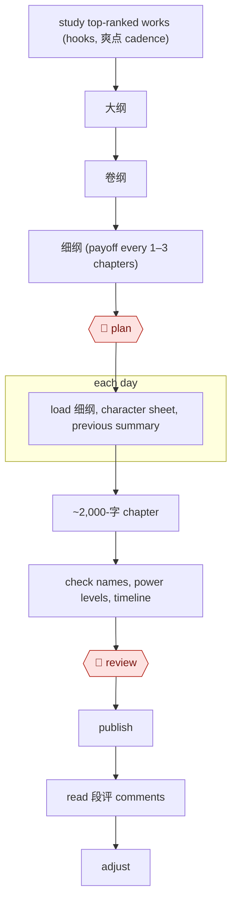

# Daily web serial

`CRE › WRI › SERIAL` · checkpointed · evidence C · **draft: needs a reference example** ([how to add one](../../../../../CONTRIBUTING.md#1-add-an-example-run))

**Shape:** `study top-ranked works (hooks, 爽点 cadence) → 大纲 → 卷纲 → 细纲 (payoff every 1–3 chapters) → 🛑 plan → each day: load 细纲, character sheet, previous summary → ~2,000-字 chapter → check names, power levels, timeline → 🛑 review → publish → read 段评 comments → adjust`
**How it differs from Bible-driven novel draft:** the deliverable is a daily chapter stream, not a manuscript, and reader comments feed back into every cycle.
**Tags:** `lang:zh`. Platform risk: 番茄小说 faced an author boycott in 2024 over an AI-training supplementary agreement and added a way to opt out. In February 2025 it banned accounts for low-quality "water" (水文) content [[12]](#sources). No explicit 起点 AI-content rule was found (§6). Status stays `draft` until a reference example with evidence A or B is added.

<!-- shape diagram: generated by scripts/build_diagrams.py from `shape`; don't edit -->

<!-- end shape diagram -->

## Steps
1. Study top-ranked works: have the model analyze the top 50 books in the category on 起点. One author's list: the 金手指 appears by chapter 5, the first face-slap climax by chapter 10, and at least 1.5 爽点 per chapter through chapter 30 [[13]](#sources).
2. Write 大纲 and 卷纲. The model proposes 5–8 directions for the world and a 15–20-character relationship web; the author keeps 3–4 and edits. Split the book into 6–8 volumes of 30–40万字, each with its core conflict, 5–8 event lines, character arcs, a 爽点 map and foreshadowing payoff points [[13]](#sources).
3. Write 细纲: the model drafts 2–3 chapters of 章纲 at a time (core conflict, 3–5 beats, emotional turn, 爽点 position, planted foreshadowing, link to the next chapter), and the author adds the "关键句" (the key action line, where the emotion breaks, where the reversal lands) [[14]](#sources). Targets: 2 small and 1 medium 爽点 per chapter, a big one every 10 chapters [[13]](#sources).
4. 🛑 **Plan**: the author approves the volume outline and trial-writes the first 10 chapters before launch [[13]](#sources). Structure comes first: "AI不能直接写，它应该写结构" [[14]](#sources).
5. Each day, load the day's 细纲, the last 500 字 of the previous chapter, the settings sheet (relationships, power levels, geography, timeline) and each speaking character's voice profile [[13]](#sources).
6. Draft the chapter in 500–800-字 segments, editing each as it arrives and re-reading every 2,000 字 for flow. Generate 2–3 versions of key chapters and merge the best parts [[13]](#sources). The model follows the 章纲 strictly, segment by segment [[14]](#sources).
7. Check before publishing: an AI pass for slow pacing, broken emotion, late 爽点 and weak motives [[14]](#sources). Every volume (about 30万字), run a check for setting contradictions and timeline errors; every week, a style-consistency check [[13]](#sources).
8. 🛑 **Review**: the author edits the draft into the published chapter. On one key chapter the author rewrote about 40% of the AI draft, adding inner thoughts, atmosphere and dialogue rhythm [[13]](#sources). Then publish.
9. Read reader comments and adjust: batch comments into the model to find favourite characters, most-awaited plots and least-liked passages, and change upcoming 细纲 to match [[13]](#sources).

**Output:** one published chapter a day (this author ran 6,000–10,000 字 a day), with the 细纲, settings sheet and comment notes carried into the next cycle [[13]](#sources).
**Failure modes → guards:** The model drifts when asked for prose directly → 章纲 with 关键句 first, then segment drafting [[14]](#sources). It forgets settings over a long book → a settings sheet pasted into every session, plus per-volume contradiction checks [[13]](#sources). Characters lose their complexity and the text breaks from context (a 番茄 author's complaint about AI expansion) → keep core characters hand-tuned [[12]](#sources) [[13]](#sources). Too much AI share makes the plot formulaic; readers complained → the author cut the AI share from about 70% to 50% and retention recovered [[13]](#sources).

## Public runs

Coverage as of 2026-11-06: **Weak**: only anonymous, vendor-linked or journalist-told accounts. From [Where are the real runs?](../../../../../research/2026-11-real-runs.md); every number was re-checked against its page.

- [提效录, *AI写小说进阶2026*](https://www.tixiaolu.com/posts/ai-novel-writing-advanced-2026/) (Advanced AI web-novel writing, 2026-03-28). A claimed 180-day serial: 大纲 → 卷纲 → daily 细纲 → AI drafts → comment-driven plot changes. "总字数218万字，总收入达到了38万元". *First-hand: anon; confidence: low.*
- [老高的AI研究室, WeChat](https://mp.weixin.qq.com/s/i2_RA8tdSVGy6LEf15Krdw) (Author with 570k readers reveals AI workflow, undated). 章纲 → segment drafting → AI review → light human edit. "单月稿费成功突破 3 万元". *First-hand: interview (unnamed author; carries a tool referral code); confidence: low.*

## Sources

12. 人人都是产品经理, 番茄小说 AI 争议. https://www.woshipm.com/ai/5988474.html · 澎湃新闻. https://m.thepaper.cn/newsDetail_forward_28167849
13. 提效录, AI写小说进阶2026：用ChatGPT写长篇网文月入2万完整攻略, 2026-03-28 (anonymous; claims unverified). https://www.tixiaolu.com/posts/ai-novel-writing-advanced-2026/
14. 老高的AI研究室 (WeChat), 57万人在读、单月稿费破3万：这位作者首次公开自己的AI小说创作体系 (undated interview; carries a tool referral). https://mp.weixin.qq.com/s/i2_RA8tdSVGy6LEf15Krdw
