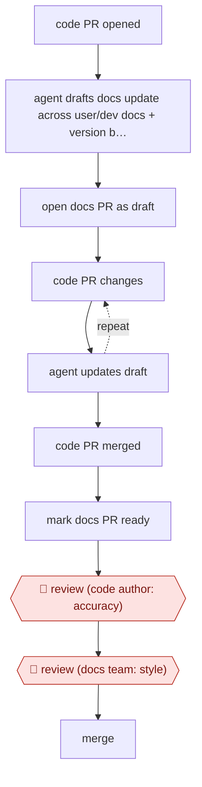

# Code-PR docs drafts

`CRE › WRI › TECHW` · checkpointed · evidence A · **draft: needs a reference example** ([how to add one](../../../../../CONTRIBUTING.md#1-add-an-example-run))

**Shape:** `code PR opened → agent drafts docs update across user/dev docs + version branches → open docs PR as draft → (code PR changes ⟲ agent updates draft) → code PR merged → mark docs PR ready → 🛑 review (code author: accuracy) → 🛑 review (docs team: style) → merge`
**How it differs:** AWF-0003 Delegated PR has an agent change code from a ticket. Here the input is a code PR, the output is a docs PR, and two reviewers each gate a different thing.
**Variants:** `promptless` · `github-agentic-workflows`

<!-- shape diagram: generated by scripts/build_diagrams.py from `shape`; don't edit -->

<!-- end shape diagram -->

## Steps
1. Trigger: a developer opens a pull request on the code repo. The agent (Promptless) drafts matching updates to the user docs and developer docs, across each one's version branches [[1]](#sources).
2. While the code PR is unmerged, the docs PR stays a draft. If the code PR changes during review, the agent updates the docs draft to match [[1]](#sources).
3. When the code PR merges, the docs PR is automatically marked ready for review [[1]](#sources).
4. 🛑 **Review**: the developer who wrote the code change checks that the draft matches what they built. One caught a draft describing a button that no longer existed [[1]](#sources).
5. 🛑 **Review**: the Education Team checks grammar, wording and style, as for any docs contribution, then merges [[1]](#sources).
6. Rollout gate: the project began with suggestions on a dashboard that the team turned into PRs by hand, and switched to automatic PRs only after the drafts consistently followed the style guide [[1]](#sources).

**Output:** Merged documentation PRs in the docs repo, kept in step with code releases.
**Failure modes → guards:** Docs describing stale UI or behaviour → the code author reviews before merge. Style drift → the docs team reviews, and automation started only after a supervised trial.

## Public runs

Coverage as of 2026-11-06: **Strong**: a first-hand, detailed run that matches most of the shape. Collected and re-checked in [New workflows for empty categories](../../../../../research/2026-11-new-workflows.md).

- [Mautic, How we keep docs up to date automatically with AI](https://mautic.org/?p=26025) (2026-09-03). Open-source project closed its docs lag behind releases using agent-drafted docs PRs. 129 Promptless docs PRs merged in about four months; 27 days vs 98 days code-merge to docs-merge. *First-hand: yes; confidence: high.*

## Sources

1. Ayu Adiati (Mautic), How we keep docs up to date automatically with AI, 2026-09-03. https://mautic.org/?p=26025
