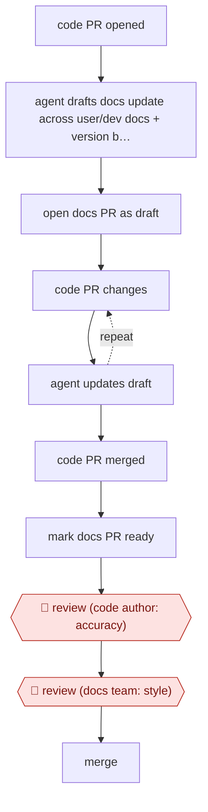

# Code-PR docs drafts

`CRE › WRI › TECHW` · checkpointed · evidence A · **draft: needs a reference example** ([how to add one](../../../../../CONTRIBUTING.md#1-add-an-example-run))

**Shape:** `code PR opened → agent drafts docs update across user/dev docs + version branches → open docs PR as draft → (code PR changes ⟲ agent updates draft) → code PR merged → mark docs PR ready → 🛑 review (code author: accuracy) → 🛑 review (docs team: style) → merge`
**Variants:** `promptless` · `github-agentic-workflows` · `ona-automations` · `biel-nova` · `claude-code-doc-check-skill`

<!-- shape diagram: generated by scripts/build_diagrams.py from `shape`; don't edit -->

<!-- end shape diagram -->

## Background

Software teams keep the product's code and its documentation in separate repositories, and the documentation has two audiences: user docs (how to use the product) and developer docs (how to build on it). Each supported version of the product often has its own branch of the docs. When a developer changes the code in a pull request (PR, a proposed change that others review before it is merged), someone must also update the matching pages. That step is easy to forget, and in volunteer projects the docs have fallen behind by whole release versions. The agent writes the docs update as a draft PR in the docs repository as soon as the code PR opens, and keeps it in step as the code PR changes. Two people still have to approve it: the developer who wrote the code change, because only they know what was really built, and the docs team, because they own the wording and style of what readers see.

**Terms:**
- **Pull request (PR)**: a proposed change to a repository that others review before it is merged. A **draft PR** is one marked not yet ready for review.
- **Code repo / docs repo**: the repositories holding the product's code and its documentation.
- **User docs / developer docs**: documentation for people using the product / for people building on it.
- **Version branches**: parallel copies of the docs, one for each supported product version.
- **Diff**: the lines a change adds and removes.
- **Style guide**: the docs team's rules for grammar, wording and tone.

## Build it with an agent

**Form:** `service`. Nobody is at the keyboard when a code PR opens or changes, so the agent runs on repository events and people see only the draft PRs it opens.

**You need:** read access to the code repo and read and write access to the docs repo and its version branches; the style guide as a file the agent reads; a connector or token for the repository host that can open and update PRs but not merge them; a list of paths and change types the agent should not document (tests, dependency bumps, internal refactors).

| Step | Built as |
|---|---|
| code PR opened → agent drafts docs update across user/dev docs + version branches | A cloud scheduled task started by the repository's pull-request event, with the code repo and docs repo attached. A skill holds the procedure: read the diff, find the affected pages on each version branch, write the update, following the style guide. |
| open docs PR as draft → (code PR changes ⟲ agent updates draft) | The same task opens the docs PR as a draft and links it to the code PR. When the code PR gets new commits the event starts the task again; it finds the linked docs PR and updates it. |
| code PR merged → mark docs PR ready | The merge event starts the task, which marks the docs PR ready for review. |
| 🛑 review (code author: accuracy) → 🛑 review (docs team: style) → merge | See Checkpoints. |

**Checkpoints:** `review` happens twice, in the docs PR. The agent's token can open and edit PRs but has no permission to merge, so a PR stays open until a person merges it. The code author is asked to review for accuracy, then the docs team for style. Both answer in the PR.

**Since the sources:** Sources date from 2026-02 to 2026-10. The sources use different tools for the same job: a docs-writing product (Promptless) triggered by each code PR, a daily scheduled agent that batches the last 24 hours of diffs into one draft PR (Ona), an agent that checks merged PRs and recent commits on the main branch (Biel.ai's Nova), and a writer-run Claude Code skill that triages merged PRs before drafting (NetFoundry). The build above follows the first, the per-PR trigger, but a team could batch changes as Ona did when per-commit runs were too noisy. Mautic began with suggestions that people turned into PRs by hand, and switched to automatic draft PRs only after the drafts followed the style guide; the build has no such trial period, so run the agent in suggestion-only mode first if you want one. Only Mautic reports the two-reviewer arrangement; the others report writers reviewing the PR.

*A design based on this entry's steps and the tool documentation as of 2026-11, not a reported run.*

## Steps

*As reported by the sources.*

1. Trigger: a developer opens a pull request (PR) on the code repo. The agent (Promptless) drafts matching updates to the user docs and developer docs, across each one's version branches [[1]](#sources).
2. While the code PR is unmerged, the docs PR stays a draft. If the code PR changes during review, the agent updates the docs draft to match [[1]](#sources).
3. When the code PR merges, the agent automatically marks the docs PR ready for review [[1]](#sources).
4. 🛑 **Review**: the developer who wrote the code change checks that the draft matches what they built. One caught a draft describing a button that no longer existed [[1]](#sources).
5. 🛑 **Review**: the docs team (the Education Team) checks grammar, wording and style, as for any docs contribution, then merges [[1]](#sources).
6. Rollout gate: the project (Mautic) began with suggestions on a dashboard that the team turned into PRs by hand, and switched to automatic PRs only after the drafts consistently followed the style guide [[1]](#sources).

**Output:** Merged documentation PRs in the docs repo, kept in step with code releases.
**Failure modes → guards:** Docs describing stale UI or behaviour → the code author reviews before merge. Style drift → the docs team reviews, and automation started only after a supervised trial.

**Recent practice (2026):**
- Step 1 (trigger): some teams batch post-merge changes into one daily docs PR rather than pairing each code PR, because per-commit runs were too noisy (Ona). Others run a writer-invoked triage report first and draft only flagged PRs (NetFoundry doc-check). [[3]](#sources)

**How it differs:** AWF-0003 Delegated PR has an agent change code from a ticket. Here the input is a code PR, the output is a docs PR, and two reviewers each gate a different thing.

## Public runs

Coverage as of 2026-11-06: **Strong**: a first-hand, detailed run that matches most of the shape. Collected and re-checked in [New workflows for empty categories](../../../../../research/2026-11-new-workflows.md). More runs added in [Third collection pass](../../../../../research/2026-11-third-pass.md).

- [Mautic, How we keep docs up to date automatically with AI](https://mautic.org/?p=26025) (2026-09-03). Open-source project closed its docs lag behind releases using agent-drafted docs PRs. 129 Promptless docs PRs merged in about four months; 27 days vs 98 days code-merge to docs-merge. *First-hand: yes; confidence: high.*
- [Ona (Siddhant Khare), How we automated writing docs with an Ona Automation](https://ona.com/stories/docs-automation) (2026-02-12). Daily 8am agent reads last 24h of diffs across code+docs repos, opens one draft docs PR. "Reviewing a draft takes about 30 seconds. Writing that same page from scratch would have been 30 minutes.". *First-hand: yes; confidence: med.*
- [Biel.ai (David Garcia), Our AI teammate keeps our docs up to date](https://blog.techdocs.studio/p/our-ai-teammate-keeps-our-docs-up) (2026-10-08). Agent checks merged PRs/commits on main, opens follow-up docs PRs (with screenshots); writers review in PR. no count; one example PR added two missing React component sections. *First-hand: yes; confidence: med.*
- [NetFoundry, Inside NetFoundry docs: Streamline doc freshness with AI](https://blog.openziti.io/streamline-doc-freshness-with-ai) (2026-03). Writer-run doc-check skill triages merged PRs across repos into needs-work/covered/skipped, drafts on command. "5 PRs analyzed · 2 need doc work · 1 already covered · 2 skipped (internal)"; "a 20-to-1 engineer-to-writer ratio". *First-hand: yes; confidence: high.*

## Sources

1. Ayu Adiati (Mautic), How we keep docs up to date automatically with AI, 2026-09-03. https://mautic.org/?p=26025
2. Siddhant Khare (Ona), How we automated writing docs with an Ona Automation, 2026-02-12. https://ona.com/stories/docs-automation
3. NetFoundry docs, Streamline doc freshness with AI (doc-check Claude Code skill), 2026. https://blog.openziti.io/streamline-doc-freshness-with-ai
