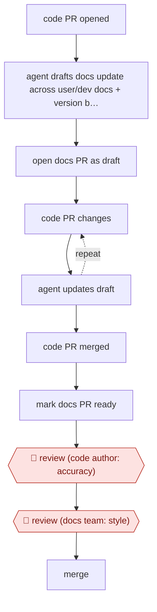

# Code-PR docs drafts

`CRE › WRI › TECHW` · checkpointed · evidence A · **draft: needs a reference example** ([how to add one](../../../../../CONTRIBUTING.md#1-add-an-example-run))

**Shape:** `code PR opened → agent drafts docs update across user/dev docs + version branches → open docs PR as draft → (code PR changes ⟲ agent updates draft) → code PR merged → mark docs PR ready → 🛑 review (code author: accuracy) → 🛑 review (docs team: style) → merge`
**How it differs:** AWF-0003 Delegated PR has an agent change code from a ticket. Here the input is a code PR, the output is a docs PR, and two reviewers each gate a different thing.
**Variants:** `promptless` · `github-agentic-workflows` · `ona-automations` · `biel-nova` · `claude-code-doc-check-skill`

<!-- shape diagram: generated by scripts/build_diagrams.py from `shape`; don't edit -->

<!-- end shape diagram -->

## Steps
1. Trigger: a developer opens a pull request on the code repo. The agent (Promptless) drafts matching updates to the user docs and developer docs, across each one's version branches [[1]](#sources).
2. While the code PR is unmerged, the docs PR stays a draft. If the code PR changes during review, the agent updates the docs draft to match [[1]](#sources).
3. When the code PR merges, the docs PR is automatically marked ready for review [[1]](#sources).
4. 🛑 **Review**: the developer who wrote the code change checks that the draft matches what they built. One caught a draft describing a button that no longer existed [[1]](#sources).
5. 🛑 **Review**: the Education Team checks grammar, wording and style, as for any docs contribution, then merges [[1]](#sources).
6. Rollout gate: the project began with suggestions on a dashboard that the team turned into PRs by hand, and switched to automatic PRs only after the drafts consistently followed the style guide [[1]](#sources).

**Output:** Merged documentation PRs in the docs repo, kept in step with code releases.
**Failure modes → guards:** Docs describing stale UI or behaviour → the code author reviews before merge. Style drift → the docs team reviews, and automation started only after a supervised trial.

**Recent practice (2026):**
- Step 1 (trigger): some teams batch post-merge changes into one daily docs PR rather than pairing each code PR, because per-commit runs were too noisy (Ona). Others run a writer-invoked triage report first and draft only flagged PRs (NetFoundry doc-check). [[3]](#sources)

## Public runs

Coverage as of 2026-11-06: **Strong**: a first-hand, detailed run that matches most of the shape. Collected and re-checked in [New workflows for empty categories](../../../../../research/2026-11-new-workflows.md). More runs added in [Third collection pass](../../../../../research/2026-11-third-pass.md).

- [Mautic, How we keep docs up to date automatically with AI](https://mautic.org/?p=26025) (2026-09-03). Open-source project closed its docs lag behind releases using agent-drafted docs PRs. 129 Promptless docs PRs merged in about four months; 27 days vs 98 days code-merge to docs-merge. *First-hand: yes; confidence: high.*
- [Ona (Siddhant Khare), How we automated writing docs with an Ona Automation](https://ona.com/stories/docs-automation) (2026-02-12). Daily 8am agent reads last 24h of diffs across code+docs repos, opens one draft docs PR. "Reviewing a draft takes about 30 seconds. Writing that same page from scratch would have been 30 minutes.". *First-hand: yes; confidence: med.*
- [Biel.ai (David Garcia), Our AI teammate keeps our docs up to date](https://blog.techdocs.studio/p/our-ai-teammate-keeps-our-docs-up) (2026-10-08). Agent checks merged PRs/commits on main, opens follow-up docs PRs (with screenshots); writers review in PR. no count; one example PR added two missing React component sections. *First-hand: yes; confidence: med.*
- [NetFoundry, Inside NetFoundry docs: Streamline doc freshness with AI](https://blog.openziti.io/streamline-doc-freshness-with-ai) (2026-03). Writer-run doc-check skill triages merged PRs across repos into needs-work/covered/skipped, drafts on command. "5 PRs analyzed · 2 need doc work · 1 already covered · 2 skipped (internal)"; "a 20-to-1 engineer-to-writer ratio". *First-hand: yes; confidence: high.*

## Sources

1. Ayu Adiati (Mautic), How we keep docs up to date automatically with AI, 2026-09-03. https://mautic.org/?p=26025
2. Siddhant Khare (Ona), How we automated writing docs with an Ona Automation, 2026-02-12. https://ona.com/stories/docs-automation
3. NetFoundry docs, Streamline doc freshness with AI (doc-check Claude Code skill), 2026. https://blog.openziti.io/streamline-doc-freshness-with-ai
