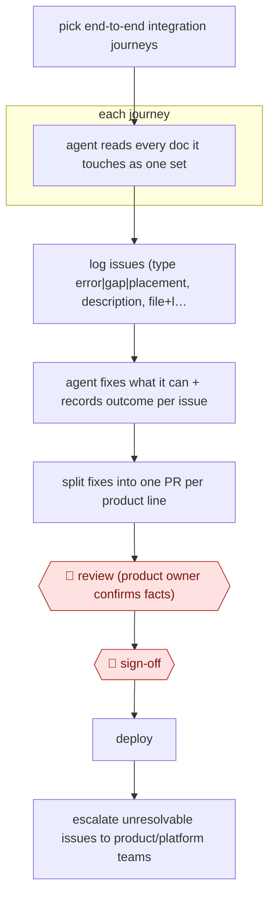

# Journey-based docs audit

`CRE › WRI › TECHW` · checkpointed · evidence A · **draft: needs a reference example** ([how to add one](../../../../../CONTRIBUTING.md#1-add-an-example-run))

**Shape:** `pick end-to-end integration journeys → each journey: agent reads every doc it touches as one set → log issues (type error|gap|placement, description, file+line) → agent fixes what it can + records outcome per issue → split fixes into one PR per product line → 🛑 review (product owner confirms facts) → 🛑 sign-off → deploy → escalate unresolvable issues to product/platform teams`
**Variants:** `markdown-docs-as-code` · `github-prs`

<!-- shape diagram: generated by scripts/build_diagrams.py from `shape`; don't edit -->

<!-- end shape diagram -->

## Background

A company that sells several software products publishes documentation for each, written by different people at different times. Each page may be correct on its own, yet a developer who follows one task from start to finish (a journey, such as getting a certificate, packaging a video and playing it on a phone) crosses several documents and meets mismatches between them, a prerequisite hidden in another product's guide, or steps in the wrong place. Checking page by page does not find these. In this workflow the agent reads everything one journey touches as a single set, logs each problem, fixes what it can in the source files and splits the fixes into one pull request (PR, a proposed change that others review before it is merged) per product line. The product owner for each line must still confirm every fact, because the agent can only work from what the documents already say, and some answers (recommended behaviour, contract values, labels in a console) exist only in other teams' heads.

**Terms:**
- **Journey (integration scenario)**: the end-to-end task a customer's developer carries out, written from the customer's point of view; here one journey is one audit unit.
- **Product line**: one of the company's separately sold products, each with its own docs and owner.
- **Product owner (PO)**: the person responsible for a product line's behaviour and facts.
- **Issue types**: error (a page says something wrong), gap (something needed is missing), placement (the right content is in the wrong place).
- **Pull request (PR)**: a proposed change to a repository that others review before it is merged.
- **Markdown source files**: the plain-text files the docs are written in, kept in a repository like code.
- **FairPlay**: Apple's copy-protection system for video; its certificate is the first step of the example journey.

## Build it with an agent

**Form:** `skill`. One person runs the audit one journey at a time and stays in the conversation, so one skill holding the procedure and the issue-log format is enough.

**You need:** the docs repository with the Markdown source files of every product line; the written journeys for each product line; a template for the issue log (type, description, file and line, remarks); the name of each product line's PO. Give the agent write access to a branch, not to the production site.

| Step | Built as |
|---|---|
| pick end-to-end integration journeys | The person lists the journeys to audit; the skill takes them one at a time. |
| each journey: agent reads every doc it touches as one set → log issues | The skill reads all the files the journey touches into one context and writes the issue log as a file. For many journeys, built-in subagents each take one journey and return their log. |
| agent fixes what it can + records outcome per issue | The skill edits the source files on a branch and writes what it checked and changed beside each issue. An issue whose answer is not in the docs is marked blocked and not guessed. |
| split fixes into one PR per product line | The skill groups the changed files by product line and prepares one branch per line. A person opens the PRs. |
| 🛑 review → 🛑 sign-off → deploy | See Checkpoints. |
| escalate unresolvable issues to product/platform teams | The skill lists the blocked issues with the question each team must answer. A person sends them. |

**Checkpoints:** `review`: the skill stops after preparing the per-product branches and the issue log; each PO reads their changes line by line in their PR and confirms the facts. `sign-off`: the agent has no deploy or merge tool and cannot touch production; the team merges and deploys after every PO has confirmed.

**Since the sources:** The newest source is from 2026-10 and the other from 2026-08. Source 1, the account of the audit itself, could not be opened when this was written (the site refused the request), so the steps rest on the entry text. Source 2 is a weekly codebase-versus-docs review rather than a journey audit. The entry does not name the agent tool the audit used, so the build above names none. The source's 71 issues and the nine blocked ones belong to Public runs, not to this design.

*A design based on this entry's steps and the tool documentation as of 2026-11, not a reported run.*

## Steps

*As reported by the sources.*

1. The team uses the customer-view integration scenarios already written for each product line. One journey a developer actually walks (e.g. FairPlay certificate → packaging → iOS playback) is one audit unit [[1]](#sources).
2. The agent reads the Markdown sources of every document the journey touches as a set, looking for problems no single page shows, such as hand-off mismatches between documents or a prerequisite buried in another product's guide [[1]](#sources).
3. The agent logs each problem with a type (error, gap or placement), a description and the source file and line. This list becomes the baseline and work log [[1]](#sources).
4. The agent fixes the entries it can by editing the source files, and writes what it checked and changed in the remarks column next to each entry [[1]](#sources).
5. People split the fixes into one pull request (PR) per product line (three primary products), so each reviewer sees only their own product's changes [[1]](#sources).
6. 🛑 **Review**: each line's product owner (PO) reviews their PR line by line and confirms whether every fact is right [[1]](#sources).
7. 🛑 **Sign-off**: after all POs confirm, the team deploys to production [[1]](#sources).
8. Issues whose answers exist nowhere in the docs (recommended API behaviour, contractual values, console labels) are blocked on other teams. The team hands them to product, platform or business stakeholders [[1]](#sources).

**Output:** Corrected documentation in production plus an issue log, with open items routed to the teams who must decide the facts.
**Failure modes → guards:** One mixed PR gets a rubber-stamp review → split PRs by product line, each with its own PO [1]. The agent cannot invent facts missing from the corpus → mark those blocked and escalate, don't let it guess [1]. Page-by-page audits miss cross-document gaps → audit by journey [1].
**How it differs:** Nearest are AWF-0075 (Code-PR docs drafts) and AWF-0135 (Release-cycle docs skill). Both are triggered by code changes or a release and draft updates for new changes. This is a one-off or periodic audit of the existing corpus along user journeys. Its deliverable is an issue log plus per-product fix PRs, reviewed by product owners and not by the code author or docs team.

## Public runs

Coverage as of 2026-11-13: **Strong**: a first-hand, detailed run that matches most of the shape. Collected and re-checked in [Third collection pass](../../../../../research/2026-11-third-pass.md).

- [DoveRunner (Daniel Kim), Auditing and Fixing Documentation Content with an AI Agent](https://doverunner.com/blogs/auditing-documentation-with-ai-agents/) (2026-08-03). Six product lines audited by journey; 71 issues; PO-reviewed PRs per product; nine blocked on other teams. "Across six product lines, this stage produced 71 content issues"; "Fixed | 59"; "Blocked on another team | 9". *First-hand: yes; confidence: high.*
- [Biel.ai (David Garcia), Our AI teammate keeps our docs up to date](https://blog.techdocs.studio/p/our-ai-teammate-keeps-our-docs-up) (2026-10-08). Weekly codebase-vs-docs review covering new ground each run; findings arrive as PRs reviewed by writers. "Nova also reviews the codebase against the documentation once a week" (no count given). *First-hand: yes; confidence: med.*

## Sources

1. Daniel Kim (DoveRunner), The Layer Nobody Scores: Auditing and Fixing Documentation Content with an AI Agent, 2026-08-03. https://doverunner.com/blogs/auditing-documentation-with-ai-agents/
2. David Garcia (Biel.ai), Our AI teammate keeps our docs up to date, 2026-10-08 (weekly codebase-vs-docs sweep that keeps a record of areas reviewed). https://blog.techdocs.studio/p/our-ai-teammate-keeps-our-docs-up
