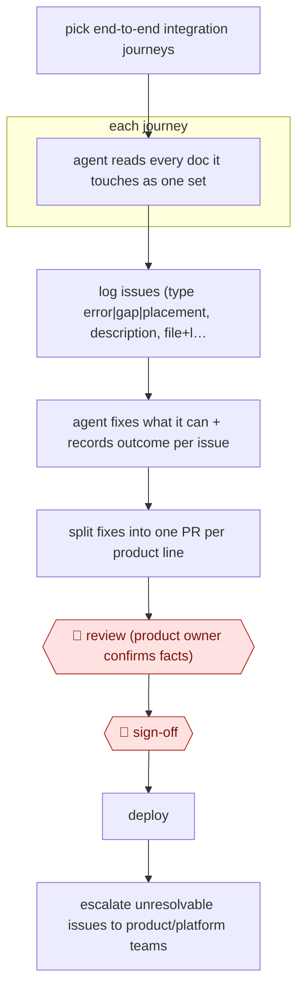

# Journey-based docs audit

`CRE › WRI › TECHW` · checkpointed · evidence A · **draft: needs a reference example** ([how to add one](../../../../../CONTRIBUTING.md#1-add-an-example-run))

**Shape:** `pick end-to-end integration journeys → each journey: agent reads every doc it touches as one set → log issues (type error|gap|placement, description, file+line) → agent fixes what it can + records outcome per issue → split fixes into one PR per product line → 🛑 review (product owner confirms facts) → 🛑 sign-off → deploy → escalate unresolvable issues to product/platform teams`
**How it differs:** Nearest are AWF-0075 (Code-PR docs drafts) and AWF-0135 (Release-cycle docs skill). Both are triggered by code changes or a release and draft updates for new changes. This is a one-off or periodic audit of the existing corpus along user journeys. Its deliverable is an issue log plus per-product fix PRs, reviewed by product owners and not by the code author or docs team.
**Variants:** `markdown-docs-as-code` · `github-prs`

<!-- shape diagram: generated by scripts/build_diagrams.py from `shape`; don't edit -->

<!-- end shape diagram -->

## Steps
1. Use the customer-view integration scenarios already written for each product line. One journey a developer actually walks (e.g. FairPlay certificate → packaging → iOS playback) is one audit unit [[1]](#sources).
2. The agent reads the Markdown sources of every document the journey touches as a set, looking for problems no single page shows, such as hand-off mismatches between documents or a prerequisite buried in another product's guide [[1]](#sources).
3. It logs each problem with a type (error, gap or placement), a description and the source file and line. This list becomes the baseline and work log [[1]](#sources).
4. The agent fixes the entries it can by editing the source files, and writes what it checked and changed in the remarks column next to each entry [[1]](#sources).
5. People split the fixes into one PR per product line (three primary products), so each reviewer sees only their own product's changes [[1]](#sources).
6. 🛑 **Review**: each line's product owner reviews their PR line by line and confirms whether every fact is right [[1]](#sources).
7. 🛑 **Sign-off**: after all POs confirm, the team deploys to production [[1]](#sources).
8. Issues whose answers exist nowhere in the docs (recommended API behaviour, contractual values, console labels) are blocked on other teams. Hand them to product, platform or business stakeholders [[1]](#sources).

**Output:** Corrected documentation in production plus an issue log, with open items routed to the teams who must decide the facts.
**Failure modes → guards:** One mixed PR gets a rubber-stamp review → split PRs by product line, each with its own PO [1]. The agent cannot invent facts missing from the corpus → mark those blocked and escalate, don't let it guess [1]. Page-by-page audits miss cross-document gaps → audit by journey [1].

## Public runs

Coverage as of 2026-11-13: **Strong**: a first-hand, detailed run that matches most of the shape. Collected and re-checked in [Third collection pass](../../../../../research/2026-11-third-pass.md).

- [DoveRunner (Daniel Kim), Auditing and Fixing Documentation Content with an AI Agent](https://doverunner.com/blogs/auditing-documentation-with-ai-agents/) (2026-08-03). Six product lines audited by journey; 71 issues; PO-reviewed PRs per product; nine blocked on other teams. "Across six product lines, this stage produced 71 content issues"; "Fixed | 59"; "Blocked on another team | 9". *First-hand: yes; confidence: high.*
- [Biel.ai (David Garcia), Our AI teammate keeps our docs up to date](https://blog.techdocs.studio/p/our-ai-teammate-keeps-our-docs-up) (2026-10-08). Weekly codebase-vs-docs review covering new ground each run; findings arrive as PRs reviewed by writers. "Nova also reviews the codebase against the documentation once a week" (no count given). *First-hand: yes; confidence: med.*

## Sources

1. Daniel Kim (DoveRunner), The Layer Nobody Scores: Auditing and Fixing Documentation Content with an AI Agent, 2026-08-03. https://doverunner.com/blogs/auditing-documentation-with-ai-agents/
2. David Garcia (Biel.ai), Our AI teammate keeps our docs up to date, 2026-10-08 (weekly codebase-vs-docs sweep that keeps a record of areas reviewed). https://blog.techdocs.studio/p/our-ai-teammate-keeps-our-docs-up
