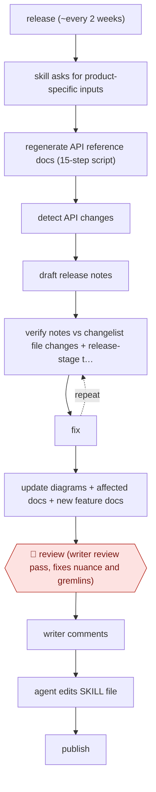

# Release-cycle docs skill

`CRE › WRI › TECHW` · checkpointed · evidence A · **draft: needs a reference example** ([how to add one](../../../../../CONTRIBUTING.md#1-add-an-example-run))

**Shape:** `release (~every 2 weeks) → skill asks for product-specific inputs → regenerate API reference docs (15-step script) → detect API changes → draft release notes → (verify notes vs changelist file changes + release-stage tags vs YAML + sub-agent screenshot compare ⟲ fix) → update diagrams + affected docs + new feature docs → 🛑 review (writer review pass, fixes nuance and gremlins) → writer comments → agent edits SKILL file → publish`
**Variants:** `agent-skills` · `cli-scripts`

<!-- shape diagram: generated by scripts/build_diagrams.py from `shape`; don't edit -->

<!-- end shape diagram -->

## Background

Software products ship a new release on a fixed rhythm, here about every two weeks, and each release needs documentation to match. A technical writer regenerates the API reference (the generated pages listing every method and setting a developer can call), works out what changed, writes release notes, redraws diagrams, and updates or adds the pages for new features. The work repeats every cycle, and the surprises are in the details: a directory that moved, two deprecated APIs merged into one, a last-minute rollback of a change. The agent takes over the repeatable parts and runs checks on its own notes. The writer still reviews every release, because only a person can explain why a change matters to developers and decide what to do when the release itself goes wrong.

**Terms:**
- **API reference**: documentation generated from the interface definitions, listing the methods, enums and settings developers can use.
- **Release notes**: the short account of what changed in a release.
- **Enum**: a fixed list of allowed values for a setting.
- **Changelist**: the set of file changes that make up a release.
- **Release-stage tag**: a label in the source code saying how far along a feature is (for example preview or general availability), which controls whether the docs show it.
- **YAML visibility files**: configuration files that decide which docs content is shown at which release stage.
- **SKILL file**: a Markdown file of instructions the agent loads for a task; here one per product.
- **Gremlins**: the writer's word for release-time surprises that break the routine.

## Build it with an agent

**Form:** `skill`. One writer runs one product's release at a time and stays in the conversation, so one skill per product holding the procedure and its checks is enough.

**You need:** one skill per product (the release process differs by team); the code repository with the changelist, the YAML visibility files and the generated reference; the script that regenerates the reference, kept beside the skill; the previous release's notes as a format example; a way to start a subagent that can open the built docs and compare screenshots. The writer keeps the publishing step.

| Step | Built as |
|---|---|
| release → skill asks for product-specific inputs | The skill's first instruction: list every input it needs (release number, branch, links) and wait for the writer to supply them. |
| regenerate API reference docs (15-step script) → detect API changes | The script beside the skill, which the skill runs, followed by a comparison of the old and new reference to list new methods, enums and changed descriptions. |
| draft release notes | The skill writes the notes in the product's set format, with staged links, from the detected changes. |
| (verify notes vs changelist file changes + release-stage tags vs YAML + sub-agent screenshot compare ⟲ fix) | Three checks the skill runs on its own draft: notes against the changelist, tags against the YAML files, and a built-in subagent that compares screenshots with the originals. The skill fixes what fails and repeats the check. |
| update diagrams + affected docs + new feature docs | The skill edits those files from the same list of changes. |
| 🛑 review → writer comments → agent edits SKILL file → publish | See Checkpoints. |

**Checkpoints:** `review`: the skill ends by presenting the notes, the changed files and anything it could not check, then stops; the writer adds why each change matters and handles the cases the skill cannot (moved directories, merged APIs, rollbacks). The writer's comments go back to the agent, which edits the product's SKILL file. The skill has no publish step, so the writer publishes.

**Since the sources:** The one source dates from 2026-05. It describes a writer using one agent skill per product, with a sub-agent for the screenshot check, which is close to this build. When this was written, the page as opened did not show the 15-step script, the 20-minute figure or that the reference is for Java; they stay in Steps as the entry recorded them. The source says each product needs its own skill because release processes differ by team, and that switching models or tools can require changes to the skill. No agent carries memory between sessions, so what the writer teaches it has to be written into the SKILL file, as the source describes. No newer account found as of 2026-11.

*A design based on this entry's steps and the tool documentation as of 2026-11, not a reported run.*

## Steps

*As reported by the sources.*

1. On each release, about every two weeks, a per-product SKILL file (four products) has the agent ask the writer for that product's release inputs up front [[1]](#sources).
2. A one-click script runs 15 steps to regenerate the Java API reference docs. It replaced about 20 minutes of manual work [[1]](#sources).
3. The agent detects API changes (new methods, enums, description changes) and drafts release notes in a set format with staged links [[1]](#sources).
4. Self-checks: the agent checks the release notes against the changelist's file changes, checks release-stage tags against the YAML visibility files, and launches a sub-agent to compare screenshots with the originals [[1]](#sources).
5. The agent updates API diagrams, affected docs and new feature docs [[1]](#sources).
6. 🛑 **Review**: the writer does a review pass. They add why a change matters to developers and handle cases the skill can't (migrated directories, merged deprecated APIs, last-minute rollbacks, bad tags, build problems) [[1]](#sources).
7. The writer's comments go back to the agent, which edits the SKILL file itself. Comments per release fell from 15–20 to about 3–5 after about a dozen iterations [[1]](#sources).

**Output:** Regenerated reference docs, release notes and updated conceptual docs for each release, plus a SKILL file that improves each cycle.
**Failure modes → guards:** AI misses why a change matters, and release-time surprises (rollbacks, bad tags) slip through → mandatory writer review pass. Prompts drift or a model is switched → comments are folded back into the per-product SKILL files.
**How it differs:** AWF-0075 Code-PR docs drafts is triggered per code PR, follows the PR's changes, and has two reviews (code author, then docs team). This run is driven by the release cycle across four products, with automated cross-checks and a writer-led loop that edits the skill itself. The trigger, deliverable (release notes plus regenerated reference) and checkpoint arrangement all differ.

## Public runs

Coverage as of 2026-11-06: **Strong**: a first-hand, detailed run that matches most of the shape. Collected and re-checked in [Second collection pass](../../../../../research/2026-11-second-pass.md).

- [I'd Rather Be Writing, Developing internal skills for recurring documentation processes](https://idratherbewriting.com/blog/internal-skills-release-docs) (2026-05-04). Per-product release-notes skill with self-checks; writer review comments fall as the skill is refined. "15–20" comments early, "maybe 3–5" after "a dozen iterations". *First-hand: yes; confidence: high.*

## Sources

1. Tom Johnson, I'd Rather Be Writing, 'Developing internal skills for recurring documentation processes like release notes', 2026-05-04. https://idratherbewriting.com/blog/internal-skills-release-docs
