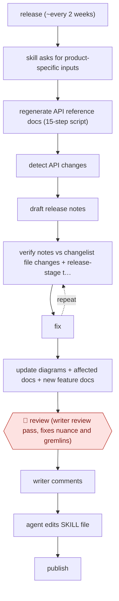

# Release-cycle docs skill

`CRE › WRI › TECHW` · checkpointed · evidence A · **draft: needs a reference example** ([how to add one](../../../../../CONTRIBUTING.md#1-add-an-example-run))

**Shape:** `release (~every 2 weeks) → skill asks for product-specific inputs → regenerate API reference docs (15-step script) → detect API changes → draft release notes → (verify notes vs changelist file changes + release-stage tags vs YAML + sub-agent screenshot compare ⟲ fix) → update diagrams + affected docs + new feature docs → 🛑 review (writer review pass, fixes nuance and gremlins) → writer comments → agent edits SKILL file → publish`
**How it differs:** AWF-0075 Code-PR docs drafts is triggered per code PR, follows the PR's changes, and has two reviews (code author, then docs team). This run is driven by the release cycle across four products, with automated cross-checks and a writer-led loop that edits the skill itself. The trigger, deliverable (release notes plus regenerated reference) and checkpoint arrangement all differ.
**Variants:** `agent-skills` · `cli-scripts`

<!-- shape diagram: generated by scripts/build_diagrams.py from `shape`; don't edit -->

<!-- end shape diagram -->

## Steps
1. On each release, about every two weeks, a per-product SKILL file (four products) asks the writer for that product's release inputs up front [[1]](#sources).
2. A one-click script runs 15 steps to regenerate the Java API reference docs. It replaced about 20 minutes of manual work [[1]](#sources).
3. The agent detects API changes (new methods, enums, description changes) and drafts release notes in a set format with staged links [[1]](#sources).
4. Self-checks: it checks the release notes against the changelist's file changes, checks release-stage tags against the YAML visibility files, and launches a sub-agent to compare screenshots with the originals [[1]](#sources).
5. It updates API diagrams, affected docs and new feature docs [[1]](#sources).
6. 🛑 **Review**: the writer does a review pass. They add why a change matters to developers and handle cases the skill can't (migrated directories, merged deprecated APIs, last-minute rollbacks, bad tags, build problems) [[1]](#sources).
7. The writer's comments go back to the agent, which edits the SKILL file itself. Comments per release fell from 15–20 to about 3–5 after about a dozen iterations [[1]](#sources).

**Output:** Regenerated reference docs, release notes and updated conceptual docs for each release, plus a SKILL file that improves each cycle.
**Failure modes → guards:** AI misses why a change matters, and release-time surprises (rollbacks, bad tags) slip through → mandatory writer review pass. Prompts drift or a model is switched → comments are folded back into the per-product SKILL files.

## Public runs

Coverage as of 2026-11-06: **Strong**: a first-hand, detailed run that matches most of the shape. Collected and re-checked in [Second collection pass](../../../../../research/2026-11-second-pass.md).

- [I'd Rather Be Writing, Developing internal skills for recurring documentation processes](https://idratherbewriting.com/blog/internal-skills-release-docs) (2026-05-04). Per-product release-notes skill with self-checks; writer review comments fall as the skill is refined. "15–20" comments early, "maybe 3–5" after "a dozen iterations". *First-hand: yes; confidence: high.*

## Sources

1. Tom Johnson, I'd Rather Be Writing, 'Developing internal skills for recurring documentation processes like release notes', 2026-05-04. https://idratherbewriting.com/blog/internal-skills-release-docs
