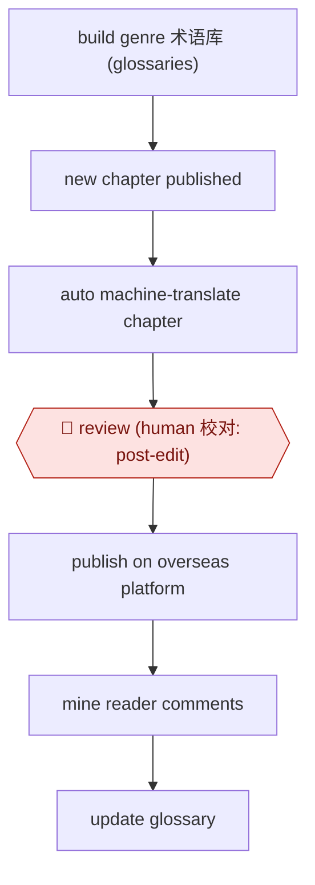

# Glossary-backed MTPE serial

`CRE › WRI › TRANS` · checkpointed · evidence B · **draft: needs a reference example** ([how to add one](../../../../../CONTRIBUTING.md#1-add-an-example-run))

**Shape:** `build genre 术语库 (glossaries) → new chapter published → auto machine-translate chapter → 🛑 review (human 校对: post-edit) → publish on overseas platform → mine reader comments → update glossary`
**How it differs:** AWF-0012 Daily web serial writes original Chinese chapters. AWF-0017 Dubbing pipeline localizes audio and video, not text.
**Variants:** `qidian-international-in-house`

<!-- shape diagram: generated by scripts/build_diagrams.py from `shape`; don't edit -->

<!-- end shape diagram -->

## Steps
1. Build several cultural 术语库 (terminology glossaries) matched to each genre's style, plus special glossaries for web slang the AI has not learned [[1]](#sources)[[2]](#sources).
2. An automated pipeline translates each new chapter with a large language model soon after the Chinese original updates [[1]](#sources).
3. 🛑 **Review**: human translators work in MTPE mode (AI+人工校对, AI translation plus human post-editing). They read the source in full, then fix, polish or sometimes rewrite the output, checking idioms, slang and background knowledge. A human holds final quality control [[1]](#sources)[[2]](#sources).
4. Publish on 起点国际 (WebNovel). Reader comments are collected for keyword extraction and data analysis, and the results feed back into the translations and glossaries [[1]](#sources).

**Output:** English and other-language serial chapters on the overseas platform, kept close to the Chinese release schedule.
**Failure modes → guards:** Xianxia (Chinese fantasy) terms such as 炼气/筑基/元婴 mistranslated even with a glossary, and literal slang renderings such as 破防 → 'break defense' → genre glossaries plus mandatory human post-editing. Accuracy is weaker in classical xianxia and complex relationships than in urban or sci-fi genres → put more human effort on those genres.

## Public runs

Coverage as of 2026-11-06: **Weak**: only anonymous, vendor-linked or journalist-told accounts. Collected and re-checked in [New workflows for empty categories](../../../../../research/2026-11-new-workflows.md).

- [人民日报海外版 via 中国作家网, 阅文 AI translation scale-up](https://www.chinawriter.com.cn/n1/2025/0124/c404027-40408116.html) (2025-01-24). Qidian International's AI translation output and share of best-seller titles in 2024. "新增出海AI翻译作品超2000部，同比增长了20倍"; "AI翻译作品占42%" of the top-100 best-sellers. *First-hand: no (news report; the 2000部 figure is from 中国音像与数字出版协会); confidence: med.*

## Sources

1. 叶子、亓康硕 (人民日报海外版, via 中国作家网), interviewing 阅文 CEO 侯晓楠, 2025-01-24. https://www.chinawriter.com.cn/n1/2025/0124/c404027-40408116.html
2. 徐鲁青 (界面新闻), on AI and 网文/短剧 translators (date not stated on page). https://m.jiemian.com/article/12331956.html
