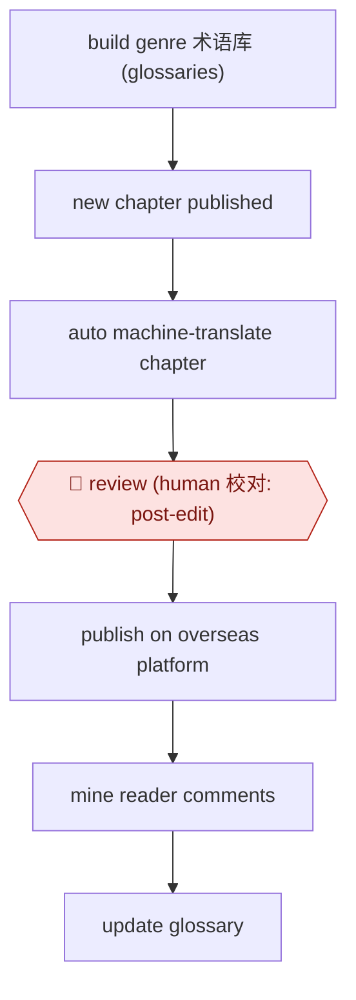

# Glossary-backed MTPE serial

`CRE › WRI › TRANS` · checkpointed · evidence B · **draft: needs a reference example** ([how to add one](../../../../../CONTRIBUTING.md#1-add-an-example-run))

**Shape:** `build genre 术语库 (glossaries) → new chapter published → auto machine-translate chapter → 🛑 review (human 校对: post-edit) → publish on overseas platform → mine reader comments → update glossary`
**Variants:** `qidian-international-in-house`

<!-- shape diagram: generated by scripts/build_diagrams.py from `shape`; don't edit -->

<!-- end shape diagram -->

## Background

网文 (Chinese web novels) are published a chapter at a time, often every day, and overseas readers who follow them want the English chapter soon after the Chinese one. Translating by hand cannot keep up with that pace across thousands of titles. A pipeline now translates each new chapter by machine as soon as the Chinese original is updated, using glossaries of the terms each genre uses so that names and fixed expressions stay consistent. The machine output still carries errors with fantasy terms, slang and cultural background, so a human translator post-edits every chapter before it goes live, and that person holds final responsibility for quality. Reader comments on the published chapters are mined for corrections to feed back into the glossaries.

**Terms:**
- **网文 (web novel)**: a serial novel written for online reading platforms, released chapter by chapter.
- **MTPE (machine translation plus post-editing)**: the machine translates, then a human translator reads the source in full and corrects, polishes or rewrites the output. The sources call this 校对 (literally proofreading), though it is heavier than that.
- **术语库 (terminology glossary)**: a list of source terms with the approved translation of each, kept for a genre so that the machine uses them consistently.
- **仙侠 (xianxia)**: Chinese fantasy about cultivating immortality; its stage names such as 炼气, 筑基 and 元婴 have no standard English equivalents.
- **破防**: slang, originally a game term for breaking through a monster's defence, now meaning to lose emotional composure; a literal rendering ("break defense") misses it.
- **起点国际 (WebNovel)**: the overseas reading platform of the 网文 publisher 阅文 (China Literature).

## Build it with an agent

**Form:** `service`. A chapter must be translated whenever the Chinese original updates, with nobody at the keyboard, and people see only a queue of drafts to post-edit.

**You need:** a feed or folder where new Chinese chapters appear; the genre glossaries and the web-slang glossary as files the agent reads; a store for chapter state (translated, in review, approved); a review queue for the post-editors; a way to export or read reader comments on published chapters. The agent gets no access to the publishing platform.

| Step | Built as |
|---|---|
| build genre 术语库 (glossaries) | Files kept by the translation team, one per genre plus one for web slang, loaded into every translation run. |
| new chapter published → auto machine-translate chapter | A cloud scheduled task, or a `claude -p` job run by your own scheduler, picks up each new chapter. A skill gives it the glossary rules and the output format; it writes the draft translation to the store. |
| 🛑 review (human 校对: post-edit) | See Checkpoints. |
| publish on overseas platform | A person or the platform's own tool publishes the approved text. |
| mine reader comments → update glossary | A weekly scheduled run reads the exported comments, groups complaints about terms and names, and proposes glossary changes as a file for the team to accept or reject. |

**Checkpoints:** `review`: each draft goes to the post-editors' queue with the source chapter beside it, and the chapter stays unpublished until a post-editor marks it approved. The agent has no publish tool, so an unreviewed chapter cannot reach readers. Proposed glossary changes wait for the team in the same way.

**Since the sources:** Source 1 dates from 2025-01; source 2 gives no date. Both describe MTPE at China Literature's overseas platform with a large language model, not an agent: the pipeline and glossaries are the platform's own tooling, and this build is a general-agent equivalent. A newer account, Rest of World of 2026-07 ([link](https://restofworld.org/2026/china-ai-web-novels/)), reports that the publisher had published more than 17,000 AI-translated stories on WebNovel; it does not describe the review step. A search found no newer public description of the glossary or post-editing pipeline as of 2026-11. The sources report that post-editing is mandatory and that accuracy is weaker in classical 仙侠 and complex relationships; the build keeps the person in the loop for every chapter.

*A design based on this entry's steps and the tool documentation as of 2026-11, not a reported run.*

## Steps

*As reported by the sources.*

1. The translation team builds several cultural 术语库 (terminology glossaries) matched to each genre's style, plus special glossaries for web slang the AI has not learned [[1]](#sources)[[2]](#sources).
2. An automated pipeline translates each new chapter with a large language model soon after the Chinese original updates [[1]](#sources).
3. 🛑 **Review**: human translators work in MTPE mode (machine translation plus post-editing; AI+人工校对). They read the source in full, then fix, polish or sometimes rewrite the output, checking idioms, slang and background knowledge. A human holds final quality control [[1]](#sources)[[2]](#sources).
4. The platform publishes the chapter on 起点国际 (WebNovel). Reader comments are collected for keyword extraction and data analysis, and the results feed back into the translations and glossaries [[1]](#sources).

**Output:** English and other-language serial chapters on the overseas platform, kept close to the Chinese release schedule.
**Failure modes → guards:** Xianxia (Chinese fantasy) terms such as 炼气/筑基/元婴 mistranslated even with a glossary, and literal slang renderings such as 破防 → 'break defense' → genre glossaries plus mandatory human post-editing. Accuracy is weaker in classical xianxia and complex relationships than in urban or sci-fi genres → put more human effort on those genres.
**How it differs:** AWF-0012 Daily web serial writes original Chinese chapters. AWF-0017 Dubbing pipeline localizes audio and video, not text.

## Public runs

Coverage as of 2026-11-06: **Weak**: only anonymous, vendor-linked or journalist-told accounts. Collected and re-checked in [New workflows for empty categories](../../../../../research/2026-11-new-workflows.md).

- [人民日报海外版 via 中国作家网, 阅文 AI translation scale-up](https://www.chinawriter.com.cn/n1/2025/0124/c404027-40408116.html) (2025-01-24). Qidian International's AI translation output and share of best-seller titles in 2024. "新增出海AI翻译作品超2000部，同比增长了20倍"; "AI翻译作品占42%" of the top-100 best-sellers. *First-hand: no (news report; the 2000部 figure is from 中国音像与数字出版协会); confidence: med.*

## Sources

1. 叶子、亓康硕 (人民日报海外版, via 中国作家网), interviewing 阅文 CEO 侯晓楠, 2025-01-24. https://www.chinawriter.com.cn/n1/2025/0124/c404027-40408116.html
2. 徐鲁青 (界面新闻), on AI and 网文/短剧 translators (date not stated on page). https://m.jiemian.com/article/12331956.html
