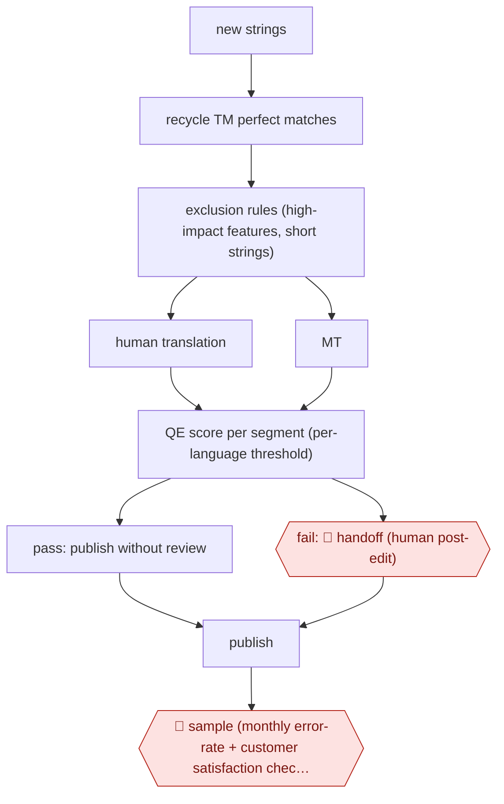

# QE-routed MT publishing

`CRE › WRI › TRANS` · sampled · evidence A · **draft: needs a reference example** ([how to add one](../../../../../CONTRIBUTING.md#1-add-an-example-run))

**Shape:** `new strings → recycle TM perfect matches → exclusion rules (high-impact features, short strings) → human translation | MT → QE score per segment (per-language threshold) → pass: publish without review | fail: 🛑 handoff (human post-edit) → publish → 🛑 sample (monthly error-rate + customer satisfaction check, recalibrate threshold)`
**How it differs:** Nearest are AWF-0076 (Glossary-backed MTPE serial) and AWF-0136 (Term-gated game localisation). In both, every chapter or text gets human post-edit or LQA before shipping. Here a quality-estimation router publishes most MT with no human touch, and humans only handle failed segments plus aggregate sampling. Autonomy moves from checkpointed to sampled, and checkpoints become a handoff and an audit.
**Variants:** `microsoft-qe-quest-plus-plus` · `taus-epic-qe` · `modelfront`

<!-- shape diagram: generated by scripts/build_diagrams.py from `shape`; don't edit -->

<!-- end shape diagram -->

## Steps
1. Unchanged strings and perfect/100% matches are recycled from translation memory [[1]](#sources).
2. Exclusion: high-customer-impact strings ('What's New', marketing, legal) and features unsuitable for MT go to human translation. They are excluded by resource (words, resource names, developer comments) or by feature. Strings under 8 words are also excluded [[1]](#sources).
3. Remaining new strings are machine-translated. A QE model per language (feature-based, trained on 100k+ segments per language) predicts TER. Low quality means predicted TER >0.3 [[1]](#sources).
4. Calibrate the QE threshold per language against a target error rate (10% of new words per product, language and month; historical human LQA fail rate is 5%). In the worked example, a QE threshold of 0.42 gives 58% throughput and 62% precision [[1]](#sources).
5. QE-pass segments publish without human review, like a 100% TM match [[1]](#sources)[[2]](#sources).
6. 🛑 **Handoff**: QE-fail segments go to human post-editing, as before [[1]](#sources)[[2]](#sources).
7. 🛑 **Sample**: monitor customer satisfaction and the error rate per language, listen to customer feedback, and re-tune the thresholds [[1]](#sources).

**Output:** Localized software UI strings published in the build. Only QE-failed and excluded strings got human work.
**Failure modes → guards:** QE models are imperfect and some low-quality MT is published on purpose → cap it with an explicit error-rate budget and watch customer satisfaction [1]. Short strings score badly or are ambiguous → length threshold [1]. QE over-flags (Yamagata estimates 30% of 'Bad' labels were fine) → fine-tune per-domain thresholds [3]. On user-generated content, polluted strings the model hasn't seen → keep post-editing for fails [3].

## Public runs

Coverage as of 2026-11-13: **Strong**: a first-hand, detailed run that matches most of the shape. Collected and re-checked in [Third collection pass](../../../../../research/2026-11-third-pass.md).

- [Microsoft (Schmidtke), Scaling up automatic translation for software](https://aclanthology.org/attachments/2020.amta-user.5.Presentation.pdf) (2020-10). Two years of QE-gated MT publishing of software UI across 37 languages, CSAT stable. "MT now used for 9% of published software translation volumes across 37 languages"; "0.4M VOLUME OF WORDS 'QE PASSED' EACH MONTH". *First-hand: yes; confidence: high.*
- [TAUS, Yamagata Europe case study](https://www.taus.net/case-studies/yamagata-saves-up-to-76-in-lead-time-and-costs-with-taus/) (undated). Custom QE model for warranty-claim MT; 'Good' strings skip post-editing. "65% for the FR-EN language pair and 76% for the DE-EN language pair". *First-hand: vendor; confidence: med.*
- [Custom.MT (Dranch), Automated QE Reduces Cost of Translation](https://custom.mt/quality-estimation-draws-nearer-to-adoption/) (2024-11-06). BLEND client stopped reviewing strings above a confidence threshold. "The resulting cost saving was 35%, economizing $47k in the pilot project"; "The impact on quality was not measured.". *First-hand: interview; confidence: med.*

## Sources

1. Dag Schmidtke (Microsoft E&D Global), Scaling up automatic translation for software: reduction of post-editing volume with well-defined customer impact, AMTA 2020 MT User Track (Vol. 2, pp. 110ff). https://aclanthology.org/attachments/2020.amta-user.5.Presentation.pdf
2. Konstantin Dranch (Custom.MT), Automated QE Reduces Cost of Translation, 2024-11-06 (BLEND pilot reported at TAUS 2024). https://custom.mt/quality-estimation-draws-nearer-to-adoption/
3. TAUS case study, EPIC API enables saving up to 76% in lead time and costs (Yamagata Europe; vendor). https://www.taus.net/case-studies/yamagata-saves-up-to-76-in-lead-time-and-costs-with-taus/
