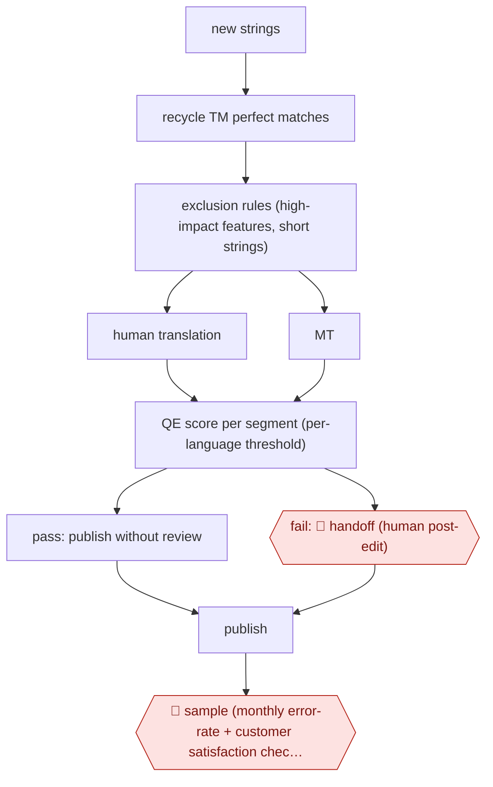

# QE-routed MT publishing

`CRE › WRI › TRANS` · sampled · evidence A · **draft: needs a reference example** ([how to add one](../../../../../CONTRIBUTING.md#1-add-an-example-run))

**Shape:** `new strings → recycle TM perfect matches → exclusion rules (high-impact features, short strings) → human translation | MT → QE score per segment (per-language threshold) → pass: publish without review | fail: 🛑 handoff (human post-edit) → publish → 🛑 sample (monthly error-rate + customer satisfaction check, recalibrate threshold)`
**Variants:** `microsoft-qe-quest-plus-plus` · `taus-epic-qe` · `modelfront`

<!-- shape diagram: generated by scripts/build_diagrams.py from `shape`; don't edit -->

<!-- end shape diagram -->

## Background

A software company ships its product in dozens of languages, and every button label and message (a UI string) needs a translation each release. Human translators are the slow, costly step. Machine translation (MT) is often good enough that a person would change nothing, but nobody knows which strings those are without reading them. Quality estimation (QE) is a model that scores each machine-translated segment without a reference translation, so the pipeline can publish high-scoring segments with no review and send only low-scoring ones to a human post-editor. The agent side takes the routing and the bookkeeping. People still own three things: the strings that must never go unreviewed (legal text, marketing, "What's New"), the post-editing of failed segments, and the monthly check that publishing without review has not raised the error rate or hurt customers, because the company is knowingly publishing some imperfect text.

**Terms:**
- **UI string**: a piece of text in a software interface, such as a button label or an error message.
- **Segment**: the unit of translation, usually one string or sentence.
- **Translation memory (TM)**: a database of earlier human translations; a 100% or perfect match is a segment already translated identically, which is reused without cost.
- **Machine translation (MT)**: automatic translation by a model.
- **Quality estimation (QE)**: a model that predicts how good a machine translation is without seeing a human reference.
- **TER (translation edit rate)**: the share of a machine translation a human would have to edit; lower is better. Here a segment is low quality when predicted TER is above 0.3.
- **Post-editing (PE)**: a human translator correcting machine output.
- **LQA (linguistic quality assurance)**: a reviewer's check of translated text against a list of error types.
- **Throughput and precision**: here, the share of segments the threshold lets through, and the share of those that really were fine.

## Build it with an agent

**Form:** `service`. Strings arrive with each build and nobody is at the keyboard; people see only the failed segments, the sample and the monthly report.

**You need:** the strings with their developer comments and resource names; read access to the translation memory; the exclusion rules (feature list, resource list, minimum length) as a file; a QE scorer per language with a threshold per language; a store for each segment's route and score; a post-editing queue; the previous months' human review results to calibrate against. The agent needs write access to the localized strings only for segments that passed, and none for segments that failed or were excluded.

| Step | Built as |
|---|---|
| new strings → recycle TM perfect matches → exclusion rules | An Agent SDK program or a `claude -p` job that your build pipeline runs on each new string set. It asks the translation memory connector for perfect matches and applies the exclusion file, with the rules written in code, not left to the model. |
| human translation \| MT | Excluded strings go to the human translation queue. The rest are machine-translated by the translation engine or by a skill that holds the style and terminology rules. |
| QE score per segment (per-language threshold) | A QE model per language (a hosted QE service or one you train), with the threshold per language kept in a config file. The agent does not choose the threshold. |
| pass: publish without review \| fail: 🛑 handoff (human post-edit) → publish | Passing segments are written to the localized strings. Failing ones go to the post-editing queue and are published once a post-editor approves them. |
| 🛑 sample (monthly error-rate + customer satisfaction check, recalibrate threshold) | See Checkpoints. |

**Checkpoints:** `handoff`: each failing segment goes to the post-editors' queue with its source, the machine output and the score, and nothing is written to the strings until a post-editor approves it. `sample`: each month the service copies a fixed share of the published passing segments, per product and language, to reviewers and reports the error rate beside the customer-satisfaction figures; a person decides whether to move a threshold. A missed handoff would publish unreviewed text, so the failing and excluded paths have no write tool, and the threshold and exclusion files are changed only by a person.

**Since the sources:** Sources date from 2020-10 to 2024-11; one (the TAUS case study) is undated. Source 1 was a slide deck whose text could not be read in this session, so its figures rest on the entry text. Searching for newer accounts as of 2026-11 turned up two 2026 EAMT conference papers, one on a model-as-judge approach to deciding whether raw AI translation is publishable without post-editing and one on small open-weight models for QE ([paper 1](https://aclanthology.org/2026.eamt-1.7.pdf), [paper 2](https://aclanthology.org/2026.eamt-1.9.pdf)); their PDFs could not be read here, so nothing in the build relies on them. The sources use trained QE models; whether a general agent can score segments reliably enough to replace one is not shown by any source here, so calibrate any scorer against human review on your own content before letting segments pass unreviewed. The 2024 BLEND pilot reports that quality impact was not measured.

*A design based on this entry's steps and the tool documentation as of 2026-11, not a reported run.*

## Steps

*As reported by the sources.*

1. The pipeline recycles unchanged strings and perfect/100% matches from translation memory (TM) [[1]](#sources).
2. Exclusion: high-customer-impact strings ('What's New', marketing, legal) and features unsuitable for MT go to human translation. They are excluded by resource (words, resource names, developer comments) or by feature. Strings under 8 words are also excluded [[1]](#sources).
3. The pipeline machine-translates the remaining new strings. A quality-estimation (QE) model per language (feature-based, trained on 100k+ segments per language) predicts TER (translation edit rate). Low quality means predicted TER >0.3 [[1]](#sources).
4. The team calibrates the QE threshold per language against a target error rate (10% of new words per product, language and month; historical human LQA (linguistic quality assurance) fail rate is 5%). In the worked example, a QE threshold of 0.42 gives 58% throughput and 62% precision [[1]](#sources).
5. QE-pass segments are published without human review, like a 100% TM match [[1]](#sources)[[2]](#sources).
6. 🛑 **Handoff**: QE-fail segments go to human post-editing (PE), as before [[1]](#sources)[[2]](#sources).
7. 🛑 **Sample**: the team monitors customer satisfaction and the error rate per language, listens to customer feedback, and re-tunes the thresholds [[1]](#sources).

**Output:** Localized software UI strings published in the build. Only QE-failed and excluded strings got human work.
**Failure modes → guards:** QE models are imperfect and some low-quality MT is published on purpose → cap it with an explicit error-rate budget and watch customer satisfaction [1]. Short strings score badly or are ambiguous → length threshold [1]. QE over-flags (Yamagata estimates 30% of 'Bad' labels were fine) → fine-tune per-domain thresholds [3]. On user-generated content, polluted strings the model hasn't seen → keep post-editing for fails [3].
**How it differs:** Nearest are AWF-0076 (Glossary-backed MTPE serial) and AWF-0136 (Term-gated game localisation). In both, every chapter or text gets human post-edit or LQA before shipping. Here a quality-estimation router publishes most MT with no human touch, and humans only handle failed segments plus aggregate sampling. Autonomy moves from checkpointed to sampled, and checkpoints become a handoff and an audit.

## Public runs

Coverage as of 2026-11-13: **Strong**: a first-hand, detailed run that matches most of the shape. Collected and re-checked in [Third collection pass](../../../../../research/2026-11-third-pass.md).

- [Microsoft (Schmidtke), Scaling up automatic translation for software](https://aclanthology.org/attachments/2020.amta-user.5.Presentation.pdf) (2020-10). Two years of QE-gated MT publishing of software UI across 37 languages, CSAT stable. "MT now used for 9% of published software translation volumes across 37 languages"; "0.4M VOLUME OF WORDS 'QE PASSED' EACH MONTH". *First-hand: yes; confidence: high.*
- [TAUS, Yamagata Europe case study](https://www.taus.net/case-studies/yamagata-saves-up-to-76-in-lead-time-and-costs-with-taus/) (undated). Custom QE model for warranty-claim MT; 'Good' strings skip post-editing. "65% for the FR-EN language pair and 76% for the DE-EN language pair". *First-hand: vendor; confidence: med.*
- [Custom.MT (Dranch), Automated QE Reduces Cost of Translation](https://custom.mt/quality-estimation-draws-nearer-to-adoption/) (2024-11-06). BLEND client stopped reviewing strings above a confidence threshold. "The resulting cost saving was 35%, economizing $47k in the pilot project"; "The impact on quality was not measured.". *First-hand: interview; confidence: med.*

## Sources

1. Dag Schmidtke (Microsoft E&D Global), Scaling up automatic translation for software: reduction of post-editing volume with well-defined customer impact, AMTA 2020 MT User Track (Vol. 2, pp. 110ff). https://aclanthology.org/attachments/2020.amta-user.5.Presentation.pdf
2. Konstantin Dranch (Custom.MT), Automated QE Reduces Cost of Translation, 2024-11-06 (BLEND pilot reported at TAUS 2024). https://custom.mt/quality-estimation-draws-nearer-to-adoption/
3. TAUS case study, EPIC API enables saving up to 76% in lead time and costs (Yamagata Europe; vendor). https://www.taus.net/case-studies/yamagata-saves-up-to-76-in-lead-time-and-costs-with-taus/
