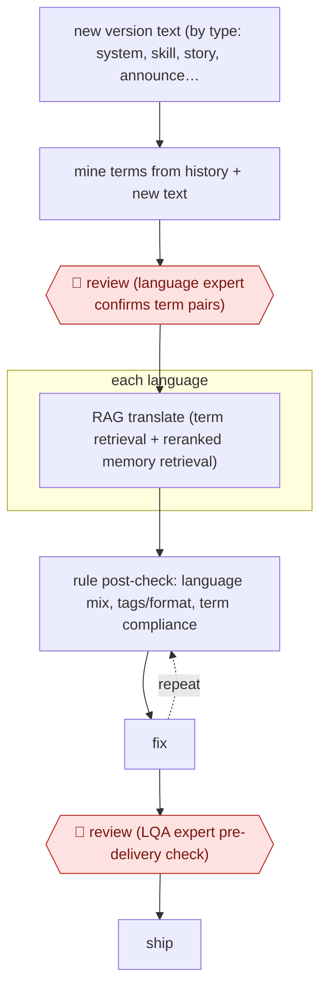

# Term-gated game localisation

`CRE › WRI › TRANS` · checkpointed · evidence A · **draft: needs a reference example** ([how to add one](../../../../../CONTRIBUTING.md#1-add-an-example-run))

**Shape:** `new version text (by type: system, skill, story, announcement, SNS) → mine terms from history + new text → 🛑 review (language expert confirms term pairs) → each language: RAG translate (term retrieval + reranked memory retrieval) → (rule post-check: language mix, tags/format, term compliance ⟲ fix) → 🛑 review (LQA expert pre-delivery check) → ship`
**Variants:** `rag-llm` · `rule-qa`

<!-- shape diagram: generated by scripts/build_diagrams.py from `shape`; don't edit -->

<!-- end shape diagram -->

## Background

A game ships in ten languages at once, and every patch adds strings: menu labels, skill descriptions, story dialogue, announcements, social posts. Each language needs its own copy, and the strings are not interchangeable — a skill description has to use the same term for a mechanic as the tutorial did two versions ago, and a character's name must be the same name the community already uses. Translating with a general model loses exactly that: it produces plausible sentences that rename the mechanic and drift from the established glossary. This workflow puts the glossary in front of the model. Terms are mined from past translations and from the new text, confirmed by a language expert, and then every string is translated with the term list and the closest approved translations in front of it. A rule layer catches the mechanical faults — a string left in the wrong language, a broken formatting tag, a term that does not match the glossary — and sends them back before a person sees the batch. The language expert's approval of the glossary is the gate that matters, because every string downstream inherits it, and the localisation QA expert at the end is the last human read before players get the build.

**Terms:**
- **string**: one piece of player-facing text, stored with an id.
- **glossary / 术语库**: the approved term pairs — source term to target term — for this version.
- **term mining**: extracting candidate term pairs from past translations and new source text.
- **translation memory (TM)**: the store of previously approved translations, with context.
- **RAG translation**: retrieving the relevant glossary entries and similar past translations, then translating with them as context.
- **rerank**: ordering retrieved candidates by relevance before they are used.
- **LQA** (localisation QA): checking translated text in context for accuracy, terminology and fit.
- **text type**: the category a string belongs to — system, skill, story, announcement, social — each with its own tone rules.

## Build it with an agent

**Form:** `service`. A version's strings arrive as a batch of thousands, run through every language without anyone starting it, and people appear twice — at the glossary, before the run, and at the delivery check after it.

**You need:** the source strings, tagged by text type; the previous versions' translations as translation memory; the current glossary and the version's proposed additions; a rule checker whose rules come from the game's own formatting (tags, placeholders, character limits); the languages and their locale conventions; the build pipeline that takes a delivered batch. The agent must not ship: delivery is a person's act, and the glossary is read-only to the run, so a translation session cannot quietly rename a mechanic.

| Step | Built as |
|---|---|
| new version text, by type | A job is created per version with the strings grouped by text type, because the tone rules differ and the reviewer should see one type at a time. |
| mine terms from history + new text | The Skill extracts candidate pairs from the translation memory and flags terms that appear only in the new source; each candidate carries the evidence — where it was used — so a reviewer can decide in seconds. |
| 🛑 review (language expert confirms term pairs) | A review queue per language pair; only approved pairs enter the version glossary, and the run reads that file rather than editing it. |
| each language: RAG translate | For every string, hybrid retrieval of glossary terms (exact match for names and item names) plus reranked memory hits by semantics, speaker, style and mood; the translation is produced with those in context and nothing else invented. |
| rule post-check ⟲ fix | The checker tests language mixing, tag and placeholder integrity, length limits and glossary compliance; failures go back with the rule that fired, and a string that fails twice goes to the LQA queue instead of looping. |
| 🛑 review (LQA expert pre-delivery check) | The expert reads in context — in the build where possible — against the glossary and the source; the delivery is their act, and the run has no path into the build. |
| ship | The verified batch goes into the game build. |

**Checkpoints:** `review`: two gates with different owners. The glossary gate is the important one, because a wrong term approved once propagates into thousands of strings, so the run treats the glossary as read-only and an expert edits it. The delivery gate is the LQA expert in the running build, where the faults a spreadsheet cannot show — truncation, overlapping text, a term that is right in isolation and wrong in the sentence — become visible.

**Since the sources:** Sources date from 2025-10: one first-hand engineering account from a large game company, which is also the public run; it is more than twelve months old and was not re-opened on this pass. What has changed since: the pattern has been written up as a production method, and the numbers attached to it are modest. A 2026 account of the same pipeline describes [three levels — a machine filter for terminology, length, sensitive words and placeholders; a linguist's pass over meaning and culture; and an in-game LQA round that loads the strings back into the UI](https://blog.csdn.net/weixin_42628846/article/details/165582175) — and reports that raw machine translation is usable about 70% of the time, rising to about 85% with a terminology engine, with the rest going to a specialist. That is consistent with this entry's rule layer and its two gates, and it sets a realistic expectation: the glossary and the checks buy the first 85%, and the last part stays human.

*A design based on this entry's steps and the tool documentation as of 2026-11, not a reported run.*

## Steps

*As reported by the sources.*

1. Each game version's source text is split by text type (system UI, skill descriptions, story dialogue, announcements, SNS), and each type has its own style rules [[1]](#sources).
2. Term mining: few-shot LLM extraction of term pairs from past translations (for example 「風ノ剣士」→「风之剑士」), plus discovery of candidate terms in new source-only text [[1]](#sources).
3. 🛑 **Review**: candidate term pairs go to language experts, and only approved ones enter the version 术语库 (glossary) [[1]](#sources).
4. RAG translation: hybrid term search (IP and character names matched exactly), plus translation-memory chunks reranked by semantic, speaker, style and mood similarity [[1]](#sources).
5. Rule post-checks run in production: mixed-language detection, HTML tag and format integrity, and glossary compliance. Failed items go back for rework [[1]](#sources).
6. 🛑 **Review**: a professional LQA (localisation QA) expert checks before delivery [[1]](#sources).

**Output:** Localised strings in up to 10 languages per version, shipped into the game build.
**Failure modes → guards:** Added or omitted content, glossary violations, mixed-language output, broken tags → rule layer (covers 70%+ of format and term issues) plus LQA expert. Glossary goes stale between versions → expert-approved term mining each version.
**How it differs:** AWF-0076 Glossary-backed MTPE serial has a human 校对 (post-editor) post-edit every web-novel chapter and updates its glossary from reader comments. Here a language expert approves the glossary up front, automated rule checks catch issues, and an LQA expert checks at the end, with strings routed by type and run across many languages. The checkpoint placement and the deliverable (game strings, not chapters) differ.

## Public runs

Coverage as of 2026-11-06: **Strong**: a first-hand, detailed run that matches most of the shape. Collected and re-checked in [Second collection pass](../../../../../research/2026-11-second-pass.md).

- [哔哩哔哩技术, B站游戏大模型翻译实践](https://juejin.cn/post/7565403446373433394) (2025-10-27). LLM localisation across several games and 10 languages, with expert term review and LQA. "翻译成本节省70%~80%" (translation cost cut 70–80%); "线上客诉控制在万分之一内" (live player complaints under 1 in 10,000). *First-hand: yes; confidence: high.*

## Sources

1. 哔哩哔哩技术 (Bilibili game algorithm team), 'B站游戏大模型翻译实践 —— 我们如何用LLM撑起全年百万字本地化翻译任务', 2025-10-27. https://juejin.cn/post/7565403446373433394 (mirror: https://adg.csdn.net/696f4d4c437a6b403369f3f6.html)
