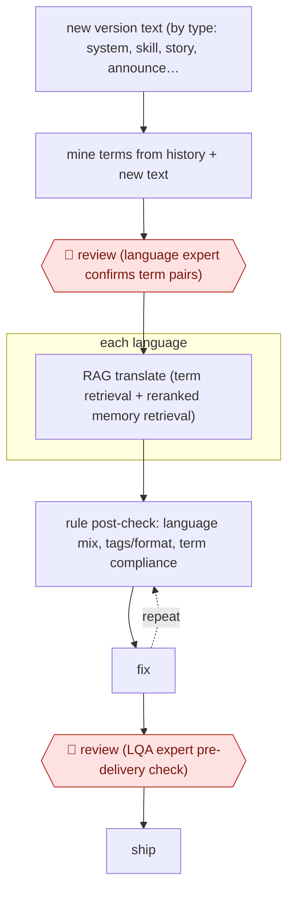

# Term-gated game localisation

`CRE › WRI › TRANS` · checkpointed · evidence A · **draft: needs a reference example** ([how to add one](../../../../../CONTRIBUTING.md#1-add-an-example-run))

**Shape:** `new version text (by type: system, skill, story, announcement, SNS) → mine terms from history + new text → 🛑 review (language expert confirms term pairs) → each language: RAG translate (term retrieval + reranked memory retrieval) → (rule post-check: language mix, tags/format, term compliance ⟲ fix) → 🛑 review (LQA expert pre-delivery check) → ship`
**How it differs:** AWF-0076 Glossary-backed MTPE serial has a human 校对 (post-editor) post-edit every web-novel chapter and updates its glossary from reader comments. Here a language expert approves the glossary up front, automated rule checks catch issues, and an LQA expert checks at the end, with strings routed by type and run across many languages. The checkpoint placement and the deliverable (game strings, not chapters) differ.
**Variants:** `rag-llm` · `rule-qa`

<!-- shape diagram: generated by scripts/build_diagrams.py from `shape`; don't edit -->

<!-- end shape diagram -->

## Steps
1. Each game version's source text is split by text type (system UI, skill descriptions, story dialogue, announcements, SNS), and each type has its own style rules [[1]](#sources).
2. Term mining: few-shot LLM extraction of term pairs from past translations (for example 「風ノ剣士」→「风之剑士」), plus discovery of candidate terms in new source-only text [[1]](#sources).
3. 🛑 **Review**: candidate term pairs go to language experts, and only approved ones enter the version 术语库 (glossary) [[1]](#sources).
4. RAG translation: hybrid term search (IP and character names matched exactly), plus translation-memory chunks reranked by semantic, speaker, style and mood similarity [[1]](#sources).
5. Rule post-checks run in production: mixed-language detection, HTML tag and format integrity, and glossary compliance. Failed items go back for rework [[1]](#sources).
6. 🛑 **Review**: a professional LQA (localisation QA) expert checks before delivery [[1]](#sources).

**Output:** Localised strings in up to 10 languages per version, shipped into the game build.
**Failure modes → guards:** Added or omitted content, glossary violations, mixed-language output, broken tags → rule layer (covers 70%+ of format and term issues) plus LQA expert. Glossary goes stale between versions → expert-approved term mining each version.

## Public runs

Coverage as of 2026-11-06: **Strong**: a first-hand, detailed run that matches most of the shape. Collected and re-checked in [Second collection pass](../../../../../research/2026-11-second-pass.md).

- [哔哩哔哩技术, B站游戏大模型翻译实践](https://juejin.cn/post/7565403446373433394) (2025-10-27). LLM localisation across several games and 10 languages, with expert term review and LQA. "翻译成本节省70%~80%" (translation cost cut 70–80%); "线上客诉控制在万分之一内" (live player complaints under 1 in 10,000). *First-hand: yes; confidence: high.*

## Sources

1. 哔哩哔哩技术 (Bilibili game algorithm team), 'B站游戏大模型翻译实践 —— 我们如何用LLM撑起全年百万字本地化翻译任务', 2025-10-27. https://juejin.cn/post/7565403446373433394 (mirror: https://adg.csdn.net/696f4d4c437a6b403369f3f6.html)
