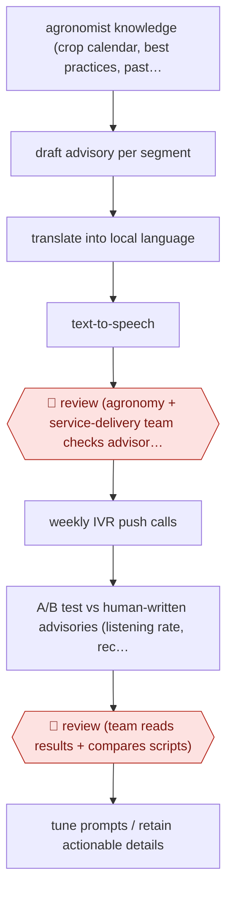

# Agronomist-gated push advisories

`ORG › AGR › ADVISORY` · checkpointed · evidence A · **draft: needs a reference example** ([how to add one](../../../../../CONTRIBUTING.md#1-add-an-example-run))

**Shape:** `agronomist knowledge (crop calendar, best practices, past advisories) + farmer segments (crop, farm size, weather, preferences) → draft advisory per segment → translate into local language → text-to-speech → 🛑 review (agronomy + service-delivery team checks advisories before release) → weekly IVR push calls → A/B test vs human-written advisories (listening rate, recall survey) → 🛑 review (team reads results + compares scripts) → tune prompts / retain actionable details`
**How it differs:** AWF-0211 (extension-agent mediated advice) answers individual farmer questions, with an extension agent relaying each answer. AWF-0154 gives plot-registered, in-season advice to one farmer at a time. Here nobody asks a question: agronomists release segmented, voiced push campaigns in bulk, and a randomised A/B evaluation is the second checkpoint. Deliverable, trigger and checkpoints all differ.
**Variants:** `paddyai` · `ivr-push-calls`

<!-- shape diagram: generated by scripts/build_diagrams.py from `shape`; don't edit -->

<!-- end shape diagram -->

## Steps
1. Agronomists supply the knowledge: crop calendars, best practices, seasonal guidance and the stock of past years' advisories. Farmer attributes (crop type, farm size, local weather, communication preferences) define the segments [[1]](#sources)[[2]](#sources).
2. PaddyAI drafts an advisory for each segment, translates it into the local language (Kannada for the coffee service) and turns it into audio for voice calls. It can produce the many customised versions that agronomists could not write by hand [[1]](#sources)[[2]](#sources).
3. 🛑 **Review**: the agronomy and service-delivery teams stay in the loop to make sure each advisory going to farmers is appropriate. Early versions were also tested in farmer focus groups for comprehension [[1]](#sources).
4. Advisories go out as one IVR push call per week on the Coffee Krishi Taranga service, which PxD runs with the Coffee Board of India [[2]](#sources).
5. The outcome is measured as an A/B test against human-written, human-voiced advisories: pick-up rate, listening rate and duration heard from platform data, plus a follow-up phone survey for recall and comprehension [[2]](#sources).
6. 🛑 **Review**: the team reads the results alongside the scripts themselves, finds that AI scripts sometimes drop specific recommended actions or technical details, and tunes PaddyAI to keep that actionable content [[2]](#sources).

**Output:** Weekly voiced advisories in the local language for each farmer segment, delivered through the IVR platform, plus an experiment-registry entry that drives the next prompt revision.
**Failure modes → guards:** AI scripts simplify and drop actionable or technical details → agronomist review before release, and script-by-script comparison after the A/B test. Lower engagement than human scripts (2–3.5 pp lower listening rate) → the A/B gate before scaling. The project page's preliminary claim of slightly higher engagement was not borne out by the final registry results; cite the registry. The registry page says AI scripts 'tend to be longer' in its abstract but '12% shorter' in its results; use the results figures.

## Public runs

Coverage as of 2026-11-13: **Strong**: a first-hand, detailed run that matches most of the shape. Collected and re-checked in [Fourth collection pass](../../../../../research/2026-11-fourth-pass.md).

- [PxD, Paddy AI A/B test 1](https://registry.precisiondev.org/registry_entry/paddyai-a-b-test-comparing-engagement-metrics-for-ai-enabled-ivr-advisories/) (2026-10-13). 11 weekly advisories, Nov 2025–Feb 2026, to coffee farmers randomised across human and AI script/voice arms. "We randomly assigned 28,796 coffee farmers"; "The average listening rate is 2pp lower for AI-generated, AI-voiced advisories (3.6% decrease, p<0.05)"; "a 6.3% lower recall rate". *First-hand: yes; confidence: high.*

## Sources

1. Precision Development (PxD), Accelerating smallholder access to AI-powered agricultural advice, 2026-02-11. https://precisiondev.org/project/accelerating-smallholder-access-to-ai-powered-agricultural-advice/
2. PxD Experiment Registry, Paddy AI A/B test 1: Artificial Intelligence versus Human-Generated Advisories, last modified 2026-10-13. https://registry.precisiondev.org/registry_entry/paddyai-a-b-test-comparing-engagement-metrics-for-ai-enabled-ivr-advisories/
