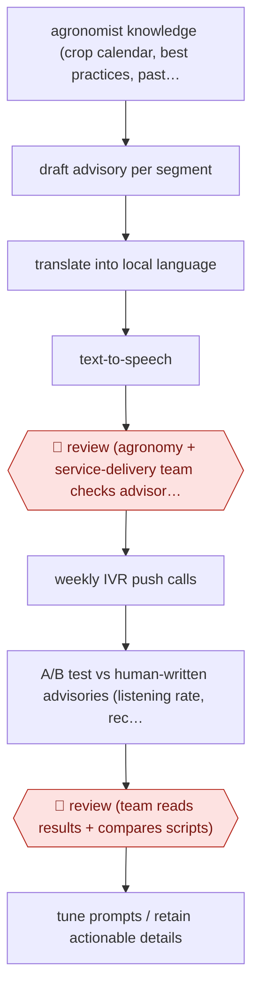

# Agronomist-gated push advisories

`ORG › AGR › ADVISORY` · checkpointed · evidence A · **draft: needs a reference example** ([how to add one](../../../../../CONTRIBUTING.md#1-add-an-example-run))

**Shape:** `agronomist knowledge (crop calendar, best practices, past advisories) + farmer segments (crop, farm size, weather, preferences) → draft advisory per segment → translate into local language → text-to-speech → 🛑 review (agronomy + service-delivery team checks advisories before release) → weekly IVR push calls → A/B test vs human-written advisories (listening rate, recall survey) → 🛑 review (team reads results + compares scripts) → tune prompts / retain actionable details`
**How it differs:** AWF-0211 (extension-agent mediated advice) answers individual farmer questions, with an extension agent relaying each answer. AWF-0154 gives plot-registered, in-season advice to one farmer at a time. Here nobody asks a question: agronomists release segmented, voiced push campaigns in bulk, and a randomised A/B evaluation is the second checkpoint. Deliverable, trigger and checkpoints all differ.
**Variants:** `paddyai` · `ivr-push-calls`

<!-- shape diagram: generated by scripts/build_diagrams.py from `shape`; don't edit -->

<!-- end shape diagram -->

## Background

An agricultural service that reaches smallholders by phone sends advice out rather than waiting to be asked: this week, apply the second nitrogen dose; watch for leaf rust after the rain; the coffee berry borer is moving. The advice has to fit a segment — a coffee grower with two acres in one district needs a different message from a paddy farmer with ten — and it has to be in the farmer's own language and spoken aloud, because many recipients have a basic handset and cannot read a message. Writing, translating and recording dozens of versions a week is more than an agronomy team can do by hand, so drafting, translation and voice are automated. The agronomists still read every advisory before it goes out, and afterwards the campaign is measured against human-written, human-voiced advisories in a randomised trial, because "the farmers listened" is not the same as "the advice was right". The published result is the uncomfortable part: the generated advisories were listened to slightly less than the human ones, and recalled less often — which is what makes the review and the script comparison the real work rather than the generation.

**Terms:**
- **advisory**: a short piece of seasonal guidance, pushed to farmers rather than requested.
- **segment**: a group of farmers defined by crop, farm size, district, weather and language.
- **IVR** (interactive voice response): the phone system that places a call and plays a recorded message.
- **TTS** (text-to-speech): turning the written advisory into spoken audio.
- **listening rate**: the share of answered calls where the message was heard, and how much of it.
- **recall survey**: a follow-up call asking what the farmer remembers of the advice.
- **A/B test**: a randomised comparison of two versions of the same campaign.
- **actionable detail**: the specific rate, timing or product name that makes advice usable.

## Build it with an agent

**Form:** `service`. A campaign goes out weekly to tens of thousands of phones with nobody starting it; the agronomy team answers one queue before release and one review of results after, and the evaluation runs on the platform's own randomisation.

**You need:** the agronomists' knowledge as files — crop calendar, the season's guidance, past advisories — with the specific rates and timings preserved; the farmer list with the attributes that define segments, and the language and dialect per segment; a translation step checked by a speaker, because a warning that reads oddly in a dialect is worse than no call; a TTS voice per language, tested for intelligibility; the IVR platform, able to hold a randomised control group; and the survey instrument for the recall measure. The agent must not release a campaign: that action belongs to the agronomy and service-delivery team.

| Step | Built as |
|---|---|
| agronomist knowledge + farmer segments | The knowledge is a reference set the Skill reads and the segment definitions are a table; a message is drafted per segment, not per farmer, because the channel cannot personalise further. |
| draft advisory per segment | One pass per segment, quoting the crop calendar's dates and the guidance's rates into the message rather than paraphrasing them, since the trial's finding was that generation drops exactly those details. |
| translate into local language | Translation per language, then a speaker's check on a sample; the dialect words and the diacritics are what machine translation gets wrong most. |
| text-to-speech | A fixed voice per language, with the pacing set once and kept, because a changed voice mid-season confuses listeners who recognise the service by it. |
| 🛑 review (agronomy + service-delivery team checks advisories before release) | A release queue: every segment's script and audio, with the actionable details highlighted so the reviewer checks them first; approval is a permission in the calling platform, which the run does not hold. |
| weekly IVR push calls | The platform dials the segment, with a randomised hold-out arm receiving the human-written, human-voiced version, so the comparison is designed before any call is placed. |
| A/B test vs human-written advisories | Listening and duration come from platform data, recall from the survey; both are reported with sample size and significance, not as one headline. |
| 🛑 review (team reads results + compares scripts) | The team reads the numbers beside the two scripts and names what the generated version lost — a rate, a timing, a condition — and that list is what the next prompt revision is built from. |

**Checkpoints:** `review`: twice, and both are about content rather than volume. The release gate is the agronomist's read of every segment's script and audio, with actionable details surfaced first; the results gate is where the script comparison happens, because a listening-rate difference says something changed but not what, and the answer is in the words. The build cannot release a campaign, and the hold-out arm is configured in the platform so the comparison cannot be quietly dropped.

**Since the sources:** Sources date from 2026-02 and 2026-10: a project page and the experiment registry entry, both opened this month, the registry being the number to cite rather than the earlier project page. What has changed since: the surrounding evidence has hardened in the same direction. A 2026 column on Indian advisory services reports that the weak point is content and curation rather than conversation — [a quarter to a third of farmer queries still go unanswered, and a fine-tuned small model raised recall of expert-verified facts from 26.2% to 50.3% at about 15% of a frontier model's cost](https://agronewstoday.com/article/ai-smallholder-farmers-small-language-models). That is a different workflow, answering questions rather than pushing advice, but it points where this entry's finding does: the model is not the bottleneck, the specific and verifiable content is. The build above treats the agronomists' rates and timings as the asset to be quoted, not paraphrased.

*A design based on this entry's steps and the tool documentation as of 2026-11, not a reported run.*

## Steps

*As reported by the sources.*

1. Agronomists supply the knowledge: crop calendars, best practices, seasonal guidance and the stock of past years' advisories. Farmer attributes (crop type, farm size, local weather, communication preferences) define the segments [[1]](#sources)[[2]](#sources).
2. PaddyAI drafts an advisory for each segment, translates it into the local language (Kannada for the coffee service) and turns it into audio for voice calls. It can produce the many customised versions that agronomists could not write by hand [[1]](#sources)[[2]](#sources).
3. 🛑 **Review**: the agronomy and service-delivery teams stay in the loop to make sure each advisory going to farmers is appropriate. Early versions were also tested in farmer focus groups for comprehension [[1]](#sources).
4. Advisories go out as one IVR push call per week on the Coffee Krishi Taranga service, which PxD runs with the Coffee Board of India [[2]](#sources).
5. The outcome is measured as an A/B test against human-written, human-voiced advisories: pick-up rate, listening rate and duration heard from platform data, plus a follow-up phone survey for recall and comprehension [[2]](#sources).
6. 🛑 **Review**: the team reads the results alongside the scripts themselves, finds that AI scripts sometimes drop specific recommended actions or technical details, and tunes PaddyAI to keep that actionable content [[2]](#sources).

**Output:** Weekly voiced advisories in the local language for each farmer segment, delivered through the IVR platform, plus an experiment-registry entry that drives the next prompt revision.
**Failure modes → guards:** AI scripts simplify and drop actionable or technical details → agronomist review before release, and script-by-script comparison after the A/B test. Lower engagement than human scripts (2–3.5 pp lower listening rate) → the A/B gate before scaling. The project page's preliminary claim of slightly higher engagement was not borne out by the final registry results; cite the registry. The registry page says AI scripts 'tend to be longer' in its abstract but '12% shorter' in its results; use the results figures.

## Public runs

Coverage as of 2026-11-13: **Strong**: a first-hand, detailed run that matches most of the shape. Collected and re-checked in [Fourth collection pass](../../../../../research/2026-11-fourth-pass.md).

- [PxD, Paddy AI A/B test 1](https://registry.precisiondev.org/registry_entry/paddyai-a-b-test-comparing-engagement-metrics-for-ai-enabled-ivr-advisories/) (2026-10-13). 11 weekly advisories, Nov 2025–Feb 2026, to coffee farmers randomised across human and AI script/voice arms. "We randomly assigned 28,796 coffee farmers"; "The average listening rate is 2pp lower for AI-generated, AI-voiced advisories (3.6% decrease, p<0.05)"; "a 6.3% lower recall rate". *First-hand: yes; confidence: high.*

## Sources

1. Precision Development (PxD), Accelerating smallholder access to AI-powered agricultural advice, 2026-02-11. https://precisiondev.org/project/accelerating-smallholder-access-to-ai-powered-agricultural-advice/
2. PxD Experiment Registry, Paddy AI A/B test 1: Artificial Intelligence versus Human-Generated Advisories, last modified 2026-10-13. https://registry.precisiondev.org/registry_entry/paddyai-a-b-test-comparing-engagement-metrics-for-ai-enabled-ivr-advisories/
