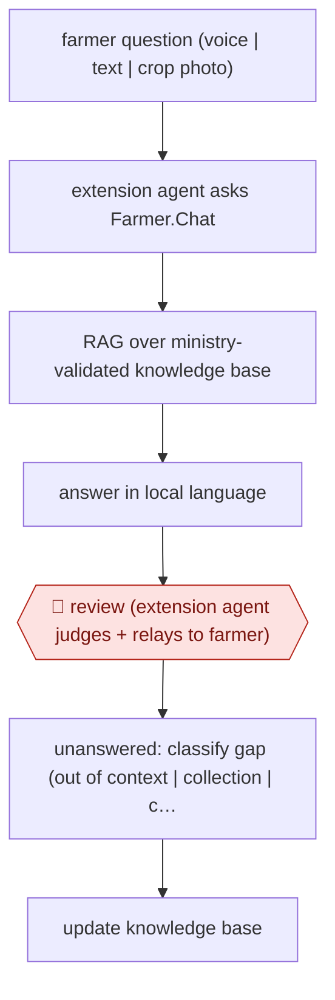

# Extension-agent mediated advice

`ORG › AGR › ADVISORY` · assist · evidence A · **draft: needs a reference example** ([how to add one](../../../../../CONTRIBUTING.md#1-add-an-example-run))

**Shape:** `farmer question (voice | text | crop photo) → extension agent asks Farmer.Chat → RAG over ministry-validated knowledge base → answer in local language → 🛑 review (extension agent judges + relays to farmer) → unanswered: classify gap (out of context | collection | content) → update knowledge base`
**How it differs:** Closest AWF-0154 Plot-registered agronomy advice: that runs a season-long, plot-specific nutrient plan with farmer plot verification and technician handoff. This is on-demand Q&A for any crop or topic, with no plot model, where the human checkpoint is an extension agent reviewing every answer before it reaches the farmer (assist, not checkpointed).
**Variants:** `farmer-chat`

<!-- shape diagram: generated by scripts/build_diagrams.py from `shape`; don't edit -->

<!-- end shape diagram -->

## Background

A smallholder with a pest on the crop has a question, and the public extension service has far too few people to answer it: a handful of agents for thousands of farms, spread over country that takes a day to cross. An assistant that answers in the farmer's language and can see a photo of the leaf closes part of that gap, but not all of it, because a wrong spray recommendation destroys a season and there is no one to hold responsible. The answer in practice is a middleman: the assistant is given to the extension agents and lead farmers rather than to the farmers directly, and they judge each answer against what they know of the field before passing it on. The knowledge behind it is curated on purpose — training transcripts, annotated call-centre logs and research factsheets, every document validated by the agriculture ministry — so the assistant is retrieving from approved material rather than from the open web. Questions it cannot answer are classified, and the classes drive what gets added: that is how the corpus grows without anyone guessing what is missing.

**Terms:**
- **extension agent**: the public or NGO adviser who visits farms and answers farmers' questions.
- **lead farmer**: a respected farmer who passes advice to neighbours.
- **RAG** (retrieval-augmented generation): answering by retrieving the relevant approved documents first, rather than from the model's memory.
- **validated knowledge base**: the corpus whose every document has been approved by the responsible authority.
- **knowledge gap**: a question the corpus cannot answer, classified as out of context, out of collection or out of content.
- **crop photo diagnosis**: identifying a pest or disease from a photograph.
- **relay**: the agent passing the answer on, in their own words, to the farmer.

## Build it with an agent

**Form:** `skill`. One extension agent asks one question at a time with the farmer in front of them or on the phone, and decides whether the answer is good enough to pass on; the work is the conversation, not a pipeline.

**You need:** the validated corpus, with each document's approval recorded and its source date, because a superseded recommendation is worse than none; multilingual retrieval and answer generation, with the language of the answer set per conversation; a photo path for crop diagnosis, with a confidence signal; weather and pest-advisory feeds where they exist; and a gap log that the content team can act on. The assistant must not answer from outside the corpus without saying so, and must not be reachable by farmers directly in this configuration.

| Step | Built as |
|---|---|
| farmer question (voice | text | crop photo) | The agent types, speaks or uploads the photo; the Skill transcribes voice first, since a misheard question produces a confidently wrong answer. |
| extension agent asks → RAG over validated knowledge base | Retrieval restricted to the approved corpus with a source and date per passage; a question whose best match is weak returns "not covered" rather than the nearest paragraph. |
| answer in local language | The answer is composed in the farmer's language from the retrieved passages, with the passages shown to the agent so the relay can be checked before it happens. |
| 🛑 review (extension agent judges + relays) | The agent reads the answer and its sources, and either passes it on in their own words or asks again; the Skill has no channel to the farmer, which is what makes the review real rather than advisory. |
| unanswered: classify gap | A separate pass labels each unanswered question as out of context (the assistant was asked something outside its job), out of collection (the document exists but is not in the corpus) or out of content (nobody has written it) — three different fixes. |
| update knowledge base | The content team works the out-of-collection and out-of-content lists, and each new document enters with its approval recorded. |

**Checkpoints:** `review`: the extension agent is the checkpoint and the delivery route at once — the assistant cannot reach the farmer, so an answer nobody passes on does not arrive. That also makes the failure mode visible: the sources report two thirds of unanswered questions were content gaps, so the review is not only a filter, it is the sensor that tells the content team what to write next.

**Since the sources:** Sources date from 2024-09 and an undated vendor story, both unchanged since the entry was collected and not re-opened this pass. What has changed since: the same arrangement has become the standard shape of publicly backed advisory in India, and the evidence about its limit has hardened. A 2026 column on the field reports voice services reaching very large numbers — one state platform took questions by phone in local dialect from more than 100,000 farmers in a year — while [a quarter to a third of queries still go unanswered, and the measured gain comes from content: a fine-tuned small model raised recall of expert-verified facts from 26.2% to 50.3% at about 15% of a frontier model's cost](https://agronewstoday.com/article/ai-smallholder-farmers-small-language-models). That is the argument for this entry's design: retrieval from a validated corpus, and a person between the answer and the field.

*A design based on this entry's steps and the tool documentation as of 2026-11, not a reported run.*

## Steps

*As reported by the sources.*

1. A curated knowledge base is built from training-video transcripts, annotated call-centre logs and crop research factsheets; India's Ministry of Agriculture validates all documents in it [[2]](#sources).
2. An extension agent (or lead farmer) asks the question by text, voice or crop photo; the assistant retrieves from the knowledge base (RAG) and answers in the local language, with weather and disease diagnosis services [[1]](#sources)[[2]](#sources).
3. 🛑 **Review**: in the initial rollout the chatbot was deployed as an assistant to extension agents, not directly to farmers, so the agent reviews the advice before passing it on [[2]](#sources).
4. Unanswered queries are classified with an LLM into out-of-context, out-of-collection and out-of-content; content gaps drive knowledge-base additions [[1]](#sources).

**Output:** An advisory answer the extension agent relays to the farmer; a log of unanswered queries that feeds knowledge-base updates.
**Failure modes → guards:** Chatbot advises farmers in error → curated KB and extension agent as the review stage [2]. Knowledge gaps: 66% of unanswered queries were content gaps → gap classification and KB updates [1].

## Public runs

Coverage as of 2026-11-13: **Strong**: a first-hand, detailed run that matches most of the shape. Collected and re-checked in [Third collection pass](../../../../../research/2026-11-third-pass.md).

- [Digital Green, Farmer.Chat (arXiv 2409.08916)](https://arxiv.org/abs/2409.08916) (2024-10-08). Kenya, India, Ethiopia, Nigeria deployment; extension agents, lead farmers and farmers as users. "Deployed in four countries, Farmer.Chat has engaged over 15,000 farmers and answered over 300,000 queries.". *First-hand: yes; confidence: high.*
- [OpenAI, Digital Green](https://openai.com/index/digital-green/) (n.d.). CEO explains extension-agent-first rollout as a human review stage. "As of January 1, 2024, over 4,500 extension agents are using Farmer.Chat across both Kenya and India.". *First-hand: vendor; confidence: med.*

## Sources

1. Namita Singh et al. (Digital Green), Farmer.Chat: Scaling AI-Powered Agricultural Services for Smallholder Farmers, arXiv 2409.08916, 2024-09-13 (v2 2024-10-08). https://arxiv.org/abs/2409.08916
2. OpenAI, Digital Green customer story (Farmer.Chat). https://openai.com/index/digital-green/
