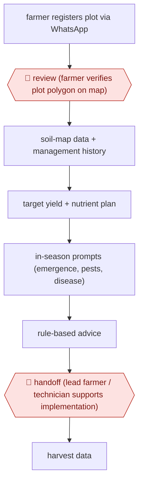

# Plot-registered agronomy advice

`ORG › AGR › ADVISORY` · checkpointed · evidence A · **draft: needs a reference example** ([how to add one](../../../../../CONTRIBUTING.md#1-add-an-example-run))

**Shape:** `farmer registers plot via WhatsApp → 🛑 review (farmer verifies plot polygon on map) → soil-map data + management history → target yield + nutrient plan → in-season prompts (emergence, pests, disease) → rule-based advice → 🛑 handoff (lead farmer / technician supports implementation) → harvest data`
**How it differs:** None close. The nearest is AWF-0042 Tutor-approved AI turns, but there a person approves every turn.
**Variants:** `chatgpt-whatsapp`

<!-- shape diagram: generated by scripts/build_diagrams.py from `shape`; don't edit -->

<!-- end shape diagram -->

## Background

A nutrient plan for one field is a calculation with a location in it: how much fertiliser this plot needs depends on what the soil there already holds, what the farmer spread last season, and what yield he is aiming at. Soil maps published at coarse resolution give the first input; the farmer's own answers give the rest. The advice then has to arrive at the right moments — at emergence, at the first signs of a pest, before the top dressing — and it has to be actionable, which is why the last step is a person: the trials behind this entry found the yield gain much larger where a technician or lead farmer supported the farmer in carrying the plan out, and no messaging channel closes that gap on its own. The registration step matters more than it looks: the whole plan hangs on which polygon is the farmer's field, so the farmer is shown the outline on a map and asked to confirm it before anything is computed, and the delivery runs over the messaging app the farmer already uses.

**Terms:**
- **plot registration**: recording a field's boundary so advice can be tied to it.
- **polygon**: the outline drawn on a map around the field, which the farmer confirms.
- **soil property map**: a published map of predicted soil characteristics, at a resolution far coarser than a field.
- **nutrient plan**: how much of which fertiliser, when, for this field and target yield.
- **top dressing**: fertiliser applied during the season rather than at planting.
- **basal fertiliser**: the application at planting, which the trials used as a compliance measure.
- **handoff**: passing the farmer to a technician or lead farmer for help carrying the plan out.

## Build it with an agent

**Form:** `service`. A season of prompts goes to many farmers over months, on the messaging channel, with nobody at the keyboard; people appear at registration, at the in-season exception, and at the handoff where implementation needs help.

**You need:** the soil property map and a way to clip it to a plot; a registration flow that produces a boundary the farmer has confirmed; the plot's management history; the rule set that turns soil, history and target yield into a nutrient plan, with the rates the agronomists have approved; a messaging channel the farmer uses, with the language and literacy assumptions made explicit; a schedule of in-season prompts tied to crop stage; the technician or lead-farmer network for the handoff; and harvest data for the season-end comparison. The plan arithmetic must be rule-based code, not a model's estimate, because a fertiliser rate is a number a farmer will spend money on.

| Step | Built as |
|---|---|
| farmer registers plot via WhatsApp | A registration flow in the messaging app records the location and draws the boundary; the Skill asks the questions the rules need and nothing more, since every extra question costs a registration. |
| 🛑 review (farmer verifies plot polygon on map) | The farmer is shown the outline and confirms or corrects it before any computation; a wrong polygon produces a confident plan for someone else's field, so this is the gate the rest depends on. |
| soil-map data + management history | The plot is clipped against the soil map; the history is what the farmer reported last season; both are stored against the plot id. |
| target yield + nutrient plan | Rule code computes the plan from the three inputs, and the Skill explains it in the farmer's language with the quantity, the timing and the cost, because a plan he cannot price is a plan he will not follow. |
| in-season prompts | A schedule keyed to crop stage asks for observations — emergence, pests, leaf colour — and the answers route to either the rules or to a person; a photo is accepted where the channel carries one. |
| rule-based advice | Advice comes from the rule set, not from free generation, so the same observation yields the same recommendation every time it is asked. |
| 🛑 handoff (lead farmer / technician supports implementation) | Where a farmer reports a problem the rules cannot resolve, or the plan is not being followed, the case goes to a technician or lead farmer with the plot, the plan and the observations attached. |
| harvest data | Yield is recorded at the end, which is what lets the next season's target and the programme's claims be checked. |

**Checkpoints:** `review`: the polygon confirmation, because every later number is computed for whatever boundary was confirmed. `handoff`: the technician step is where the measured result actually appears — the trial found a much larger gain in the technician-supported group — so the build treats the handoff as part of the workflow rather than an optional extra, and routes to it on a stated trigger (an unresolved observation, a missed stage, a plan not followed).

**Since the sources:** Sources date from 2025 and 2026-09: the platform's own paper and an observational preprint on yields. The preprint was not re-opened on this pass, and its authors may be linked to the provider, which the entry already flags. What has changed since: the surrounding evidence has become more cautious in the same direction. A 2026 review of advisory evidence in South Asia reports that [technical performance is better evidenced than farmer outcomes](https://www.agriculturejournal.org/abstract?var=27413), and that trust is conditional: in a 2026 producer survey only about a quarter of respondents said they trusted AI agricultural recommendations without cross-checking them. That supports the two things this build insists on — a person at implementation, and a season-end yield record — rather than adding anything new.

*A design based on this entry's steps and the tool documentation as of 2026-11, not a reported run.*

## Steps

*As reported by the sources.*

1. The farmer georeferences the plot and verifies the polygon on a map (🛑 **Review**) [[1]](#sources).
2. Generate a target yield and nutrient plan from the iSDA soil property map and the farmer's answers [[1]](#sources).
3. Prompt for observations through the season and return tailored advice from rule models [[1]](#sources).
4. 🛑 **Handoff**: lead farmers or technicians support implementation; the technician-supported group got the larger yield gain [[2]](#sources).

**Output:** Per-field nutrient plan and in-season advice.
**Failure modes → guards:** Farmers don't follow the plan → yields track basal-fertiliser compliance; technician support helps.

## Public runs

Coverage as of 2026-11-06: **Weak**: only anonymous, vendor-linked or journalist-told accounts. Collected and re-checked in [Second collection pass](../../../../../research/2026-11-second-pass.md).

- [agriRxiv 2026.00493](https://www.cabidigitallibrary.org/doi/10.31220/agriRxiv.2026.00493) (2026-09-18). 605 farmers surveyed at harvest; crop-cut yields compared. "2.21-fold higher among Technician-supported VA farmers". *First-hand: study (observational preprint; authors may be linked to the platform provider); confidence: med.*

## Sources

1. iSDA / IFA, Virtual Agronomist - an AI-assisted chatbot for guiding crop management decisions (agriRxiv 2025.00332). https://www.cabidigitallibrary.org/doi/pdf/10.31220/agriRxiv.2025.00332?download=true
2. Yield and economic impacts of an AI-enabled Virtual Agronomist advisory system... (agriRxiv 2026.00493), 2026-09-18. https://www.cabidigitallibrary.org/doi/10.31220/agriRxiv.2026.00493
