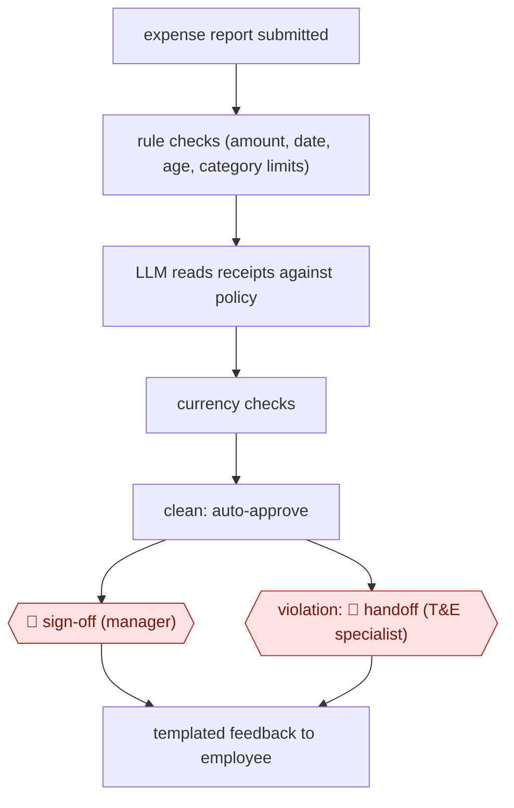

# Policy-checked expense audit

`ORG › BIZ › ADMIN` · sampled · evidence B · **draft: needs a reference example** ([how to add one](../../../../../CONTRIBUTING.md#1-add-an-example-run))

**Shape:** `expense report submitted → rule checks (amount, date, age, category limits) → LLM reads receipts against policy → currency checks → clean: auto-approve → 🛑 sign-off (manager) | violation: 🛑 handoff (T&E specialist) → templated feedback to employee`
**How it differs:** AWF-0022 Invoice extract-match-route matches supplier invoices to POs for payment. This workflow checks employee expenses against internal T&E policy and sends coaching feedback to the employee. Different deliverable and checkpoint owner.
**Variants:** `make-gemini-workday-monday` · `appzen`

<!-- shape diagram: generated by scripts/build_diagrams.py from `shape`; don't edit -->

<!-- end shape diagram -->

## Steps
1. The employee submits a report in Workday. A webhook creates an item on the T&E team's review board (monday.com) [[1]](#sources).
2. Run rule checks: item amount, date, expense age, and category limits such as meals and events [[1]](#sources).
3. For items needing more scrutiny, send the policies, receipts and employee data to an LLM (Gemini on Vertex AI). It extracts receipt details and judges them against policy [[1]](#sources).
4. Run extra deterministic checks, such as currencies matching [[1]](#sources).
5. Route it. Clean reports are auto-approved and sent on to the manager in Workday (🛑 **Sign-off**: manager). Violations go to 'review needed' (🛑 **Handoff**: a T&E specialist decides) [[1]](#sources).
6. For reports needing revision, the specialist picks a prewritten explanation of the violation and sends it to the employee by email or in Workday [[1]](#sources).
7. The T&E team edits policy lists and thresholds on the board. These sync on demand and every Sunday [[1]](#sources).
8. Before going live, run it in parallel with the old process for 60–70 days. Widen autonomy only after 30–40 days live [[1]](#sources).

**Output:** Approved or returned expense reports in Workday, plus a review queue and audit trail of exceptions.
**Failure modes → guards:** Wrong policy version → a policy store the team owns, synced weekly. Over-trusting the model → parallel run and gradual autonomy. Obvious violations still need a human (auto-reject is only being considered). Accuracy ('near 100%') is vendor-reported.

## Public runs

Coverage as of 2026-11-06: **Weak**: only anonymous, vendor-linked or journalist-told accounts. Collected and re-checked in [New workflows for empty categories](../../../../../research/2026-11-new-workflows.md).

- [Make, Celonis expense auditing story](https://www.make.com/success-stories/make-ai-agents-help-celonis-lower-expense-auditing-costs) (2025-11-25). Celonis T&E team's agent audits thousands of expense lines a month; violations routed to specialists. "We can now process about a thousand documents per dollar.". *First-hand: vendor; confidence: med.*

## Sources

1. Make, Make AI Agents help Celonis lower expense auditing costs (customer story, named Celonis staff quoted), 2025-11-25. https://www.make.com/success-stories/make-ai-agents-help-celonis-lower-expense-auditing-costs
