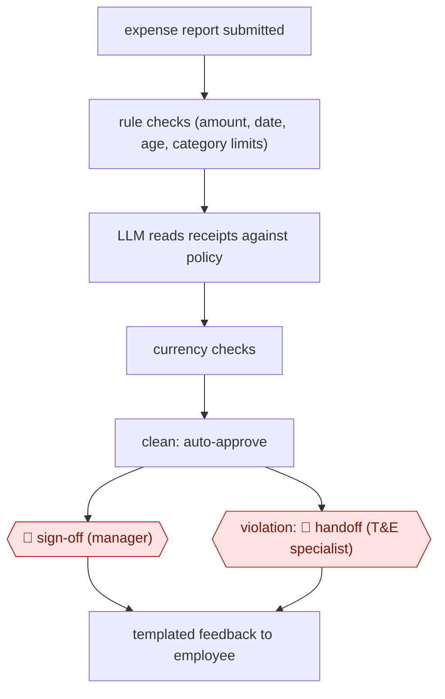

# Policy-checked expense audit

`ORG › BIZ › ADMIN` · sampled · evidence B · **draft: needs a reference example** ([how to add one](../../../../../CONTRIBUTING.md#1-add-an-example-run))

**Shape:** `expense report submitted → rule checks (amount, date, age, category limits) → LLM reads receipts against policy → currency checks → clean: auto-approve → 🛑 sign-off (manager) | violation: 🛑 handoff (T&E specialist) → templated feedback to employee`
**Variants:** `make-gemini-workday-monday` · `appzen`

<!-- shape diagram: generated by scripts/build_diagrams.py from `shape`; don't edit -->

<!-- end shape diagram -->

## Background

Employees who spend company money on travel, meals or events claim it back by submitting an expense report with their receipts. Before the money is repaid, a small travel-and-expense team checks every line against the company's written policy, and the employee's manager approves the report. A company with thousands of lines a month has far more lines than a few specialists can read with care: receipts come in many formats and currencies, and the policy changes often. The agent runs the fixed checks, reads each receipt against the policy and lets clean reports through to the manager. A person still decides every report that breaks the rules, and the manager still approves payment, because this is the employee's money, a wrong rejection is unfair to them, and a suspected misuse of funds is a judgement about a colleague that the company must be able to defend.

**Terms:**
- **T&E (travel and expense)**: the company's spending on employee travel, meals and events, and the team and policy that govern it.
- **Expense report**: an employee's claim for repayment, made of lines, each with a receipt.
- **Expense age**: how long after the spending the line was claimed; policies often reject claims older than a set limit.
- **Category limits**: maximum amounts per type of spending, such as a meal or an event.
- **Webhook**: a message one system sends to another the moment something happens, here when a report is submitted.
- **Review board**: a shared task list where each report is an item with a status the team can see and change.
- **LLM (large language model)**: the AI model that reads the receipts and the policy text.
- **Deterministic check**: a fixed rule written as code, which gives the same answer every time.
- **Auto-approve**: here, passing a clean report on to the manager without a specialist looking at it; it is not the payment decision.
- **PO (purchase order)**: a company's formal order to a supplier, which an invoice is matched against before payment.
- **Parallel run**: running the new process beside the old one for a period and comparing the results before relying on it.

## Build it with an agent

**Form:** `service`. Each report starts a run with nobody at the keyboard, and people see only violations and the manager's approval request.

**You need:** read access to submitted expense reports and their receipts in the expense system, and permission to set one status (passed audit, or review needed), through an MCP connector or a small script; the T&E policy, limits and thresholds as reference files the T&E team edits; a review queue for violations, such as the team's board or a ticket queue; a library of approved feedback templates. Employee records and receipts are personal data: keep them inside the systems your organisation has approved for them. Give the agent no tool that approves payment, rejects a report or writes to employees.

| Step | Built as |
|---|---|
| expense report submitted | The expense system's webhook starts an Agent SDK program or `claude -p`; a cloud scheduled task can instead collect new reports every few hours. |
| rule checks (amount, date, age, category limits) | A script beside the skill applies the limits from the policy file and returns each line's result. |
| LLM reads receipts against policy | The skill: the agent reads each flagged receipt against the policy file and records the rule it relies on. Long reports can be split across subagents. |
| currency checks | A second script compares the receipt currency and amount with the claimed line. |
| clean: auto-approve → 🛑 sign-off (manager) | The agent sets the report to passed audit through the connector; the expense system routes it to the manager. |
| violation: 🛑 handoff (T&E specialist) | The agent sets review needed and adds a queue item with each failed rule, the receipt and a proposed feedback template. |
| templated feedback to employee | The specialist chooses or edits the template and sends it from the expense system. |

**Checkpoints:** `sign-off`: the manager approves in the expense system; the connector exposes no approval or payment action, and a `PreToolUse` hook rejects any call that would set a status other than the two allowed. `handoff`: every report with a violation goes to the specialist's queue with the evidence gathered; the agent has no tool to reject a report or send mail, so the employee hears only from the specialist. Policy files are read-only to the agent, so only the T&E team changes the rules.

**Since the sources:** The one source, which is also the one public run, dates from 2025-11. It is a vendor's customer story: the customer built the process as a set of scenarios on a no-code automation platform, with one model call to read receipts, and checks running every few hours. This build runs the same steps with a general agent and keeps the order of fixed checks first, model judgement second. It leaves out the source's custom send-back pages and the automatic rejection of obvious violations that the team was only considering. The source's parallel run and gradual widening of autonomy are advice for going live, not part of the build. `appzen`, listed in `variants`, is a commercial expense-audit product that the source does not describe. The accuracy it reports is the vendor's own figure.

*A design based on this entry's steps and the tool documentation as of 2026-11, not a reported run.*

## Steps

*As reported by the sources.*

1. The employee submits a report in the HR and finance system (Workday). A webhook creates an item on the T&E team's review board (monday.com) [[1]](#sources).
2. The automation runs rule checks: item amount, date, expense age, and category limits such as meals and events [[1]](#sources).
3. For items needing more scrutiny, the automation sends the policies, receipts and employee data to an LLM (Gemini on Vertex AI). The LLM extracts receipt details and judges them against policy [[1]](#sources).
4. The automation runs extra deterministic checks, such as currencies matching [[1]](#sources).
5. The automation routes the report. Clean reports are auto-approved and sent on to the manager in Workday (🛑 **Sign-off**: manager). Violations go to 'review needed' (🛑 **Handoff**: a T&E specialist decides) [[1]](#sources).
6. For reports needing revision, the T&E specialist picks a prewritten explanation of the violation and sends it to the employee by email or in Workday [[1]](#sources).
7. The T&E team edits policy lists and thresholds on the board. These sync on demand and every Sunday [[1]](#sources).
8. Before going live, the team runs it in parallel with the old process for 60–70 days. The team widens autonomy only after 30–40 days live [[1]](#sources).

**Output:** Approved or returned expense reports in Workday, plus a review queue and audit trail of exceptions.
**Failure modes → guards:** Wrong policy version → a policy store the team owns, synced weekly. Over-trusting the model → parallel run and gradual autonomy. Obvious violations still need a human (auto-reject is only being considered). Accuracy ('near 100%') is vendor-reported.
**How it differs:** AWF-0022 Invoice extract-match-route matches supplier invoices to POs for payment. This workflow checks employee expenses against internal T&E policy and sends coaching feedback to the employee. Different deliverable and checkpoint owner.

## Public runs

Coverage as of 2026-11-06: **Weak**: only anonymous, vendor-linked or journalist-told accounts. Collected and re-checked in [New workflows for empty categories](../../../../../research/2026-11-new-workflows.md).

- [Make, Celonis expense auditing story](https://www.make.com/success-stories/make-ai-agents-help-celonis-lower-expense-auditing-costs) (2025-11-25). Celonis T&E team's agent audits thousands of expense lines a month; violations routed to specialists. "We can now process about a thousand documents per dollar.". *First-hand: vendor; confidence: med.*

## Sources

1. Make, Make AI Agents help Celonis lower expense auditing costs (customer story, named Celonis staff quoted), 2025-11-25. https://www.make.com/success-stories/make-ai-agents-help-celonis-lower-expense-auditing-costs
