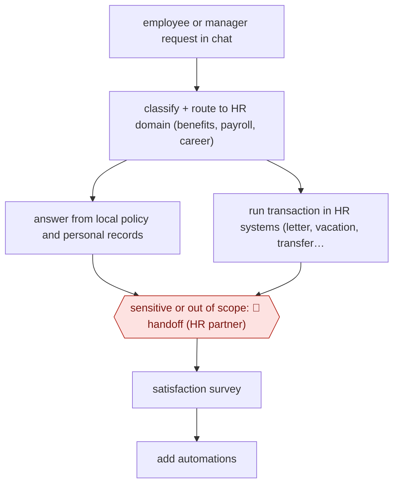

# Contained HR service desk

`ORG › BIZ › HR` · sampled · evidence A · **draft: needs a reference example** ([how to add one](../../../../../CONTRIBUTING.md#1-add-an-example-run))

**Shape:** `employee or manager request in chat → classify + route to HR domain (benefits, payroll, career) → answer from local policy and personal records | run transaction in HR systems (letter, vacation, transfer, promotion step) → sensitive or out of scope: 🛑 handoff (HR partner) → satisfaction survey → add automations`
**How it differs:** AWF-0144 Manager-approved pipeline actions and AWF-0029 Source-screen-schedule hiring are recruiting workflows with per-batch or per-decision approval. This is the employee-services side of HR: the agent completes most requests end to end, and humans take only the 6% handoffs. The deliverable and the autonomy are different.
**Variants:** `watsonx-orchestrate`

<!-- shape diagram: generated by scripts/build_diagrams.py from `shape`; don't edit -->

<!-- end shape diagram -->

## Steps
1. Employees and managers go to one chat front door (AskHR) for HR; IBM closed the HR phone line and email so this is the entry point [[1]](#sources)[[3]](#sources).
2. An LLM classifies the prompt and routes it to the relevant HR domain (Benefits, Payroll, Career and Skills) [[2]](#sources).
3. For questions, it answers personalised to local payroll and HR policy; for tasks, it runs the transaction directly in back-end systems (Workday, SAP SuccessFactors, Concur): employment verification letters, vacation requests, manager-initiated employee transfers, steps in quarterly promotions, compensation and org changes [[2]](#sources)[[3]](#sources). In 2025 it orchestrates multiple agents for multi-step HR transactions [[3]](#sources).
4. 🛑 **Handoff**: requests it cannot contain, and sensitive matters such as low performance or misconduct, go to a human HR partner [[1]](#sources)[[4]](#sources).
5. Satisfaction (CSAT/NPS) is tracked and new automations are added; there are almost 90 [[1]](#sources)[[3]](#sources).

**Output:** Answered HR questions and completed HR transactions in the system of record; the remaining cases go to HR partners.
**Failure modes → guards:** Forced adoption sank satisfaction at first (NPS -35) → iterated on answers and added transactions until NPS rose [1]. Sensitive cases handled by bot → routed to humans by policy [4]. Wrong transaction → executed only at the requesting manager's instruction inside AskHR (exact confirmation step not described publicly).

## Public runs

Coverage as of 2026-11-13: **Strong**: a first-hand, detailed run that matches most of the shape. Collected and re-checked in [Third collection pass](../../../../../research/2026-11-third-pass.md).

- [IBM CHRO, Embracing the future of HR](https://www.ibm.com/think/insights/embracing-future-of-hr-ai-first-enterprise) (2025-04-29). IBM's own HR desk: containment, handoff share, transaction speed-up. "In 2024, AskHR handled more than 11.5 million interactions; 94% of those interactions were contained within the platform". *First-hand: yes; confidence: high.*
- [IBM, HR | IBM Transformation](https://www.ibm.com/case-studies/ibm-transformation/ask-hr) (2026-07-16). 2025 multi-agent orchestration for HR transactions; volume. "That same year, AskHR handled more than 16 million individual user messages.". *First-hand: yes; confidence: high.*

## Sources

1. Nickle LaMoreaux (IBM CHRO), IBM Think, Embracing the future of HR by becoming an AI-first enterprise, 2025-04-29. https://www.ibm.com/think/insights/embracing-future-of-hr-ai-first-enterprise
2. IBM, IBM AskHR case study, 2025-08-21. https://www.ibm.com/case-studies/ibm-askhr
3. IBM, HR | IBM Transformation, 2026-07-16. https://www.ibm.com/case-studies/ibm-transformation/ask-hr
4. Emma Burleigh, Fortune, IBM CHRO says first AskHR AI rollout made workers dissatisfied with HR, 2024-07-12. https://fortune.com/2024/07/12/ibm-chro-ai-chatbot-rollout-strategy-lessons/
