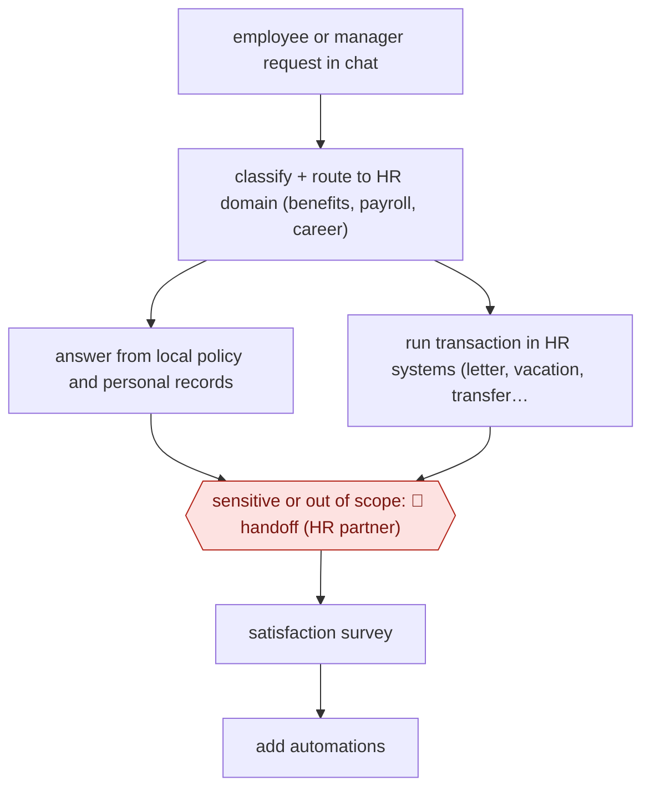

# Contained HR service desk

`ORG › BIZ › HR` · sampled · evidence A · **draft: needs a reference example** ([how to add one](../../../../../CONTRIBUTING.md#1-add-an-example-run))

**Shape:** `employee or manager request in chat → classify + route to HR domain (benefits, payroll, career) → answer from local policy and personal records | run transaction in HR systems (letter, vacation, transfer, promotion step) → sensitive or out of scope: 🛑 handoff (HR partner) → satisfaction survey → add automations`
**Variants:** `watsonx-orchestrate`

<!-- shape diagram: generated by scripts/build_diagrams.py from `shape`; don't edit -->

<!-- end shape diagram -->

## Background

In a large company, the HR (human resources) department answers employees' questions about pay, benefits, leave and careers, and carries out routine changes for them and their managers: a letter confirming someone's employment, a holiday request, moving a person to a new manager, a step in a promotion round. Each starts when an employee or manager asks. By hand this means phone lines, email inboxes and HR staff looking up the same policies and typing the same changes into several systems, with answers that differ by country. Here an agent is the single front door: it answers from the local policy and the person's own records and completes routine changes in the HR systems itself. People in HR still take what the agent cannot finish and every sensitive matter, such as poor performance or misconduct, because those decisions affect someone's job and pay, carry legal duties to the employee, and need a person who can weigh the circumstances.

**Terms:**
- **HR partner**: an HR professional who advises managers and employees on cases that need judgement.
- **System of record**: the system whose data counts as the official version, here the HR, payroll and expense systems.
- **Transaction**: a change the agent makes in a system of record, such as a vacation request or a transfer.
- **Containment**: the share of requests completed inside the assistant, without passing to a person.
- **Employment verification letter**: a letter confirming that someone works for the company, often needed for a lease or a loan.
- **LLM (large language model)**: the AI model that reads the request and writes the answer.
- **Multi-agent orchestration**: one agent passing parts of a task to other agents and combining what they return.
- **CSAT / NPS**: satisfaction scores from user surveys; NPS (Net Promoter Score) measures how readily users would recommend the service and can be negative.

## Build it with an agent

**Form:** `service`. Each request arrives from the chat front door with nobody at the agent's keyboard, and HR partners see only the cases handed to them.

**You need:** a chat front door that passes each message and the signed-in person's identity to an Agent SDK program; MCP connectors to the HR, payroll and expense systems that act with the requesting person's own permissions, not an administrator's; the HR policies for each country as reference files, kept by HR; one skill per HR domain (benefits, payroll, career) listing the transactions it may run; a queue where HR partners pick up handed-off cases. Records of pay, health benefits, performance and conduct are personal and often sensitive data: keep them inside systems your organisation has approved, and do not let the agent show one person's records to another.

| Step | Built as |
|---|---|
| employee or manager request in chat | The front door starts the Agent SDK program with the message and the person's identity. |
| classify + route to HR domain (benefits, payroll, career) | The agent picks the matching domain skill; a subagent per domain can be used to keep each domain's instructions apart. |
| answer from local policy and personal records | The skill reads the policy file for the person's country and the person's own record through the connector. |
| run transaction in HR systems (letter, vacation, transfer, promotion step) | A connector tool for each approved transaction. `canUseTool` shows the requester what will be changed and asks them to confirm before it runs; any approval the HR system itself requires still applies. |
| sensitive or out of scope: 🛑 handoff (HR partner) | The agent stops, tells the person who will contact them, and posts the case and what it has gathered to the HR partners' queue. |
| satisfaction survey → add automations | The front door sends the survey; HR reviews the results and the handoff log to decide which transaction to add next. |

**Checkpoints:** `handoff`: the skill lists the sensitive topics (performance, misconduct, complaints, anything about another named employee) and tells the agent to stop on them. Because a missed stop here reaches an employee and can affect their job or pay, a `PreToolUse` hook also blocks every transaction tool when the case is flagged sensitive, and the connector offers only the approved transactions, so anything else can only be handed off. The agent has no tool that changes pay or employment status outside those transactions.

**Since the sources:** Sources date from 2024-07 to 2026-07. They describe IBM's own HR assistant, built on IBM's own agent platform (`watsonx-orchestrate`, still current in the 2026-07 source). They report results and the kinds of requests handled, but not how each transaction is confirmed or how sensitive cases are detected; the confirmation and the hook in this build are the catalog's design, not what IBM reports. The source's front door also replaced the HR phone line and email; that is an organisational decision, not part of the build. Source 4 (Fortune) refused the page when re-checked in 2026-11, so the misconduct example rests on the earlier reading of it.

*A design based on this entry's steps and the tool documentation as of 2026-11, not a reported run.*

## Steps

*As reported by the sources.*

1. Employees and managers go to one chat front door (AskHR) for HR; IBM closed the HR phone line and email so this is the entry point [[1]](#sources)[[3]](#sources).
2. The assistant's LLM classifies the prompt and routes it to the relevant HR domain (Benefits, Payroll, Career and Skills) [[2]](#sources).
3. For questions, the assistant answers personalised to local payroll and HR policy; for tasks, it runs the transaction directly in the systems of record (Workday, SAP SuccessFactors, Concur): employment verification letters, vacation requests, manager-initiated employee transfers, steps in quarterly promotions, compensation and org changes [[2]](#sources)[[3]](#sources). In 2025 the assistant orchestrates multiple agents for multi-step HR transactions [[3]](#sources).
4. 🛑 **Handoff**: the assistant passes requests it cannot contain, and sensitive matters such as low performance or misconduct, to a human HR partner [[1]](#sources)[[4]](#sources).
5. The HR team tracks satisfaction (CSAT/NPS) and adds new automations; there are almost 90 [[1]](#sources)[[3]](#sources).

**Output:** Answered HR questions and completed HR transactions in the system of record; the remaining cases go to HR partners.
**Failure modes → guards:** Forced adoption sank satisfaction at first (NPS -35) → iterated on answers and added transactions until NPS rose [1]. Sensitive cases handled by bot → routed to humans by policy [4]. Wrong transaction → executed only at the requesting manager's instruction inside AskHR (exact confirmation step not described publicly).
**How it differs:** AWF-0144 Manager-approved pipeline actions and AWF-0029 Source-screen-schedule hiring are recruiting workflows with per-batch or per-decision approval. This is the employee-services side of HR: the agent completes most requests end to end, and humans take only the 6% handoffs. The deliverable and the autonomy are different.

## Public runs

Coverage as of 2026-11-13: **Strong**: a first-hand, detailed run that matches most of the shape. Collected and re-checked in [Third collection pass](../../../../../research/2026-11-third-pass.md).

- [IBM CHRO, Embracing the future of HR](https://www.ibm.com/think/insights/embracing-future-of-hr-ai-first-enterprise) (2025-04-29). IBM's own HR desk: containment, handoff share, transaction speed-up. "In 2024, AskHR handled more than 11.5 million interactions; 94% of those interactions were contained within the platform". *First-hand: yes; confidence: high.*
- [IBM, HR | IBM Transformation](https://www.ibm.com/case-studies/ibm-transformation/ask-hr) (2026-07-16). 2025 multi-agent orchestration for HR transactions; volume. "That same year, AskHR handled more than 16 million individual user messages.". *First-hand: yes; confidence: high.*

## Sources

1. Nickle LaMoreaux (IBM CHRO), IBM Think, Embracing the future of HR by becoming an AI-first enterprise, 2025-04-29. https://www.ibm.com/think/insights/embracing-future-of-hr-ai-first-enterprise
2. IBM, IBM AskHR case study, 2025-08-21. https://www.ibm.com/case-studies/ibm-askhr
3. IBM, HR | IBM Transformation, 2026-07-16. https://www.ibm.com/case-studies/ibm-transformation/ask-hr
4. Emma Burleigh, Fortune, IBM CHRO says first AskHR AI rollout made workers dissatisfied with HR, 2024-07-12. https://fortune.com/2024/07/12/ibm-chro-ai-chatbot-rollout-strategy-lessons/
