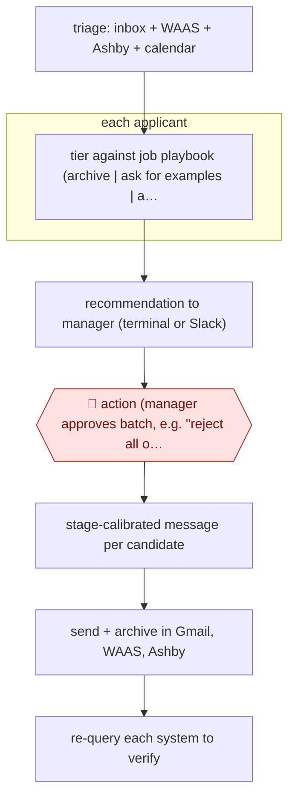

# Manager-approved pipeline actions

`ORG › BIZ › HR` · checkpointed · evidence A · **draft: needs a reference example** ([how to add one](../../../../../CONTRIBUTING.md#1-add-an-example-run))

**Shape:** `triage: inbox + WAAS + Ashby + calendar → each applicant: tier against job playbook (archive | ask for examples | advance) → recommendation to manager (terminal or Slack) → 🛑 action (manager approves batch, e.g. "reject all of these") → stage-calibrated message per candidate → send + archive in Gmail, WAAS, Ashby → re-query each system to verify`
**Variants:** `claude-code` · `waas-mcp` · `ashby-mcp` · `gmail` · `slack`

<!-- shape diagram: generated by scripts/build_diagrams.py from `shape`; don't edit -->

<!-- end shape diagram -->

## Background

A hiring manager at a small company receives applications in several places at once: an email inbox, a job board and an applicant tracking system. Each applicant has to be read against the job's requirements and then rejected, asked for more, or moved forward, and every system has to end up saying the same thing. That is hours of repetitive reading and writing, and it is easy to reject someone in one place while they still show as active in another. The agent reads each applicant against the manager's written criteria, recommends an action and drafts the message. The manager still approves each batch before anything is sent or archived, because a rejection reaches a real person and decisions about who gets a job carry legal duties that belong to the employer, not to a tool.

**Terms:**
- **ATS (applicant tracking system)**: software in which a company keeps its candidates and the stage each has reached in hiring. Ashby is the one in the source.
- **WAAS (Work at a Startup)**: a job board where startups post roles and receive applications, with its own messaging.
- **Playbook**: a file for one job holding the hard requirements, strong signals, auto-archive rules and email templates.
- **Tier**: to sort an applicant into a group; here archive, ask for examples, or advance.
- **Archive**: take a candidate out of the active pipeline, with a reason code.
- **Work authorization**: the legal right to work in the job's country.
- **NYC LL144, EU AI Act**: rules on automated tools used in hiring. New York City's Local Law 144 and the EU AI Act both cover them; the EU Act treats such systems as high risk.

## Build it with an agent

**Form:** `skill`. One hiring manager works through their own applicants in the conversation and approves there, so one skill with the playbooks beside it is enough.

**You need:** connectors (MCP) for the mailbox, the job board and the ATS, with read access to the calendar; one playbook file per open role, edited by the manager; a message template per stage in each playbook. Applicant profiles are personal data: use only systems your organisation has approved for them, and check what the hiring-law rules above require before using any ranking.

| Step | Built as |
|---|---|
| triage: inbox + WAAS + Ashby + calendar | The skill's first instruction: read each system through its connector and group the items (scheduling, pipeline decisions, new applications, noise). |
| each applicant: tier against job playbook | The agent opens the role's playbook file and tiers each applicant. For many applicants, subagents take a few each and return a table: applicant, tier, rule relied on. Unclear work authorization or location is flagged, never archived. |
| recommendation to manager (terminal or Slack) | The skill lists the recommendations in the conversation. A chat connector can post them to a channel instead. |
| 🛑 action | See Checkpoints. |
| stage-calibrated message per candidate | The playbook template for the candidate's stage plus one custom line per person, shown as a draft. |
| send + archive in Gmail, WAAS, Ashby | Connector write calls, made only after approval. |
| re-query each system to verify | The skill's last instruction: read each system again and report only the actions that took effect. |

**Checkpoints:** `action`: the skill presents the drafted messages and the archive plan and stops until the manager answers; the manager may approve the whole batch ("reject all of these") or single candidates. Sending and archiving reach people outside the company, so the connector tools that send a message or archive a candidate are set to ask in the permission rules, and the manager is told not to switch them to always allow. A skipped instruction then still shows up as a prompt.

**Since the sources:** Sources date from 2026-03. They could not be re-opened when this was written (the page reader got a 403 from the site), so this section rests on the entry's own text. The source is itself a set of Claude Code skills that follows this build: a playbook per role, an approval step before any write, and a re-query at the end. The timer-driven background mode that posts to Slack is left out; the build runs when the manager asks. The build does nothing about the hiring-law duties named under Terms (notices, audits, human review); the employer has to meet them.

*A design based on this entry's steps and the tool documentation as of 2026-11, not a reported run.*

## Steps

*As reported by the sources.*

1. Configure: the hiring manager copies the user, Ashby and per-role job playbook templates. The playbook holds hard requirements, strong signals, auto-archive rules and email templates [[1]](#sources).
2. Triage: the agent scans the inbox, Work at a Startup (WAAS) applicants, Ashby candidates, calendar, sent mail and drafts, then groups items (scheduling, pipeline decisions, new applications, noise) [[1]](#sources).
3. Review applicants: the agent pulls full profiles and tiers each one against the playbook. If work authorization or location is unclear it flags the candidate for review instead of auto-archiving [[2]](#sources).
4. Optional background mode: `/loop 10m /recruit-watch` makes the agent post a recommendation for each new item to Slack. The manager replies 👎, 'skip' or 'ask' in the thread [[3]](#sources).
5. 🛑 **Action**: the hiring manager approves each write action, singly or in bulk. The skill presents the drafted rejection and the archive plan and waits ('Present for approval — DO NOT CREATE YET'). Its rules include 'NEVER send or archive without explicit approval' [[2]](#sources).
6. Execute: the agent sends each personalized rejection (standard template plus a custom line per person) through Gmail or WAAS messaging, and archives the candidate in Gmail, WAAS and Ashby with a reason code [[1]](#sources)[[2]](#sources).
7. Verify: the agent re-queries Gmail, Ashby and WAAS and does not report success until each action has taken effect [[2]](#sources).

**Output:** Candidates are messaged and archived consistently across ATS, WAAS and Gmail, with feedback notes logged in the ATS. The manager's pipeline is cleared of decided items.
**Failure modes → guards:** Rejection on missing data (location or visa) → the playbook rule forces a flag instead of an auto-archive. A silent failed write in one system → mandatory re-query before reporting. Spammy outreach → the README explicitly disclaims bulk spam. Hiring-law exposure (NYC LL144, EU AI Act high-risk) applies because the agent tiers candidates.
**How it differs:** AWF-0029 Source-screen-schedule hiring. There the agent writes evidence summaries with 'no reject decision', and a person decides at the end. Here the agent tiers candidates, recommends archives and rejections, and on the manager's command sends the rejections and archives the candidates itself. The checkpoint is a per-batch action approval, and the deliverable is executed messages and ATS changes, not interview kits.

## Public runs

Coverage as of 2026-11-06: **Strong**: a first-hand, detailed run that matches most of the shape. Collected and re-checked in [Second collection pass](../../../../../research/2026-11-second-pass.md).

- [YC software team, Recruiting Co-Pilot 'See it work'](https://github.com/yc-software/recruiting) (2026-03-31). Real session: 8 applicants rated; manager says reject all; agent sends 8 personalized rejections and archives each. "Claude pulled full profiles for 8 applicants" … "Took about 2 minutes.". *First-hand: yes; confidence: high.*

## Sources

1. yc-software, Recruiting Co-Pilot README (repo created 2026-03-31). https://github.com/yc-software/recruiting
2. yc-software, reject and review-applicants SKILL.md. https://github.com/yc-software/recruiting (.claude/skills/reject, .claude/skills/review-applicants)
3. yc-software, recruit-watch SKILL.md. https://github.com/yc-software/recruiting (.claude/skills/recruit-watch)
