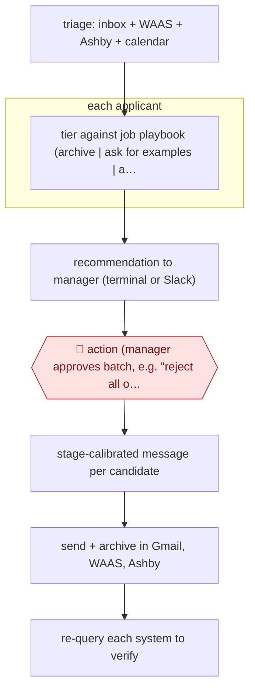

# Manager-approved pipeline actions

`ORG › BIZ › HR` · checkpointed · evidence A · **draft: needs a reference example** ([how to add one](../../../../../CONTRIBUTING.md#1-add-an-example-run))

**Shape:** `triage: inbox + WAAS + Ashby + calendar → each applicant: tier against job playbook (archive | ask for examples | advance) → recommendation to manager (terminal or Slack) → 🛑 action (manager approves batch, e.g. "reject all of these") → stage-calibrated message per candidate → send + archive in Gmail, WAAS, Ashby → re-query each system to verify`
**How it differs:** AWF-0029 Source-screen-schedule hiring. There the agent writes evidence summaries with 'no reject decision', and a person decides at the end. Here the agent tiers candidates, recommends archives and rejections, and on the manager's command sends the rejections and archives the candidates itself. The checkpoint is a per-batch action approval, and the deliverable is executed messages and ATS changes, not interview kits.
**Variants:** `claude-code` · `waas-mcp` · `ashby-mcp` · `gmail` · `slack`

<!-- shape diagram: generated by scripts/build_diagrams.py from `shape`; don't edit -->

<!-- end shape diagram -->

## Steps
1. Configure: copy the user, Ashby and per-role job playbook templates. The playbook holds hard requirements, strong signals, auto-archive rules and email templates [[1]](#sources).
2. Triage: the agent scans the inbox, Work at a Startup (WAAS) applicants, Ashby candidates, calendar, sent mail and drafts, then groups items (scheduling, pipeline decisions, new applications, noise) [[1]](#sources).
3. Review applicants: the agent pulls full profiles and tiers each one against the playbook. If work authorization or location is unclear it flags the candidate for review instead of auto-archiving [[2]](#sources).
4. Optional background mode: `/loop 10m /recruit-watch` posts a recommendation for each new item to Slack. The manager replies 👎, 'skip' or 'ask' in the thread [[3]](#sources).
5. 🛑 **Action**: the hiring manager approves each write action, singly or in bulk. The skill presents the drafted rejection and the archive plan and waits ('Present for approval — DO NOT CREATE YET'). Its rules include 'NEVER send or archive without explicit approval' [[2]](#sources).
6. Execute: the agent sends each personalized rejection (standard template plus a custom line per person) through Gmail or WAAS messaging, and archives the candidate in Gmail, WAAS and Ashby with a reason code [[1]](#sources)[[2]](#sources).
7. Verify: the agent re-queries Gmail, Ashby and WAAS and does not report success until each action has taken effect [[2]](#sources).

**Output:** Candidates are messaged and archived consistently across ATS, WAAS and Gmail, with feedback notes logged in the ATS. The manager's pipeline is cleared of decided items.
**Failure modes → guards:** Rejection on missing data (location or visa) → the playbook rule forces a flag instead of an auto-archive. A silent failed write in one system → mandatory re-query before reporting. Spammy outreach → the README explicitly disclaims bulk spam. Hiring-law exposure (NYC LL144, EU AI Act high-risk) applies because the agent tiers candidates.

## Public runs

Coverage as of 2026-11-06: **Strong**: a first-hand, detailed run that matches most of the shape. Collected and re-checked in [Second collection pass](../../../../../research/2026-11-second-pass.md).

- [YC software team, Recruiting Co-Pilot 'See it work'](https://github.com/yc-software/recruiting) (2026-03-31). Real session: 8 applicants rated; manager says reject all; agent sends 8 personalized rejections and archives each. "Claude pulled full profiles for 8 applicants" … "Took about 2 minutes.". *First-hand: yes; confidence: high.*

## Sources

1. yc-software, Recruiting Co-Pilot README (repo created 2026-03-31). https://github.com/yc-software/recruiting
2. yc-software, reject and review-applicants SKILL.md. https://github.com/yc-software/recruiting (.claude/skills/reject, .claude/skills/review-applicants)
3. yc-software, recruit-watch SKILL.md. https://github.com/yc-software/recruiting (.claude/skills/recruit-watch)
