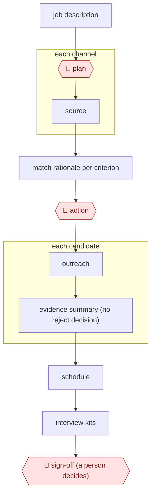

# Source-screen-schedule hiring

`ORG › BIZ › HR` · checkpointed · evidence B · **draft: needs a reference example** ([how to add one](../../../../../CONTRIBUTING.md#1-add-an-example-run))

**Shape:** `job description → 🛑 plan → each channel: source → match rationale per criterion → 🛑 action → outreach → each candidate: evidence summary (no reject decision) → schedule → interview kits → 🛑 sign-off (a person decides)`
**Variants:** `linkedin-hiring-assistant` (global English release by end of September 2025; sources candidates, screens via InMail Q&A, schedules [[29]](#sources)) · `paradox` · `juicebox`

<!-- shape diagram: generated by scripts/build_diagrams.py from `shape`; don't edit -->

<!-- end shape diagram -->

**Why "evidence, not verdict" matters (compliance):**
- **NYC LL144.** It requires an annual independent bias audit before an automated hiring tool is used, a public summary of the results, and candidate notice 10 business days in advance. The employer is responsible, not the vendor [[27]](#sources).
- **EU AI Act.** It classifies recruitment AI as high-risk. Its obligations were originally due August 2, 2026, and the Digital Omnibus provisionally moves them to December 2, 2027. Confirm which date is legally in force [[28]](#sources).

Keeping the agent at *evidence*, never *verdict*, reduces exposure to both.

## Public runs

Coverage as of 2026-11-06: **Partial**: first-hand runs that cover part of the shape or put checkpoints elsewhere. From [Where are the real runs?](../../../../../research/2026-11-real-runs.md); every number was re-checked against its page.

- [YC software team, yc-software/recruiting](https://github.com/yc-software/recruiting). Claude Code commands for triage, outreach, scheduling and candidate briefs; the manager approves each step, **including rejections**. "27 inbox emails, 38 active candidates"; 8 applicants rated, "about 2 minutes". *First-hand: yes; confidence: med.*
- [LinkedIn, Infinite Resource Solutions story](https://business.linkedin.com/hire/customer-stories/infinite-resource-solutions) (undated). Sourcing → export to the ATS → scoring against recruiter criteria. "2–3 hours per day"; "48 hours to less than a day". *First-hand: vendor; confidence: low.*

## Sources

27. NYC DCWP, *AEDT FAQ*. https://www.nyc.gov/assets/dca/downloads/pdf/about/DCWP-AEDT-FAQ.pdf
28. Cuatrecasas, *The Digital Omnibus on AI: impact on employment relations*. https://www.cuatrecasas.com/en/global/labor-and-employment/art/digital-omnibus-on-ai-how-does-it-impact-employment-relations
29. LinkedIn, *Hiring Assistant to launch globally in English* (2025). https://news.linkedin.com/2025/hiring-assistant-globally-available
