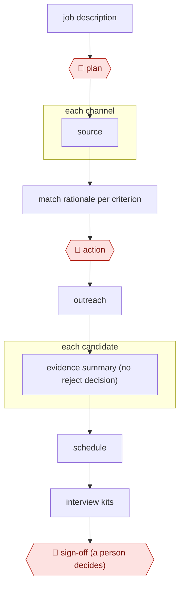

# Source-screen-schedule hiring

`ORG › BIZ › HR` · checkpointed · evidence B · **draft: needs a reference example** ([how to add one](../../../../../CONTRIBUTING.md#1-add-an-example-run))

**Shape:** `job description → 🛑 plan → each channel: source → match rationale per criterion → 🛑 action → outreach → each candidate: evidence summary (no reject decision) → schedule → interview kits → 🛑 sign-off (a person decides)`
**Variants:** `linkedin-hiring-assistant` (global English release by end of September 2025; sources candidates, screens via InMail Q&A, schedules [[29]](#sources)) · `paradox` · `juicebox`

<!-- shape diagram: generated by scripts/build_diagrams.py from `shape`; don't edit -->

<!-- end shape diagram -->

## Background

Recruiting for a role means finding people who might fit, deciding from their profiles who is worth contacting, writing to them, booking interviews and preparing the interviewers. Recruiters repeat this for every role, across several channels (a professional network, job boards, the company's own applicant tracking system), and the matching of each profile to the role's criteria is slow, repetitive reading. The agent does the searching, the per-criterion comparison, the draft messages, the calendar booking and the interview notes. A person still approves the search criteria, every message that goes out, and the final choice of who advances or is rejected. Rules on automated hiring tools put legal duties on the employer, and a rejection is a decision about a person that the company must be able to explain, so the agent supplies evidence and never a verdict.

**Terms:**
- **Sourcing**: finding candidates who have not applied, by searching profiles.
- **ATS (applicant tracking system)**: software where a company keeps its candidates and the stage each has reached. Ashby is the one in the YC source.
- **WAAS (Work at a Startup)**: a job board where startups post roles and receive applications.
- **Playbook**: a file for one role listing what its applicants are rated against.
- **Shortlist**: the candidates kept for a role after screening.
- **Outreach**: the first message to a candidate who has not applied; **InMail** is LinkedIn's direct message to someone you are not connected to.
- **Interview kit (candidate brief)**: a short written background on a candidate,, for whoever interviews them.
- **Bias audit**: an independent test of whether an automated tool treats groups of people differently.
- **NYC LL144, EU AI Act, Digital Omnibus**: rules on automated tools in hiring. New York City's Local Law 144 requires a bias audit and notice to candidates; the EU AI Act classes recruitment AI as high-risk; the Digital Omnibus on AI is the EU law that changes when its obligations apply.

## Build it with an agent

**Form:** `skill`. One recruiter works through one role at a time in the conversation and approves each stage there, so one skill with the role file beside it is enough; the channels can be read in parallel by built-in subagents.

**You need:** connectors (MCP) for the ATS, the mailbox and the calendar, and for each job board or applicant source that offers one; a role file per open role holding the qualifications and the message templates, written by the recruiter. Do not connect any tool that rejects a candidate, changes a candidate's stage, or sends a decision. Candidate profiles are personal data: use only systems your organisation has approved, and settle with your legal team what notice and audit the rules above require before any scoring is used.

| Step | Built as |
|---|---|
| job description → 🛑 plan | The skill turns the job description and the hiring manager's criteria into a role file and a search plan, then stops. See Checkpoints. |
| each channel: source → match rationale per criterion | Built-in subagents each take one channel and return a table: candidate, each qualification, found or missing in the profile, and the line that shows it. |
| 🛑 action → outreach | The skill saves a draft message per candidate from the role's template. Sending is a connector call under a permission rule that asks. See Checkpoints. |
| each candidate: evidence summary (no reject decision) | One paragraph per candidate listing the evidence for and against each qualification. The skill's instructions forbid a rating or a recommendation to reject, and no tool exists that could act on one. |
| schedule | The calendar connector finds open slots and creates the event; the invite is sent only after approval. The skill then checks that the ATS shows the same event. |
| interview kits | The candidate brief from the evidence summary, saved as a file for the interviewer. |
| 🛑 sign-off (a person decides) | See Checkpoints. |

**Checkpoints:** `plan`: the skill writes the criteria and search plan to the role file and stops until the recruiter approves or edits them. `action`: the recruiter reads and edits each draft; the tools that send a message or an invite are set to ask in the permission rules, so nothing leaves without a prompt. `sign-off`: the skill ends by presenting the evidence summaries and stopping. The agent has no tool that rejects a candidate or changes their stage, so the recruiter or hiring manager acts in the ATS themselves.

**Since the sources:** Sources date from 2025-09 to 2026-07; the YC repository, the NYC FAQ and two of the LinkedIn pages are undated. Two sources (the NYC FAQ and the YC repository) could not be re-opened when this was written (the page reader got a 403 from each site), so the entry's text stands for them. The EU timing note above has been overtaken: the Cuatrecasas page now reports that the Digital Omnibus on AI was published as Regulation (EU) 2026/1744 on 24 July 2026 and that obligations for stand-alone high-risk systems, including recruitment, apply from 2 December 2027 ([source 28](https://www.cuatrecasas.com/en/global/labor-and-employment/art/digital-omnibus-on-ai-how-does-it-impact-employment-relations)). The YC repository is a set of Claude Code commands and this build follows it, except that the YC manager also approves rejections through the agent, which this build does not allow. LinkedIn's Hiring Assistant is a vendor product that searches LinkedIn's own network, which a general agent cannot do; the build can source only from channels a connector exposes, and the source does not show the vendor's internal steps.

*A design based on this entry's steps and the tool documentation as of 2026-11, not a reported run.*

## Steps

*As reported by the sources.*

**Why "evidence, not verdict" matters (compliance):**
- **NYC LL144.** It requires an annual independent bias audit before an automated hiring tool is used, a public summary of the results, and candidate notice 10 business days in advance. The employer is responsible, not the vendor [[27]](#sources).
- **EU AI Act.** It classifies recruitment AI as high-risk. Its obligations were originally due August 2, 2026, and the Digital Omnibus provisionally moves them to December 2, 2027. Confirm which date is legally in force [[28]](#sources).

Keeping the agent at *evidence*, never *verdict*, reduces exposure to both.

1. The recruiter starts from the job description and the hiring manager's criteria. Hiring Assistant (LinkedIn's agent) turns the recruiter's criteria into search queries [[32]](#sources). In the YC setup, a playbook file holds what each role is rated against [[30]](#sources).
2. 🛑 **Plan**: the recruiter picks the roles and defines the qualifications candidates are scored against [[31]](#sources) [[32]](#sources). When the hiring manager changes criteria, the recruiter updates them and gets a new batch in minutes [[31]](#sources).
3. Each channel: source. Recruiters pull candidates from LinkedIn and export them "in a click" to the ATS shortlist [[31]](#sources). In the YC setup, a start-of-day `/triage` scans the inbox, Work at a Startup (WAAS) applicants, the Ashby ATS and the calendar [[30]](#sources).
4. The agent writes the match rationale per criterion: it scores each candidate against the recruiter's qualifications [[31]](#sources) and show which qualifications were found in the profile and which are missing [[32]](#sources). `/review-applicants` rates new applicants against the playbook [[30]](#sources).
5. 🛑 **Action**: the recruiter reads and edits drafted outreach before it goes out. LinkedIn's drafted messages are editable [[32]](#sources). In the YC setup, `/outreach` drafts personalised emails from the role template, and the manager reviews a close-out email and edits it before saying "send it" [[30]](#sources).
6. Each candidate: the agent writes an evidence summary, not a verdict. `/candidate-brief` writes a one-paragraph background brief, and `/candidate-status` checks the candidate across WAAS, Ashby, Gmail and Calendar [[30]](#sources). The vendor states that Hiring Assistant "does not make autonomous or automatic decisions" [[32]](#sources).
7. Schedule: the agent's `/schedule` finds open slots, creates Zoom or in-person events, sends invites and moves the candidate's ATS stage. A reschedule then checks that the ATS event synced [[30]](#sources). Interview prep in the YC repo is the candidate brief from step 6 [[30]](#sources).
8. 🛑 **Sign-off**: a person decides who advances and who is rejected. Under NYC LL144, the employer, not the vendor, carries the bias-audit and candidate-notice duties for automated tools [[27]](#sources), and the EU AI Act treats recruitment AI as high-risk [[28]](#sources).

**Output:** A candidate pipeline in the ATS: sourced and scored shortlists with per-criterion rationale, sent outreach, booked interviews and candidate briefs. Advance and reject decisions go to the hiring manager.
**Failure modes → guards:** Bulk rejection on one instruction ("reject all of these" sent 8 rejections in about 2 minutes) → sign off on each candidate, not a batch [[30]](#sources). Calendar, ATS and email fall out of step → check the sync after each scheduling change [[30]](#sources). Candidate spam → the README warns against it and says the tool is not meant to replace judgement [[30]](#sources). Model bias → LinkedIn runs per-model fairness reviews [[32]](#sources), and the employer still needs its own independent audit under LL144 [[27]](#sources). API keys and tokens in config files → keep them in gitignored files [[30]](#sources).

## Public runs

Coverage as of 2026-11-06: **Partial**: first-hand runs that cover part of the shape or put checkpoints elsewhere. From [Where are the real runs?](../../../../../research/2026-11-real-runs.md); every number was re-checked against its page.

- [YC software team, yc-software/recruiting](https://github.com/yc-software/recruiting). Claude Code commands for triage, outreach, scheduling and candidate briefs; the manager approves each step, **including rejections**. "27 inbox emails, 38 active candidates"; 8 applicants rated, "about 2 minutes". *First-hand: yes; confidence: med.*
- [LinkedIn, Infinite Resource Solutions story](https://business.linkedin.com/hire/customer-stories/infinite-resource-solutions) (undated). Sourcing → export to the ATS → scoring against recruiter criteria. "2–3 hours per day"; "48 hours to less than a day". *First-hand: vendor; confidence: low.*

## Sources

27. NYC DCWP, *AEDT FAQ*. https://www.nyc.gov/assets/dca/downloads/pdf/about/DCWP-AEDT-FAQ.pdf
28. Cuatrecasas, *The Digital Omnibus on AI: impact on employment relations*. https://www.cuatrecasas.com/en/global/labor-and-employment/art/digital-omnibus-on-ai-how-does-it-impact-employment-relations
29. LinkedIn, *Hiring Assistant to launch globally in English* (2025). https://news.linkedin.com/2025/hiring-assistant-globally-available
30. YC software team, *yc-software/recruiting* (Claude Code recruiting co-pilot). https://github.com/yc-software/recruiting
31. LinkedIn (vendor), *Infinite Resource Solutions customer story* (undated). https://business.linkedin.com/hire/customer-stories/infinite-resource-solutions
32. LinkedIn (vendor), *AI Transparency in Hiring Solutions*. https://business.linkedin.com/hire/ai-transparency/hire
