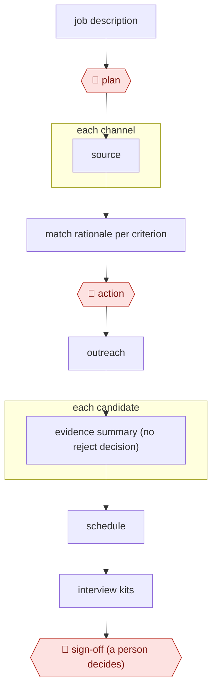

# Source-screen-schedule hiring

`ORG › BIZ › HR` · checkpointed · evidence B · **draft: needs a reference example** ([how to add one](../../../../../CONTRIBUTING.md#1-add-an-example-run))

**Shape:** `job description → 🛑 plan → each channel: source → match rationale per criterion → 🛑 action → outreach → each candidate: evidence summary (no reject decision) → schedule → interview kits → 🛑 sign-off (a person decides)`
**Variants:** `linkedin-hiring-assistant` (global English release by end of September 2025; sources candidates, screens via InMail Q&A, schedules [[29]](#sources)) · `paradox` · `juicebox`

<!-- shape diagram: generated by scripts/build_diagrams.py from `shape`; don't edit -->

<!-- end shape diagram -->

**Why "evidence, not verdict" matters (compliance):**
- **NYC LL144.** It requires an annual independent bias audit before an automated hiring tool is used, a public summary of the results, and candidate notice 10 business days in advance. The employer is responsible, not the vendor [[27]](#sources).
- **EU AI Act.** It classifies recruitment AI as high-risk. Its obligations were originally due August 2, 2026, and the Digital Omnibus provisionally moves them to December 2, 2027. Confirm which date is legally in force [[28]](#sources).

Keeping the agent at *evidence*, never *verdict*, reduces exposure to both.

## Steps
1. Start from the job description and the hiring manager's criteria. Hiring Assistant turns the recruiter's criteria into search queries [[32]](#sources). In the YC setup, a playbook file holds what each role is rated against [[30]](#sources).
2. 🛑 **Plan**: the recruiter picks the roles and defines the qualifications candidates are scored against [[31]](#sources) [[32]](#sources). When the hiring manager changes criteria, the recruiter updates them and gets a new batch in minutes [[31]](#sources).
3. Each channel: source. Pull candidates from LinkedIn and export them "in a click" to the ATS shortlist [[31]](#sources). In the YC setup, a start-of-day `/triage` scans the inbox, Work at a Startup (WAAS) applicants, the Ashby ATS and the calendar [[30]](#sources).
4. Write the match rationale per criterion: score each candidate against the recruiter's qualifications [[31]](#sources) and show which qualifications were found in the profile and which are missing [[32]](#sources). `/review-applicants` rates new applicants against the playbook [[30]](#sources).
5. 🛑 **Action**: the recruiter reads and edits drafted outreach before it goes out. LinkedIn's drafted messages are editable [[32]](#sources). In the YC setup, `/outreach` drafts personalised emails from the role template, and the manager reviews a close-out email and edits it before saying "send it" [[30]](#sources).
6. Each candidate: an evidence summary, not a verdict. `/candidate-brief` writes a one-paragraph background brief, and `/candidate-status` checks the candidate across WAAS, Ashby, Gmail and Calendar [[30]](#sources). The vendor states that Hiring Assistant "does not make autonomous or automatic decisions" [[32]](#sources).
7. Schedule: `/schedule` finds open slots, creates Zoom or in-person events, sends invites and moves the candidate's ATS stage. A reschedule then checks that the ATS event synced [[30]](#sources). Interview prep in the YC repo is the candidate brief from step 6 [[30]](#sources).
8. 🛑 **Sign-off**: a person decides who advances and who is rejected. Under NYC LL144, the employer, not the vendor, carries the bias-audit and candidate-notice duties for automated tools [[27]](#sources), and the EU AI Act treats recruitment AI as high-risk [[28]](#sources).

**Output:** A candidate pipeline in the ATS: sourced and scored shortlists with per-criterion rationale, sent outreach, booked interviews and candidate briefs. Advance and reject decisions go to the hiring manager.
**Failure modes → guards:** Bulk rejection on one instruction ("reject all of these" sent 8 rejections in about 2 minutes) → sign off on each candidate, not a batch [[30]](#sources). Calendar, ATS and email fall out of step → check the sync after each scheduling change [[30]](#sources). Candidate spam → the README warns against it and says the tool is not meant to replace judgement [[30]](#sources). Model bias → LinkedIn runs per-model fairness reviews [[32]](#sources), and the employer still needs its own independent audit under LL144 [[27]](#sources). API keys and tokens in config files → keep them in gitignored files [[30]](#sources).

## Public runs

Coverage as of 2026-11-06: **Partial**: first-hand runs that cover part of the shape or put checkpoints elsewhere. From [Where are the real runs?](../../../../../research/2026-11-real-runs.md); every number was re-checked against its page.

- [YC software team, yc-software/recruiting](https://github.com/yc-software/recruiting). Claude Code commands for triage, outreach, scheduling and candidate briefs; the manager approves each step, **including rejections**. "27 inbox emails, 38 active candidates"; 8 applicants rated, "about 2 minutes". *First-hand: yes; confidence: med.*
- [LinkedIn, Infinite Resource Solutions story](https://business.linkedin.com/hire/customer-stories/infinite-resource-solutions) (undated). Sourcing → export to the ATS → scoring against recruiter criteria. "2–3 hours per day"; "48 hours to less than a day". *First-hand: vendor; confidence: low.*

## Sources

27. NYC DCWP, *AEDT FAQ*. https://www.nyc.gov/assets/dca/downloads/pdf/about/DCWP-AEDT-FAQ.pdf
28. Cuatrecasas, *The Digital Omnibus on AI: impact on employment relations*. https://www.cuatrecasas.com/en/global/labor-and-employment/art/digital-omnibus-on-ai-how-does-it-impact-employment-relations
29. LinkedIn, *Hiring Assistant to launch globally in English* (2025). https://news.linkedin.com/2025/hiring-assistant-globally-available
30. YC software team, *yc-software/recruiting* (Claude Code recruiting co-pilot). https://github.com/yc-software/recruiting
31. LinkedIn (vendor), *Infinite Resource Solutions customer story* (undated). https://business.linkedin.com/hire/customer-stories/infinite-resource-solutions
32. LinkedIn (vendor), *AI Transparency in Hiring Solutions*. https://business.linkedin.com/hire/ai-transparency/hire
