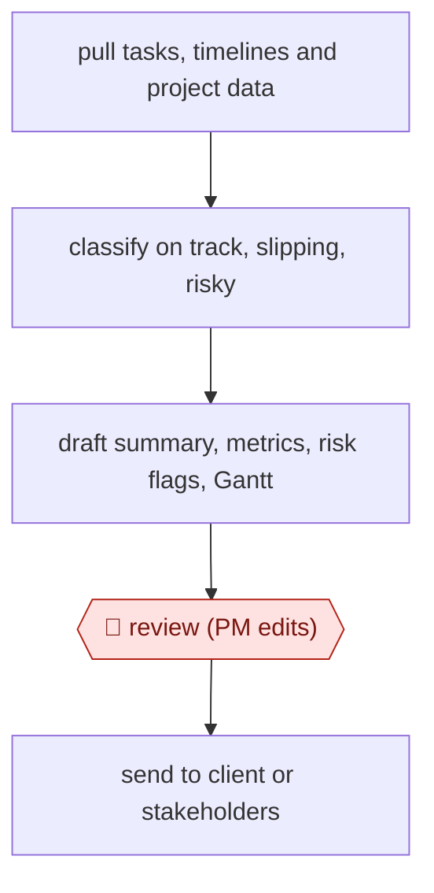

# Data-pulled status report

`ORG › BIZ › PMO` · assist · evidence C · **draft: needs a reference example** ([how to add one](../../../../../CONTRIBUTING.md#1-add-an-example-run))

**Shape:** `pull tasks, timelines and project data → classify on track, slipping, risky → draft summary, metrics, risk flags, Gantt → 🛑 review (PM edits) → send to client or stakeholders`
**How it differs:** None close. AWF-0031 Daily inbox triage handles incoming mail. This workflow produces outgoing project status from project data.
**Variants:** `ganttly`

<!-- shape diagram: generated by scripts/build_diagrams.py from `shape`; don't edit -->

<!-- end shape diagram -->

## Steps
1. Connect the project data sources (task lists, timelines) [[1]](#sources).
2. The model reads the data and marks what is on track, slipping or risky, and what matters to stakeholders [[1]](#sources).
3. Generate the report: written summary, computed metrics, flagged risks, and a Gantt chart with dependencies and critical path [[1]](#sources).
4. 🛑 **Review**: the PM reads and edits the draft before it goes out [[1]](#sources).
5. Send it in the client's format (PDF, HTML or email summary), weekly instead of monthly [[1]](#sources).

**Output:** A weekly status report sent to clients or stakeholders.
**Failure modes → guards:** Polished but wrong status → the PM checks it against the source data before sending. A vague or inconsistent report format → set a house template first. Evidence is one self-report by the author of the tool, so the time savings are unverified.

## Public runs

Coverage as of 2026-11-06: **Weak**: only anonymous, vendor-linked or journalist-told accounts. Collected and re-checked in [New workflows for empty categories](../../../../../research/2026-11-new-workflows.md).

- [Sacha d'Unienville, How I automated PM status reports with AI](https://dev.to/workbench/how-i-automated-pm-status-reports-with-ai-1koc) (year not stated). A retail PM's weekly status reports drafted from project data and reviewed before sending. "Time saved: 5+ hours/week → 30 minutes.". *First-hand: vendor; confidence: low.*

## Sources

1. Sacha d'Unienville, How I automated PM status reports with AI, DEV Community, date shown as 'Apr 20' (year not stated). https://dev.to/workbench/how-i-automated-pm-status-reports-with-ai-1koc
