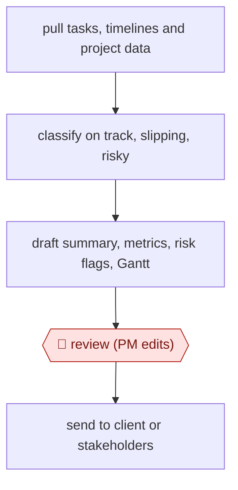

# Data-pulled status report

`ORG › BIZ › PMO` · assist · evidence C · **draft: needs a reference example** ([how to add one](../../../../../CONTRIBUTING.md#1-add-an-example-run))

**Shape:** `pull tasks, timelines and project data → classify on track, slipping, risky → draft summary, metrics, risk flags, Gantt → 🛑 review (PM edits) → send to client or stakeholders`
**Variants:** `ganttly`

<!-- shape diagram: generated by scripts/build_diagrams.py from `shape`; don't edit -->

<!-- end shape diagram -->

## Background

A project manager (PM) keeps a project's work moving and tells the people who depend on it, the client or the stakeholders, how it is going. Each week the PM gathers updates from the people doing the work, compares them with the plan, works out what is late or at risk, and writes it up in whatever form each client wants. Compiling and reformatting takes much of the week, and a report that reads well can still be wrong if it was built from stale data. The agent reads the project data, sorts the work into on track, slipping or risky, and drafts the report and the Gantt chart. The PM still reads and edits it before it goes out, because the report is the PM's own statement to the client about their project and the PM knows what the data leaves out.

**Terms:**
- **Status report**: a regular note to a client or stakeholders saying whether a project is on track, what is at risk and what comes next.
- **Stakeholder**: anyone with an interest in the project's outcome, such as the client or a sponsor.
- **Gantt chart**: a chart of tasks as bars along a timeline.
- **Dependency, critical path**: a dependency means one task cannot start until another finishes; the critical path is the chain of dependent tasks that sets the earliest finish date, so a delay on it delays the project.
- **Risk flag**: a marked item that could make the project late or over budget.

## Build it with an agent

**Form:** `skill`. One project manager produces one project's report at a time and stays in the conversation to edit it, so one skill with a report template beside it is enough.

**You need:** read access to the project's task list and timeline, through a connector (MCP) to the project tool or an exported file the PM drops in; a report template for each client format, written by the PM; a way to draw a Gantt chart, such as a script beside the skill that writes an image or an HTML file from the task data. Do not connect a mail tool. Project data may name clients and contractors: use only systems your organisation has approved for it.

| Step | Built as |
|---|---|
| pull tasks, timelines and project data | The skill's first instruction: read the task list and timeline through the connector or the exported file, and stop if a field it needs (dates, owners, dependencies) is missing. |
| classify on track, slipping, risky | The agent compares each task's dates and status with the plan and writes a table: task, class, the data that shows it. |
| draft summary, metrics, risk flags, Gantt | The agent fills the client's template from that table; metrics are computed by a script, not estimated in text; a second script draws the Gantt chart with dependencies and critical path. |
| 🛑 review (PM edits) | See Checkpoints. |
| send to client or stakeholders | The PM sends it from their own mailbox. |

**Checkpoints:** `review`: the skill ends by presenting the draft report, the classification table and the source figures behind each metric, then stops; the PM edits the draft. The agent has no mail tool, so nothing reaches the client unless the PM sends it.

**Since the sources:** The one source, which is also the one public run, is a post dated 'Apr 20' with no year; the author's account was created in 2026-04, so it is probably from 2026-04. It is the author's own advertisement for a paid reporting tool (`ganttly`), and it gives four plain steps and no more: connect the data, let the AI classify it, generate the report, choose a format. It does not show a prompt, a template or how the tool checks the data, so this build is the catalog's design for the same four steps, not a copy of the tool. The tool's interactive Gantt chart is not reproduced; a script draws a static chart. The time figures in the post are the author's own claim and the build makes none.

*A design based on this entry's steps and the tool documentation as of 2026-11, not a reported run.*

## Steps

*As reported by the sources.*

1. The PM connects the project data sources (task lists, timelines) [[1]](#sources).
2. The model reads the data and marks what is on track, slipping or risky, and what matters to stakeholders [[1]](#sources).
3. Generate the report: written summary, computed metrics, flagged risks, and a Gantt chart with dependencies and critical path [[1]](#sources).
4. 🛑 **Review**: the PM reads and edits the draft before it goes out [[1]](#sources).
5. The PM sends it in the client's format (PDF, HTML or email summary), weekly instead of monthly [[1]](#sources).

**Output:** A weekly status report sent to clients or stakeholders.
**Failure modes → guards:** Polished but wrong status → the PM checks it against the source data before sending. A vague or inconsistent report format → set a house template first. Evidence is one self-report by the author of the tool, so the time savings are unverified.
**How it differs:** None close. AWF-0031 Daily inbox triage handles incoming mail. This workflow produces outgoing project status from project data.

## Public runs

Coverage as of 2026-11-06: **Weak**: only anonymous, vendor-linked or journalist-told accounts. Collected and re-checked in [New workflows for empty categories](../../../../../research/2026-11-new-workflows.md).

- [Sacha d'Unienville, How I automated PM status reports with AI](https://dev.to/workbench/how-i-automated-pm-status-reports-with-ai-1koc) (year not stated). A retail PM's weekly status reports drafted from project data and reviewed before sending. "Time saved: 5+ hours/week → 30 minutes.". *First-hand: vendor; confidence: low.*

## Sources

1. Sacha d'Unienville, How I automated PM status reports with AI, DEV Community, date shown as 'Apr 20' (year not stated). https://dev.to/workbench/how-i-automated-pm-status-reports-with-ai-1koc
