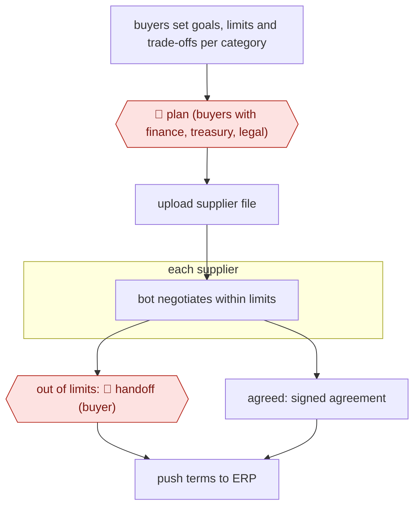

# Bounded tail-spend negotiation

`ORG › BIZ › PROC` · checkpointed · evidence B · **draft: needs a reference example** ([how to add one](../../../../../CONTRIBUTING.md#1-add-an-example-run))

**Shape:** `buyers set goals, limits and trade-offs per category → 🛑 plan (buyers with finance, treasury, legal) → upload supplier file → each supplier: bot negotiates within limits → out of limits: 🛑 handoff (buyer) | agreed: signed agreement → push terms to ERP`
**How it differs:** AWF-0022 Invoice extract-match-route processes invoices after purchase. This workflow negotiates the commercial terms before purchase within limits a person sets. Different deliverable and checkpoints.
**Variants:** `pactum`

<!-- shape diagram: generated by scripts/build_diagrams.py from `shape`; don't edit -->

<!-- end shape diagram -->

## Steps
1. Choose tail-end suppliers whose terms are rarely negotiated (in Walmart's pilot: fleet services, shopping carts, retail equipment) [[1]](#sources).
2. Define the campaign goal (payment terms, discount range, deadline) and set rules, thresholds and escalation paths by region or category [[2]](#sources).
3. 🛑 **Plan**: buyers, with finance, treasury and legal, agree the negotiation playbook before launch. The pilot had 5 buyers and these departments involved [[1]](#sources). The approval mechanics are from the vendor's docs [[2]](#sources).
4. Upload a supplier file (contacts, current terms, spend). The platform previews estimated savings [[2]](#sources).
5. The chatbot negotiates with each supplier in parallel, trading payment days, discounts and service levels within the set limits [[2]](#sources).
6. 🛑 **Handoff**: any offer outside the limits escalates to the buying team [[2]](#sources).
7. Agreed terms are signed, pushed back to procurement systems and logged for audit [[2]](#sources).

**Output:** Signed supplier agreements with new commercial terms (payment terms, discounts), sent to ERP/contract records.
**Failure modes → guards:** Bot exceeds mandate → hard limits plus escalation. Suppliers refuse to engage → re-engagement, and targets set realistically (20% target in the pilot). Savings figures are vendor- or secondary-sourced → check them against your own spend data. The HBR source is paywalled and I only saw it quoted.

## Public runs

Coverage as of 2026-11-06: **Weak**: only anonymous, vendor-linked or journalist-told accounts. Collected and re-checked in [New workflows for empty categories](../../../../../research/2026-11-new-workflows.md).

- [ProcureCon, Walmart AI chatbot automates supplier negotiations](https://procureconsupplychain.wbresearch.com/blog/walmart-ai-chatbot-automate-supplier-negotiations) (2022-11-08 for the HBR source). Three-month Walmart Canada pilot with tail-end suppliers; results quoted from HBR. "reaching an agreement with 64%" of suppliers; "an average negotiation turnaround of 11 days". *First-hand: no (secondary summary of HBR and Talking Logistics); confidence: med.*

## Sources

1. ProcureCon (WBR), Walmart AI chatbot automates supplier negotiations (quotes HBR, Van Hoek, DeWitt, Lacity, Johnson, 'How Walmart Automated Supplier Negotiations', 2022-11-08, and Talking Logistics 2023-05-01), undated. https://procureconsupplychain.wbresearch.com/blog/walmart-ai-chatbot-automate-supplier-negotiations
2. Pactum, Commercial term negotiations (vendor), undated. https://pactum.com/commercial-terms/
