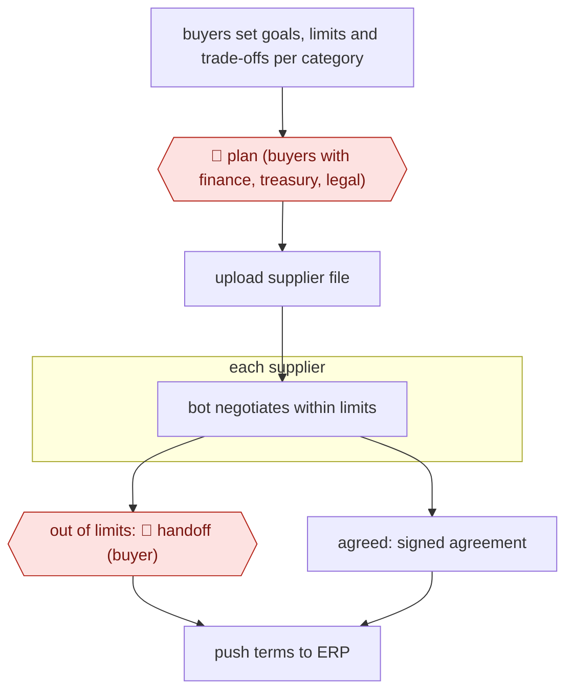

# Bounded tail-spend negotiation

`ORG › BIZ › PROC` · checkpointed · evidence B · **draft: needs a reference example** ([how to add one](../../../../../CONTRIBUTING.md#1-add-an-example-run))

**Shape:** `buyers set goals, limits and trade-offs per category → 🛑 plan (buyers with finance, treasury, legal) → upload supplier file → each supplier: bot negotiates within limits → out of limits: 🛑 handoff (buyer) | agreed: signed agreement → push terms to ERP`
**Variants:** `pactum`

<!-- shape diagram: generated by scripts/build_diagrams.py from `shape`; don't edit -->

<!-- end shape diagram -->

## Background

A company buys from thousands of suppliers, and its buyers negotiate seriously only with the few largest ones. The long tail of small suppliers (fleet servicing, shopping carts, minor equipment) keeps whatever payment terms and prices were set years ago, because no buyer has the hours to negotiate with each. Doing it by hand means hundreds of separate email threads over weeks. Here buyers set the goal and the limits for a category once, and the agent holds the negotiation conversations with every supplier in parallel, trading one term against another inside those limits. People still set and approve the limits, because they commit the company's money and cash position and involve finance, treasury and legal; and anything the agent cannot settle inside the limits goes to a buyer, who alone can go beyond them.

**Terms:**
- **Tail spend**: the many small purchases from small suppliers that together are a large sum but get little negotiating attention.
- **Payment terms**: how many days after the invoice the company pays; longer terms keep cash in the company longer.
- **Treasury**: the finance team that manages the company's cash and funding.
- **Limits (mandate)**: the ranges the agent may agree to, such as a payment-term range, a minimum discount and service levels.
- **Service levels**: the delivery or support standards a supplier promises.
- **Campaign**: one goal negotiated with many suppliers at once, such as longer payment terms.
- **ERP**: the company's main accounting and operations system, where supplier terms are recorded.
- **Escalate**: pass an item to a person because it is outside what the agent may decide.

## Build it with an agent

**Form:** `service`. Suppliers answer over days, so the work runs as many short runs started by incoming replies, with nobody at the keyboard; buyers see only escalated cases.

**You need:** a campaign file per category that the buyers write and approve (goal, limits, trade-offs, deadline, escalation rules), which the agent can read but not change; the supplier file (contacts, current terms, spend); a mailbox or messaging connector limited to the campaign's suppliers; a state store holding each supplier's offers, counter-offers and status; a queue where escalated cases land. Do not give the agent access to the ERP or a signing tool. Supplier contact details and spend are confidential business data: use only systems your organisation has approved.

| Step | Built as |
|---|---|
| buyers set goals, limits and trade-offs per category | The campaign file, written by the buyers. |
| 🛑 plan | See Checkpoints. |
| upload supplier file | A script reads the file and creates a state-store record per supplier; a skill estimates savings from the current terms and the campaign file, for the buyers to see before launch. |
| each supplier: bot negotiates within limits | An incoming reply, or a scheduled task that finds suppliers due a first message or a follow-up, starts one run per supplier: an Agent SDK program or `claude -p` that loads that supplier's record, reads the campaign file through a skill, and writes the next offer. |
| out of limits: 🛑 handoff (buyer) | The run stops and adds a queue item with the thread, the supplier's offer and the limit it breaks. |
| agreed: signed agreement → push terms to ERP | A script writes the agreed terms to a record for the buyers' contract and ERP process; the signature and the ERP entry follow your own process. |

**Checkpoints:** `plan`: the agent has no way to start a campaign; it begins only when the campaign file carries the approval that buyers, finance, treasury and legal gave, checked by the launching script. `handoff`: every outgoing offer passes through a script (or a `PreToolUse` hook on the send tool) that compares it with the limits in the campaign file and blocks it if any term is outside, so an instruction in a skill cannot be skipped; the blocked case goes to the buyers' queue with the evidence. Only a buyer can widen a limit, by editing the campaign file.

**Since the sources:** Sources are undated; source 1 quotes an HBR article of 2022-11-08 and a Talking Logistics piece of 2023-05-01, and source 2 is a vendor product page. Source 1 could not be re-opened when this was written (403), and its HBR original is paywalled. Newer accounts of the same practice exist: a Pactum blog of 2026-07-31 describes Ahold Delhaize USA and Honeywell running autonomous negotiations within set guardrails ([Pactum](https://pactum.com/blog/how-enterprise-procurement-leaders-use-ai)); it is a vendor's own account and does not change the steps. The sources describe a vendor platform with its own negotiation engine and supplier-facing screens, and they do not show how it negotiates. This build uses a general agent writing each message within the limits, which is a design for the same shape and not the vendor's method. Pactum's contact validation, translation and dashboards are left out.

*A design based on this entry's steps and the tool documentation as of 2026-11, not a reported run.*

## Steps

*As reported by the sources.*

1. The buying team chooses tail-end suppliers whose terms are rarely negotiated (in Walmart's pilot: fleet services, shopping carts, retail equipment) [[1]](#sources).
2. The buyers define the campaign goal (payment terms, discount range, deadline) and set rules, thresholds and escalation paths by region or category [[2]](#sources).
3. 🛑 **Plan**: buyers, with finance, treasury and legal, agree the negotiation playbook before launch. The pilot had 5 buyers and these departments involved [[1]](#sources). The approval mechanics are from the vendor's docs [[2]](#sources).
4. The buyers upload a supplier file (contacts, current terms, spend). The platform previews estimated savings [[2]](#sources).
5. The chatbot negotiates with each supplier in parallel, trading payment days, discounts and service levels within the set limits [[2]](#sources).
6. 🛑 **Handoff**: any offer outside the limits escalates to the buying team [[2]](#sources).
7. Agreed terms are signed, pushed back to procurement systems and logged for audit [[2]](#sources).

**Output:** Signed supplier agreements with new commercial terms (payment terms, discounts), sent to ERP/contract records.
**Failure modes → guards:** Bot exceeds mandate → hard limits plus escalation. Suppliers refuse to engage → re-engagement, and targets set realistically (20% target in the pilot). Savings figures are vendor- or secondary-sourced → check them against your own spend data. The HBR source is paywalled and I only saw it quoted.
**How it differs:** AWF-0022 Invoice extract-match-route processes invoices after purchase. This workflow negotiates the commercial terms before purchase within limits a person sets. Different deliverable and checkpoints.

## Public runs

Coverage as of 2026-11-06: **Weak**: only anonymous, vendor-linked or journalist-told accounts. Collected and re-checked in [New workflows for empty categories](../../../../../research/2026-11-new-workflows.md).

- [ProcureCon, Walmart AI chatbot automates supplier negotiations](https://procureconsupplychain.wbresearch.com/blog/walmart-ai-chatbot-automate-supplier-negotiations) (2022-11-08 for the HBR source). Three-month Walmart Canada pilot with tail-end suppliers; results quoted from HBR. "reaching an agreement with 64%" of suppliers; "an average negotiation turnaround of 11 days". *First-hand: no (secondary summary of HBR and Talking Logistics); confidence: med.*

## Sources

1. ProcureCon (WBR), Walmart AI chatbot automates supplier negotiations (quotes HBR, Van Hoek, DeWitt, Lacity, Johnson, 'How Walmart Automated Supplier Negotiations', 2022-11-08, and Talking Logistics 2023-05-01), undated. https://procureconsupplychain.wbresearch.com/blog/walmart-ai-chatbot-automate-supplier-negotiations
2. Pactum, Commercial term negotiations (vendor), undated. https://pactum.com/commercial-terms/
