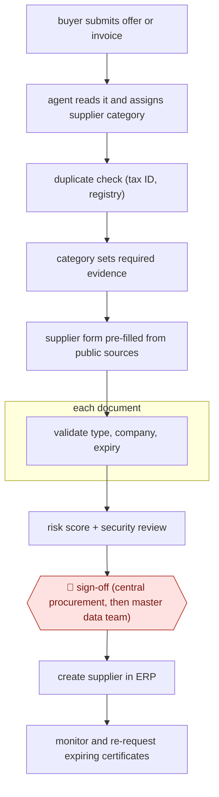

# Evidence-gated supplier onboarding

`ORG › BIZ › PROC` · checkpointed · evidence B · **draft: needs a reference example** ([how to add one](../../../../../CONTRIBUTING.md#1-add-an-example-run))

**Shape:** `buyer submits offer or invoice → agent reads it and assigns supplier category → duplicate check (tax ID, registry) → category sets required evidence → supplier form pre-filled from public sources → each document: validate type, company, expiry → risk score + security review → 🛑 sign-off (central procurement, then master data team) → create supplier in ERP → monitor and re-request expiring certificates`
**Variants:** `lio` · `box-ai-agents`

<!-- shape diagram: generated by scripts/build_diagrams.py from `shape`; don't edit -->

<!-- end shape diagram -->

## Background

Before a company can pay a new supplier, someone has to set it up as a supplier record in the accounting system, after checking that it exists, is not already on the list, and can show the paperwork its kind of work requires: a supplier that handles customer data, for example, must hold security certificates. In many companies this is skipped in practice: a supplier is created when its first invoice arrives, by whoever has access, so the checks come after the money is spent and the same supplier may appear many times. The agent reads what the buyer has, decides the supplier's category, checks for duplicates, asks the supplier only for the evidence that category needs, checks each document, and scores the risk. People still approve the new record, first central procurement and then the master data team, because the approval is a control: it decides who the company may pay, and a person has to be accountable for it.

**Terms:**
- **Supplier record (master data)**: the entry for a supplier in the accounting system, with name, tax number and payment details, used for every later payment.
- **ERP**: the company's main accounting and operations system; SAP S/4HANA is the one in the source.
- **Master data team**: the people who own the quality of supplier and other core records in the ERP.
- **Tax ID, registry**: the supplier's tax number and the official company register; both identify a company and reveal duplicates.
- **Supplier category**: a group, such as a one-time supplier or a supplier handling customer data, that sets what evidence is required.
- **Certificate**: a document from a third party, such as a security certification, that a supplier must hold and renew; it has an expiry date.
- **Requalify**: check an existing supplier again against current requirements.
- **GRC (governance, risk and compliance)**: the team that sets and checks a company's rules and risks.
- **Audit log**: a record of every action, by a person or the agent, kept for later review.

## Build it with an agent

**Form:** `service`. A request starts when a buyer submits a document, the supplier answers days later, and certificate expiry is watched on a timer, so the work is a series of runs with nobody at the keyboard and people see only approval requests.

**You need:** a state store with one record per supplier (category, evidence received, checks passed, approvals); read access to the ERP's existing supplier records and to public company registers, through connectors (MCP) or scripts; a place to receive the supplier's documents; the evidence requirements for each category, kept as a reference file that procurement edits; an approval queue for central procurement and the master data team. Do not give the agent a tool that creates or changes ERP records. Supplier documents, such as security certificates, are confidential: use only systems your organisation has approved.

| Step | Built as |
|---|---|
| buyer submits offer or invoice → agent reads it and assigns supplier category | The submission starts an Agent SDK program or `claude -p` run. A skill reads the document and proposes a category from the category reference file. |
| duplicate check (tax ID, registry) | A script looks up the tax ID and name in the ERP supplier list and the public register and returns matches; a possible duplicate stops the run and goes to the master data team. |
| category sets required evidence → supplier form pre-filled from public sources | The skill lists the category's required documents and pre-fills the supplier's form from the register; the supplier receives the link. |
| each document: validate type, company, expiry | Each upload starts a run: the skill checks that the certificate is the right type, names the right company and has not expired, and records the result in the state store. |
| risk score + security review | A subagent reads the evidence in the state store and writes a score with its reasons; a second subagent that has not seen the first's work reviews the documents for security issues. |
| 🛑 sign-off (central procurement, then master data team) | See Checkpoints. |
| create supplier in ERP | A script run by the master data team after the second approval; the agent does not run it. |
| monitor and re-request expiring certificates | A cloud scheduled task, or your own scheduler running `claude -p`, scans the state store for certificates near expiry and sends the standard re-request to the supplier. |

**Checkpoints:** `sign-off`: the run ends by posting the evidence summary, risk score and reasons to the approval queue for central procurement; when that approval is recorded, a new run posts it to the master data team. The agent has no ERP write tool, so nothing enters the ERP unless the second approver acts, and the script that creates the record refuses to run unless both approvals are in the state store.

**Since the sources:** Source 2 dates from 2025-09 and source 1 is undated. Both are vendor accounts: source 1 is a Lio case study of an unnamed retailer, and source 2 is a Box story of Samsung Semiconductor, which covers only the scoring and security review in step 3, not the whole flow. A later search finds the same job now offered natively by ERP and workflow vendors, for example SAP's Supplier Onboarding Agent for SAP Business Network (listed 2026-02, [SAP](https://www.sap.com/assetdetail/2026/02/34307b42-407f-0010-bca6-c68f7e60039b.html)); its page is a short summary with no steps, so nothing here is changed by it. The sources are product accounts, not a run of a general agent: this build is the catalog's design for the same shape. It leaves out the vendors' supplier portal, sanctions screening and the one-click requalification of the whole supplier base. Where an ERP vendor's own onboarding agent is available, it may replace the scripts and the form.

*A design based on this entry's steps and the tool documentation as of 2026-11, not a reported run.*

## Steps

*As reported by the sources.*

1. Onboarding starts from whatever the buyer has, an offer or invoice; the agent reads it, assigns a supplier category, and checks for duplicates against tax IDs and registry data before any record is created [[1]](#sources).
2. The category decides what the supplier must prove: a one-time supplier fills a short form; a supplier handling customer data must provide certificates. The supplier gets a link to a form the agent has pre-filled from public sources [[1]](#sources).
3. The agent validates each document as it arrives (right certificate type, right company, not expired) [[1]](#sources). In Samsung Semiconductor's GRC flow, agents extract metadata from vendor documents, compute a risk score, and a second agent reviews documentation for security issues for vendors that pass [[2]](#sources).
4. 🛑 **Sign-off**: approval runs through company-defined stakeholders, central procurement first and master data team last, so nothing enters SAP without passing the process [[1]](#sources). At Samsung the GRC team decides whether to use the vendor [[2]](#sources).
5. The supplier is created in SAP S/4HANA; every human or agent action is logged for audit. Existing suppliers are requalified by category and the agent requests new certificates before old ones expire [[1]](#sources).

**Output:** An approved, de-duplicated supplier master record in the ERP, with validated evidence and an audit log; ongoing certificate monitoring.
**Failure modes → guards:** Suppliers created ad hoc on first invoice and duplicated (one supplier 15 times) → no record created without passing the flow, duplicate check first [1]. Expired certificates go unnoticed → agent re-requests before expiry [1]. Vendor-reported results only → treat speed claims as vendor evidence.
**How it differs:** AWF-0083 Bounded tail-spend negotiation (only PROC entry): that negotiates prices and terms with existing suppliers within buyer limits. This qualifies and creates new suppliers. The deliverable is a supplier record, not agreed terms, and sign-off is a staged approval chain.

## Public runs

Coverage as of 2026-11-13: **Weak**: only anonymous, vendor-linked or journalist-told accounts. Collected and re-checked in [Third collection pass](../../../../../research/2026-11-third-pass.md).

- [Box, Samsung Semiconductor vendor assessment](https://blog.box.com/samsung-semiconductor-cuts-vendor-assessment-time-90-using-box-ai-agents) (2025-09-04). Named GRC head describes agent scoring and security review of vendor documents. "reducing vendor security assessments from 3-5 days to approximately 4 hours". *First-hand: vendor; confidence: med.*
- [Lio, global retail leader](https://www.lio.ai/customers/global-retail-leader) (undated). Category-driven evidence, duplicate checks, staged approval before SAP creation. "its roughly 100 critical IT suppliers". *First-hand: vendor; confidence: low.*

## Sources

1. Lio, Agentic Supplier Management: global retail leader (vendor case study, customer unnamed). https://www.lio.ai/customers/global-retail-leader
2. Box, Samsung Semiconductor cuts vendor assessment time by 90% using Box AI Agents, 2025-09-04. https://blog.box.com/samsung-semiconductor-cuts-vendor-assessment-time-90-using-box-ai-agents
