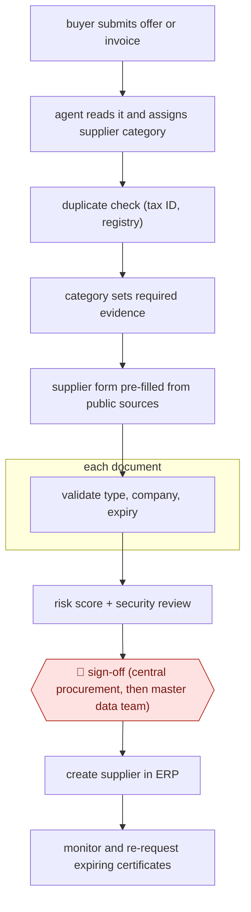

# Evidence-gated supplier onboarding

`ORG › BIZ › PROC` · checkpointed · evidence B · **draft: needs a reference example** ([how to add one](../../../../../CONTRIBUTING.md#1-add-an-example-run))

**Shape:** `buyer submits offer or invoice → agent reads it and assigns supplier category → duplicate check (tax ID, registry) → category sets required evidence → supplier form pre-filled from public sources → each document: validate type, company, expiry → risk score + security review → 🛑 sign-off (central procurement, then master data team) → create supplier in ERP → monitor and re-request expiring certificates`
**How it differs:** AWF-0083 Bounded tail-spend negotiation (only PROC entry): that negotiates prices and terms with existing suppliers within buyer limits. This qualifies and creates new suppliers. The deliverable is a supplier record, not agreed terms, and sign-off is a staged approval chain.
**Variants:** `lio` · `box-ai-agents`

<!-- shape diagram: generated by scripts/build_diagrams.py from `shape`; don't edit -->

<!-- end shape diagram -->

## Steps
1. Onboarding starts from whatever the buyer has, an offer or invoice; the agent reads it, assigns a supplier category, and checks for duplicates against tax IDs and registry data before any record is created [[1]](#sources).
2. The category decides what the supplier must prove: a one-time supplier fills a short form; a supplier handling customer data must provide certificates. The supplier gets a link to a form the agent has pre-filled from public sources [[1]](#sources).
3. Each document is validated as it arrives (right certificate type, right company, not expired) [[1]](#sources). In Samsung Semiconductor's GRC flow, agents extract metadata from vendor documents, compute a risk score, and a second agent reviews documentation for security issues for vendors that pass [[2]](#sources).
4. 🛑 **Sign-off**: approval runs through company-defined stakeholders, central procurement first and master data team last, so nothing enters SAP without passing the process [[1]](#sources). At Samsung the GRC team decides whether to use the vendor [[2]](#sources).
5. The supplier is created in SAP S/4HANA; every human or agent action is logged for audit. Existing suppliers are requalified by category and the agent requests new certificates before old ones expire [[1]](#sources).

**Output:** An approved, de-duplicated supplier master record in the ERP, with validated evidence and an audit log; ongoing certificate monitoring.
**Failure modes → guards:** Suppliers created ad hoc on first invoice and duplicated (one supplier 15 times) → no record created without passing the flow, duplicate check first [1]. Expired certificates go unnoticed → agent re-requests before expiry [1]. Vendor-reported results only → treat speed claims as vendor evidence.

## Public runs

Coverage as of 2026-11-13: **Weak**: only anonymous, vendor-linked or journalist-told accounts. Collected and re-checked in [Third collection pass](../../../../../research/2026-11-third-pass.md).

- [Box, Samsung Semiconductor vendor assessment](https://blog.box.com/samsung-semiconductor-cuts-vendor-assessment-time-90-using-box-ai-agents) (2025-09-04). Named GRC head describes agent scoring and security review of vendor documents. "reducing vendor security assessments from 3-5 days to approximately 4 hours". *First-hand: vendor; confidence: med.*
- [Lio, global retail leader](https://www.lio.ai/customers/global-retail-leader) (undated). Category-driven evidence, duplicate checks, staged approval before SAP creation. "its roughly 100 critical IT suppliers". *First-hand: vendor; confidence: low.*

## Sources

1. Lio, Agentic Supplier Management: global retail leader (vendor case study, customer unnamed). https://www.lio.ai/customers/global-retail-leader
2. Box, Samsung Semiconductor cuts vendor assessment time by 90% using Box AI Agents, 2025-09-04. https://blog.box.com/samsung-semiconductor-cuts-vendor-assessment-time-90-using-box-ai-agents
