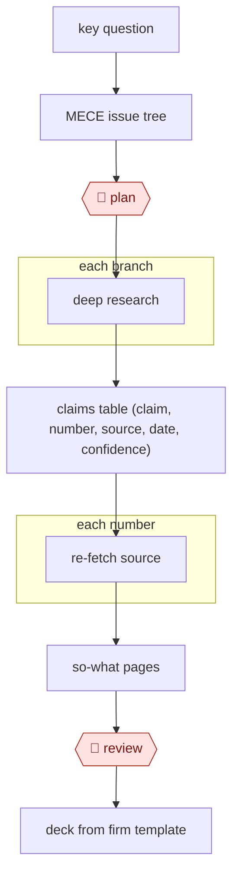

# Issue-tree research

`ORG › BIZ › STRAT` · checkpointed · evidence A · accepted · [reference example](examples/2026-11-where-are-the-real-runs/)

**Shape:** `key question → MECE issue tree → 🛑 plan → each branch: deep research → claims table (claim, number, source, date, confidence) → each number: re-fetch source → so-what pages → 🛑 review → deck from firm template`
**Agent kit:** [run this in Claude Code](variants/claude-code.md)

<!-- shape diagram: generated by scripts/build_diagrams.py from `shape`; don't edit -->

<!-- end shape diagram -->

## Steps
1. Pick the key question. Before scaling up, test the method on one case you already know, such as your own company, and make the agent say how it found each item [[1]](#sources). In this repo's run, the maintainer chose one of four suggested questions [[3]](#sources).
2. Build a MECE issue tree, split so that each item belongs to exactly one branch, with the same sub-questions under every branch [[3]](#sources). The lead agent saves the plan to memory so it survives context truncation [[2]](#sources).
3. 🛑 **Plan**: the question owner approves the tree, the research rules (for example first-hand sources only, public channels only, nobody contacted) and the deliverables before any research starts [[3]](#sources).
4. Each branch: deep research. Launch one subagent per branch in parallel, each with a brief giving the objective, output format, tools and sources to use, and boundaries [[2]](#sources) [[3]](#sources). For data-heavy questions, gather one data point at a time: fix its definition, test the method on 1–5 rows, use the cheapest method that works and save it to the skill [[1]](#sources).
5. Merge the findings into a claims table (claim, number, source, date, confidence), kept as the single source of truth, one row per entity [[1]](#sources) [[3]](#sources). Allow "unknown" as an answer instead of forcing yes/no [[1]](#sources).
6. Each number: re-fetch the source. Separate checker agents re-open every source and check each number on its page. In this repo's run, that meant 65 sources and about 20 corrections [[3]](#sources). Anthropic's system uses a separate citation agent for this pass [[2]](#sources). Also spot-check a sample of rows, every outlier, and the hardest fields by hand [[1]](#sources).
7. Write the so-what pages. Try different cuts in quick chart artifacts and compare medians with means, since outliers skew means [[1]](#sources).
8. 🛑 **Review**: the question owner reads the findings and approves or sends back [[3]](#sources). Publish methodology caveats with them: what isn't significant and where numbers are fuzzy [[1]](#sources).
9. Build the deck from the firm template (a Slides artifact in this repo's run [[3]](#sources); final charts polished in Figma at MKT1 [[1]](#sources)).

**Output:** A research deck with so-what pages, plus the claims table behind it, every number traceable to a re-checked source.
**Failure modes → guards:** The agent fills gaps with plausible numbers (round figures exposed this) → explicit "flag unknowns" rules and an "unknown" option [[1]](#sources). Errors flow into published charts (two newsletters were corrected after release) → the re-fetch and spot-check steps come before 🛑 review [[1]](#sources). Subagents duplicate each other's work → briefs with explicit boundaries [[2]](#sources). Agents prefer SEO content farms → source-quality rules in the brief [[2]](#sources). A branch reads only search-result text → the re-fetch step catches it, and the brief should require a direct fetch [[3]](#sources). Stale facts, such as executives who have left → check those fields by hand [[1]](#sources). The firm template is empty at deck time → fill it in before the run [[3]](#sources). Judgement calls, such as coverage grades, go unchecked → have the checker review them too [[3]](#sources).

## Public runs

Coverage as of 2026-11-06: **Partial**: first-hand runs that cover part of the shape or put checkpoints elsewhere. From [Where are the real runs?](../../../../../research/2026-11-real-runs.md); every number was re-checked against its page.

- [Emily Kramer, MKT1](https://newsletter.mkt1.co/p/state-of-marketing-report-part-3-how-to-research-in-claude-code) (2026-05-06). 100 companies researched one data point at a time; the spreadsheet is the source of truth; spot-checks; published report. "100 high-growth B2B startups, 90+ data points each"; "burned 250 Clay credits". *First-hand: yes; confidence: high.*
- [Hadfield et al., Anthropic Engineering](https://www.anthropic.com/engineering/multi-agent-research-system) (2025-06-13). Lead agent → 3–5 parallel subagents → citation pass; humans only in evaluation. "outperformed single-agent Claude Opus 4 by 90.2%"; "about 15× more tokens". *First-hand: yes (own product); confidence: high.*
- [Graydon Trusler, claude-code-heavy](https://github.com/gtrusler/claude-code-heavy). Worktrees → 2–8 parallel research assistants → synthesis. "Assistants: 6"; "~11,500 words". *First-hand: yes; confidence: med.*

## Sources

1. Emily Kramer (MKT1), State of Marketing Report part 3: how to research in Claude Code, 2026-05-06. https://newsletter.mkt1.co/p/state-of-marketing-report-part-3-how-to-research-in-claude-code
2. Jeremy Hadfield et al. (Anthropic), How we built our multi-agent research system, 2025-06-13. https://www.anthropic.com/engineering/multi-agent-research-system
3. This repo, Example run: where are the real runs?, 2026-11-06. [examples/2026-11-where-are-the-real-runs/](examples/2026-11-where-are-the-real-runs/)
