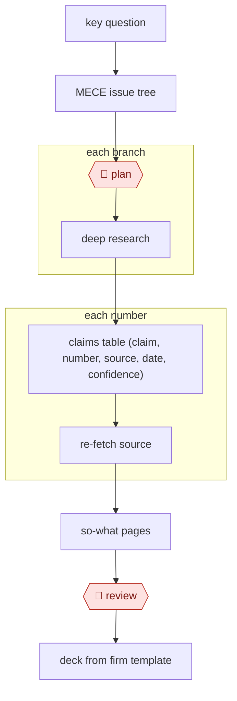

# Issue-tree research

`ORG › BIZ › STRAT` · checkpointed · evidence A · accepted · [reference example](examples/2026-11-where-are-the-real-runs/)

**Shape:** `key question → MECE issue tree → 🛑 plan → each branch: deep research → claims table (claim, number, source, date, confidence) → each number: re-fetch source → so-what pages → 🛑 review → deck from firm template`

<!-- shape diagram: generated by scripts/build_diagrams.py from `shape`; don't edit -->

<!-- end shape diagram -->

## Public runs

Coverage as of 2026-11-06: **Partial**: first-hand runs that cover part of the shape or put checkpoints elsewhere. From [Where are the real runs?](../../../../../research/2026-11-real-runs.md); every number was re-checked against its page.

- [Emily Kramer, MKT1](https://newsletter.mkt1.co/p/state-of-marketing-report-part-3-how-to-research-in-claude-code) (2026-05-06). 100 companies researched one data point at a time; the spreadsheet is the source of truth; spot-checks; published report. "100 high-growth B2B startups, 90+ data points each"; "burned 250 Clay credits". *First-hand: yes; confidence: high.*
- [Hadfield et al., Anthropic Engineering](https://www.anthropic.com/engineering/multi-agent-research-system) (2025-06-13). Lead agent → 3–5 parallel subagents → citation pass; humans only in evaluation. "outperformed single-agent Claude Opus 4 by 90.2%"; "about 15× more tokens". *First-hand: yes (own product); confidence: high.*
- [Graydon Trusler, claude-code-heavy](https://github.com/gtrusler/claude-code-heavy). Worktrees → 2–8 parallel research assistants → synthesis. "Assistants: 6"; "~11,500 words". *First-hand: yes; confidence: med.*

