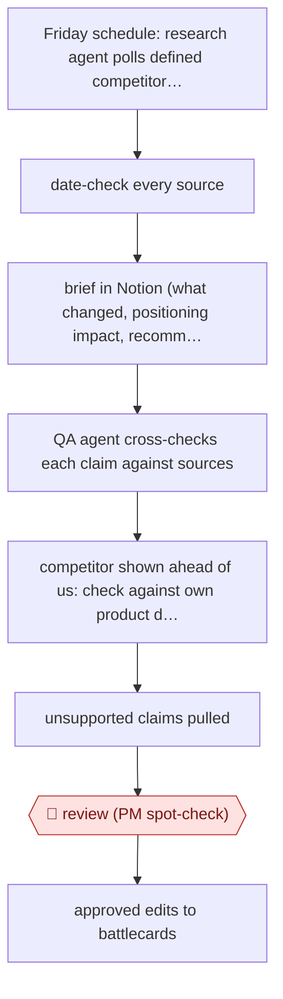

# QA-agent competitive brief

`ORG › BIZ › STRAT` · checkpointed · evidence A · **draft: needs a reference example** ([how to add one](../../../../../CONTRIBUTING.md#1-add-an-example-run))

**Shape:** `Friday schedule: research agent polls defined competitor sources → date-check every source → brief in Notion (what changed, positioning impact, recommended battlecard edits) → QA agent cross-checks each claim against sources → competitor shown ahead of us: check against own product docs, site, blog → unsupported claims pulled → 🛑 review (PM spot-check) → approved edits to battlecards`
**How it differs:** Closest is AWF-0030 Issue-tree research: a one-off key question with 🛑 plan, then a deck. This entry has no plan gate. It is a standing weekly brief where a second agent does claim QA and a single human review gates edits to a live sales asset. Deliverable (recurring brief plus battlecard edits) and checkpoint arrangement both differ.
**Variants:** `notion` · `multi-agent-qa`

<!-- shape diagram: generated by scripts/build_diagrams.py from `shape`; don't edit -->

<!-- end shape diagram -->

## Background

A sales team needs to know what its competitors changed and how to answer it, and the person who owns that answer is usually a product marketer with a dozen other jobs. The weekly output is a short brief — what a competitor shipped, what it means for positioning, which sales talking points should change — and the expensive part is not writing it but being wrong in it, because a seller quoting a stale or invented competitor claim in a live deal loses the deal and the trust. This workflow splits the work between two agents on purpose. One researches and writes; the other reads the brief as an adversary, checks every claim against the source it came from, and, whenever the brief says a competitor is ahead, checks that against the company's own product documentation before the claim goes any further. Sources must pass a date check before they enter, which was added after old posts started appearing as news. A product manager reads the result before anything reaches a battlecard, because a battlecard is used in front of customers and the seller cannot check it in the room.

**Terms:**
- **battlecard**: the one-page document a seller uses to compare a competitor with the product, objection by objection.
- **positioning**: how the product is described relative to alternatives, and why it wins.
- **competitive intel**: facts about what competitors have shipped, priced or announced.
- **QA agent**: a second agent whose only job is to attack the first one's claims.
- **recency check**: verifying a source's publication date before it can be cited as news.
- **evergreen differentiator**: a difference that stays true for quarters, which belongs on a battlecard.
- **weekly intel**: something that changed this week, which belongs in the brief and not on the card.
- **spot-check**: reading a sample closely rather than everything.

## Build it with an agent

**Form:** `service`. It runs on a weekly schedule with nobody starting it, the output lands in a shared document, and the only human act is the approval that lets edits reach the sales asset.

**You need:** the competitor source list, defined and maintained, with the pages that count as authoritative; a document destination with a fixed template; the company's own product documentation, site and blog, as the reference for "are we actually behind here"; the battlecard assets and the permission model that keeps the run from editing them; and the schedule. The agent may write the brief but must not publish to the battlecard without an approval record, and it must not cite a source whose date it could not verify.

| Step | Built as |
|---|---|
| Friday schedule: research agent polls sources | A scheduled run with a fixed source list; a source added or dropped is a change to the list, reviewed like any other, so coverage does not drift silently. |
| date-check every source | A check before writing, not after: a page whose publication date cannot be read is excluded rather than assumed current — the failure that prompted it was old posts surfacing as news. |
| brief in Notion | A Subagent writes into the fixed template: what changed, the positioning implication, the recommended battlecard edits, each with its source. |
| QA agent cross-checks each claim | A second Subagent with different instructions — it sees the brief and the sources, is told to find faults, and returns a list of claims to pull, soften or requalify; it does not rewrite the brief. |
| competitor ahead of us: check own docs | The claim class that matters most: any "they have X and we do not" is checked against the company's own documentation before it survives, because a false gap is what makes a seller look unprepared. |
| unsupported claims pulled | The Skill applies the QA list and records what was removed, so the week's brief and the week's corrections are both visible. |
| 🛑 review (PM spot-check) | The product manager reads the brief and the QA list; only their approval lets edits reach the battlecard, and the run has no write permission there. |
| approved edits to battlecards | The approved edits are applied by a person or by a second, approval-gated step — never by the research run. |

**Checkpoints:** `review`: the product manager's spot-check is deliberately kept after the agents, not replaced by them, because the QA agent can only check a claim against the source, and what a seller needs is a claim that is also true of the product today. The build makes the review cheap — the brief arrives with its unsupported claims already pulled and its sources attached — and makes the gate real: the battlecard is outside the run's write permissions.

**Since the sources:** Sources date from 2026-06: one first-hand engineering account, opened this month, which is also the public run. What has changed since: nothing found that supersedes it — the bounded searches for newer accounts of agent-checked competitive intelligence returned vendor and practitioner material on the same pattern rather than a later run. The entry's own point is the one worth keeping: [the pipeline takes under five minutes of human involvement a week](https://www.trmlabs.com/resources/blog/meet-the-agents-how-noor-and-vera-are-accelerating-competitive-intelligence-at-trm) and the human time is spent on the part that cannot be automated, deciding which shifts matter for a live deal.

*A design based on this entry's steps and the tool documentation as of 2026-11, not a reported run.*

## Steps

*As reported by the sources.*

1. Every Friday afternoon the research agent (Noor) pulls from a defined set of competitive sources. It writes a brief in a fixed Notion format: what changed, what it means for positioning, and recommended battlecard updates [[1]](#sources).
2. Every source must pass a recency check (publication date verified) before it can enter a brief. This was added after old posts were surfacing as news [[1]](#sources).
3. A separate QA agent (Vera) runs 22 minutes later. It reads the whole brief, cross-references each claim against the source material, and flags anything inaccurate, unsupported or misleading [[1]](#sources).
4. 'Step 8': whenever the brief positions a competitor as ahead on something, the QA agent checks the claim against the company's own website, blog and product docs before it goes any further [[1]](#sources).
5. The agents separate evergreen differentiators, which belong on battlecards, from weekly intel, which stays in the Friday brief only. This cuts down unnecessary battlecard edits [[1]](#sources).
6. 🛑 **Review**: a product manager spot-checks the result before approved edits reach the battlecards that sellers use. The enablement team still judges which shifts matter for live deals [[1]](#sources).

**Output:** A weekly competitive-intel brief in Notion and a small set of approved battlecard edits for the sales team.
**Failure modes → guards:** Stale sources presented as news → mandatory date check. Agent grading its own homework misses tier-specific or false 'gap' claims → separate QA agent plus the internal-docs check. Too many battlecard edits → retrained to separate evergreen from weekly intel. Bad intel reaching a seller mid-deal → human PM spot-check kept on purpose.

## Public runs

Coverage as of 2026-11-13: **Strong**: a first-hand, detailed run that matches most of the shape. Collected and re-checked in [Fourth collection pass](../../../../../research/2026-11-fourth-pass.md).

- [TRM Labs, Meet the Agents: Noor and Vera](https://www.trmlabs.com/resources/blog/meet-the-agents-how-noor-and-vera-are-accelerating-competitive-intelligence-at-trm) (2026-06-03). Weekly research + QA agent pipeline, PM spot-check; QA caught tier-specific and false-gap claims. "requires less than five minutes of human involvement per cycle. And it happens on a weekly cadence instead of monthly.". *First-hand: yes; confidence: high.*

## Sources

1. TRM Labs (Laura Cavanaugh), Meet the Agents: How Noor and Vera Are Accelerating Competitive Intelligence at TRM, 2026-06-03. https://www.trmlabs.com/resources/blog/meet-the-agents-how-noor-and-vera-are-accelerating-competitive-intelligence-at-trm
