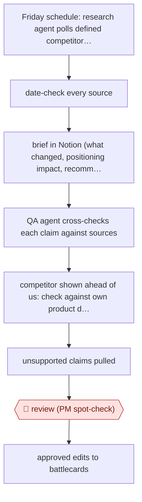

# QA-agent competitive brief

`ORG › BIZ › STRAT` · checkpointed · evidence A · **draft: needs a reference example** ([how to add one](../../../../../CONTRIBUTING.md#1-add-an-example-run))

**Shape:** `Friday schedule: research agent polls defined competitor sources → date-check every source → brief in Notion (what changed, positioning impact, recommended battlecard edits) → QA agent cross-checks each claim against sources → competitor shown ahead of us: check against own product docs, site, blog → unsupported claims pulled → 🛑 review (PM spot-check) → approved edits to battlecards`
**How it differs:** Closest is AWF-0030 Issue-tree research: a one-off key question with 🛑 plan, then a deck. This entry has no plan gate. It is a standing weekly brief where a second agent does claim QA and a single human review gates edits to a live sales asset. Deliverable (recurring brief plus battlecard edits) and checkpoint arrangement both differ.
**Variants:** `notion` · `multi-agent-qa`

<!-- shape diagram: generated by scripts/build_diagrams.py from `shape`; don't edit -->

<!-- end shape diagram -->

## Steps
1. Every Friday afternoon the research agent (Noor) pulls from a defined set of competitive sources. It writes a brief in a fixed Notion format: what changed, what it means for positioning, and recommended battlecard updates [[1]](#sources).
2. Every source must pass a recency check (publication date verified) before it can enter a brief. This was added after old posts were surfacing as news [[1]](#sources).
3. A separate QA agent (Vera) runs 22 minutes later. It reads the whole brief, cross-references each claim against the source material, and flags anything inaccurate, unsupported or misleading [[1]](#sources).
4. 'Step 8': whenever the brief positions a competitor as ahead on something, the QA agent checks the claim against the company's own website, blog and product docs before it goes any further [[1]](#sources).
5. The agents separate evergreen differentiators, which belong on battlecards, from weekly intel, which stays in the Friday brief only. This cuts down unnecessary battlecard edits [[1]](#sources).
6. 🛑 **Review**: a product manager spot-checks the result before approved edits reach the battlecards that sellers use. The enablement team still judges which shifts matter for live deals [[1]](#sources).

**Output:** A weekly competitive-intel brief in Notion and a small set of approved battlecard edits for the sales team.
**Failure modes → guards:** Stale sources presented as news → mandatory date check. Agent grading its own homework misses tier-specific or false 'gap' claims → separate QA agent plus the internal-docs check. Too many battlecard edits → retrained to separate evergreen from weekly intel. Bad intel reaching a seller mid-deal → human PM spot-check kept on purpose.

## Public runs

Coverage as of 2026-11-13: **Strong**: a first-hand, detailed run that matches most of the shape. Collected and re-checked in [Fourth collection pass](../../../../../research/2026-11-fourth-pass.md).

- [TRM Labs, Meet the Agents: Noor and Vera](https://www.trmlabs.com/resources/blog/meet-the-agents-how-noor-and-vera-are-accelerating-competitive-intelligence-at-trm) (2026-06-03). Weekly research + QA agent pipeline, PM spot-check; QA caught tier-specific and false-gap claims. "requires less than five minutes of human involvement per cycle. And it happens on a weekly cadence instead of monthly.". *First-hand: yes; confidence: high.*

## Sources

1. TRM Labs (Laura Cavanaugh), Meet the Agents: How Noor and Vera Are Accelerating Competitive Intelligence at TRM, 2026-06-03. https://www.trmlabs.com/resources/blog/meet-the-agents-how-noor-and-vera-are-accelerating-competitive-intelligence-at-trm
