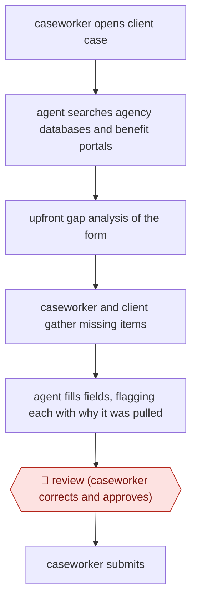

# Gap-checked benefits form fill

`ORG › GOV › CASEWORK` · checkpointed · evidence B · **draft: needs a reference example** ([how to add one](../../../../../CONTRIBUTING.md#1-add-an-example-run))

**Shape:** `caseworker opens client case → agent searches agency databases and benefit portals → upfront gap analysis of the form → caseworker and client gather missing items → agent fills fields, flagging each with why it was pulled → 🛑 review (caseworker corrects and approves) → caseworker submits`
**How it differs:** AWF-0081 Summary-aided casework decision. There, decision-makers use summaries to decide asylum claims. Here, the agent assembles and fills a benefits application from existing records, with an upfront gap analysis. The deliverable is a submitted application, not a decision, and the checkpoint is a field-level caseworker review before submission.
**Variants:** `nava-form-filling-assistant`

<!-- shape diagram: generated by scripts/build_diagrams.py from `shape`; don't edit -->

<!-- end shape diagram -->

## Steps
1. A caseworker meets a resident to start a benefit application, for example Medicaid or SNAP [[1]](#sources).
2. The agent searches the organization's databases and benefit systems for the client's existing data [[1]](#sources)[[2]](#sources).
3. Gap check: before filling anything, it scans the application form and lists what is missing, so the caseworker and client can start gathering items such as a medical record [[1]](#sources).
4. The agent fills the form fields. Each AI-filled field is flagged with an explanation of where the data came from. Processing detail is hidden in a collapsible panel because staff found it distracting during client conversations [[1]](#sources).
5. 🛑 **Review**: the caseworker checks the flagged fields, corrects anything wrong and fills gaps ('Caseworkers review for accuracy, fill in anything missing, and submit') [[3]](#sources).
6. The caseworker submits the application [[2]](#sources)[[3]](#sources).

**Output:** A completed, caseworker-approved benefits application submitted to the program portal, prepared in the session with the client.
**Failure modes → guards:** Wrong data pulled from stale records → per-field provenance flags plus caseworker correction. Agent UI distracts from the client conversation → processing detail collapsed by default. Erosion of caseworker-client trust → the Phase 1 findings led to design changes for trust and adoption.

## Public runs

Coverage as of 2026-11-06: **Partial**: first-hand runs that cover part of the shape or put checkpoints elsewhere. Collected and re-checked in [Second collection pass](../../../../../research/2026-11-second-pass.md).

- [Route Fifty, Riverside County pilot](https://www.route-fifty.com/artificial-intelligence/2026/03/open-source-ai-assistant-shows-promise-california-caseworkers-service-delivery/412378) (2026-03-25). Second-phase pilot at Riverside County Children and Families Commission with real families. "About a dozen staff members". *First-hand: interview; confidence: med.*

## Sources

1. Route Fifty, Open-source AI assistant shows promise for California caseworkers' service delivery, 2026-03-25. https://www.route-fifty.com/artificial-intelligence/2026/03/open-source-ai-assistant-shows-promise-california-caseworkers-service-delivery/412378
2. Nava PBC, Form-Filling Assistant. https://www.navapbc.com/labs/caseworker-ai-tools/form-filling-assistant
3. Nava PBC, AI caseworker tools, 2026-04-30. https://www.navapbc.com/news/ai-caseworker-tools
