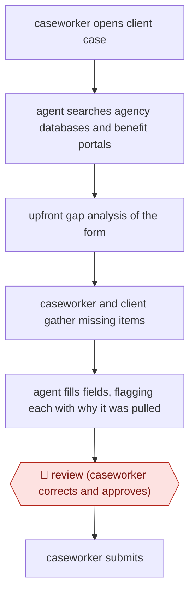

# Gap-checked benefits form fill

`ORG › GOV › CASEWORK` · checkpointed · evidence B · **draft: needs a reference example** ([how to add one](../../../../../CONTRIBUTING.md#1-add-an-example-run))

**Shape:** `caseworker opens client case → agent searches agency databases and benefit portals → upfront gap analysis of the form → caseworker and client gather missing items → agent fills fields, flagging each with why it was pulled → 🛑 review (caseworker corrects and approves) → caseworker submits`
**Variants:** `nava-form-filling-assistant`

<!-- shape diagram: generated by scripts/build_diagrams.py from `shape`; don't edit -->

<!-- end shape diagram -->

## Background

A caseworker at a public agency or a community organisation helps a resident apply for benefits such as Medicaid (public health coverage) or SNAP (food assistance). The application forms are long, the facts they ask for already sit in several agency databases and benefit portals, and caseworkers end up re-entering the same data while the client waits. Missing documents tend to surface late. The agent searches those records, lists what the form still lacks before filling anything, and then fills the fields and says where each value came from. The caseworker still checks every field and submits, because the application is made in the client's name, a wrong entry can delay or deny the benefit, and only the caseworker can ask the client about what the records do not show.

**Terms:**
- **Caseworker**: the staff member who helps a client apply for benefits and is accountable for the application.
- **Medicaid, SNAP**: two US public benefit programs, for health coverage and for food purchases.
- **Benefit portal**: the program's online system where applications are submitted.
- **Gap analysis**: a check, before filling, of which form fields the existing records cannot answer.
- **Provenance flag**: a note on a filled field saying which record the value came from.

## Build it with an agent

**Form:** `skill`. One caseworker works on one application at a time, in the session with the client, so a single skill that holds the procedure and the form's field list is enough.

**You need:** the blank application form and its list of required fields as files beside the skill; read-only access to the agency databases and benefit systems through MCP connectors; a setup your agency has approved for client personal data, with the agent reading only the case open in the session. Give the agent no tool that writes to a portal.

| Step | Built as |
|---|---|
| caseworker opens client case → agent searches agency databases and benefit portals | The caseworker names the case. The skill reads the client's existing data through read-only MCP connectors. A portal with no connector stays outside the build, and the caseworker adds what it shows. |
| upfront gap analysis of the form | The skill's next instruction: compare the form's required fields with what was found, write the list of what is missing, and stop. |
| caseworker and client gather missing items | The conversation. The skill waits and takes in what the caseworker adds. |
| agent fills fields, flagging each with why it was pulled | The skill writes a filled copy of the form as a file, with one note per field naming the record the value came from. Technical detail goes at the end of the file, not between the fields. |
| 🛑 review (caseworker corrects and approves) → caseworker submits | See Checkpoints. |

**Checkpoints:** `review`: the skill presents the filled form field by field with the provenance flags, then stops while the caseworker corrects values and fills gaps. Submission is not built: the connectors are read-only (a permission rule denies any write tool), so the caseworker submits in the portal themselves.

**Since the sources:** Sources date from 2026-03 to 2026-04, and the public run is from 2026-03. The open-source tool they describe uses several agents that navigate databases and portals on their own; this build is one skill that reads through connectors and does not operate a portal's screens. The sources report a pilot with about a dozen staff and give no evidence about how well a build like this works. Source 2 lists a pilot-results demo dated 2026-08 that was not opened for this entry. No performance claim is made here.

*A design based on this entry's steps and the tool documentation as of 2026-11, not a reported run.*

## Steps

*As reported by the sources.*

1. A caseworker meets a resident to start a benefit application, for example Medicaid or SNAP [[1]](#sources).
2. The agent searches the organization's databases and benefit systems for the client's existing data [[1]](#sources)[[2]](#sources).
3. The agent runs a gap analysis: before filling anything, it scans the application form and lists what is missing, so the caseworker and client can start gathering items such as a medical record [[1]](#sources).
4. The agent fills the form fields. Each AI-filled field is flagged with an explanation of where the data came from. Processing detail is hidden in a collapsible panel because staff found it distracting during client conversations [[1]](#sources).
5. 🛑 **Review**: the caseworker checks the flagged fields, corrects anything wrong and fills gaps ('Caseworkers review for accuracy, fill in anything missing, and submit') [[3]](#sources).
6. The caseworker submits the application [[2]](#sources)[[3]](#sources).

**Output:** A completed, caseworker-approved benefits application submitted to the program portal, prepared in the session with the client.
**Failure modes → guards:** Wrong data pulled from stale records → per-field provenance flags plus caseworker correction. Agent UI distracts from the client conversation → processing detail collapsed by default. Erosion of caseworker-client trust → the Phase 1 findings led to design changes for trust and adoption.
**How it differs:** AWF-0081 Summary-aided casework decision. There, decision-makers use summaries to decide asylum claims. Here, the agent assembles and fills a benefits application from existing records, with an upfront gap analysis. The deliverable is a submitted application, not a decision, and the checkpoint is a field-level caseworker review before submission.

## Public runs

Coverage as of 2026-11-06: **Partial**: first-hand runs that cover part of the shape or put checkpoints elsewhere. Collected and re-checked in [Second collection pass](../../../../../research/2026-11-second-pass.md).

- [Route Fifty, Riverside County pilot](https://www.route-fifty.com/artificial-intelligence/2026/03/open-source-ai-assistant-shows-promise-california-caseworkers-service-delivery/412378) (2026-03-25). Second-phase pilot at Riverside County Children and Families Commission with real families. "About a dozen staff members". *First-hand: interview; confidence: med.*

## Sources

1. Route Fifty, Open-source AI assistant shows promise for California caseworkers' service delivery, 2026-03-25. https://www.route-fifty.com/artificial-intelligence/2026/03/open-source-ai-assistant-shows-promise-california-caseworkers-service-delivery/412378
2. Nava PBC, Form-Filling Assistant. https://www.navapbc.com/labs/caseworker-ai-tools/form-filling-assistant
3. Nava PBC, AI caseworker tools, 2026-04-30. https://www.navapbc.com/news/ai-caseworker-tools
