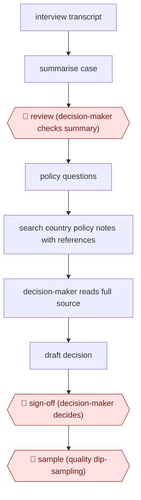

# Summary-aided casework decision

`ORG › GOV › CASEWORK` · assist · evidence A · **draft: needs a reference example** ([how to add one](../../../../../CONTRIBUTING.md#1-add-an-example-run))

**Shape:** `interview transcript → summarise case → 🛑 review (decision-maker checks summary) → policy questions → search country policy notes with references → decision-maker reads full source → draft decision → 🛑 sign-off (decision-maker decides) → 🛑 sample (quality dip-sampling)`
**Variants:** `home-office-acs` · `home-office-aps`

<!-- shape diagram: generated by scripts/build_diagrams.py from `shape`; don't edit -->

<!-- end shape diagram -->

## Background

A person who asks a country for protection as a refugee makes an asylum claim. The claim is tested in an interview, and a trained official, the decision-maker, then decides whether to grant it. Before deciding, the decision-maker has to read the interview transcript, which can run to 50 pages or more, and find what the government's official country information says about conditions in the applicant's home country. Both take a long time by hand. The agent summarises the transcript and searches the country information, giving references. The decision-maker still checks the summary against the transcript, opens every source the search cites, and makes and signs the decision alone, because it is a legal decision with serious consequences for the applicant and a summary can be wrong or leave something out.

**Terms:**
- **Decision-maker**: the official who is legally responsible for deciding an asylum claim.
- **Interview transcript**: the written record of the applicant's asylum interview.
- **Country Policy Information Notes (CPINs), Country of Origin Information Requests (COIRs)**: the Home Office's published notes and information responses on conditions in applicants' home countries, used as the policy basis for decisions.
- **Calibre**: the quality framework used to check a sample of decisions after they are made.
- **Dip-sampling**: checking a small random share of finished decisions rather than all of them.

## Build it with an agent

**Form:** `skill`. One decision-maker works on one case at a time and stays in the conversation, so one skill with the procedure and the policy notes is enough.

**You need:** the interview transcript as a file; the policy notes as reference files beside the skill, or reached through an MCP connector to the document store that holds them; a setup your organisation has approved for asylum applicants' personal data. Give the agent no tool that records a decision or writes to the case system.

| Step | Built as |
|---|---|
| interview transcript → summarise case | The skill reads the transcript and writes a summary in which every statement names the transcript page it comes from, so the check that follows can be done against the source. |
| 🛑 review (decision-maker checks summary) | See Checkpoints. |
| policy questions → search country policy notes with references | The decision-maker asks in the conversation. The skill searches the notes and answers with the note title and section for each point. |
| decision-maker reads full source | The skill lists every note it cited and tells the decision-maker to open each one before relying on it. |
| draft decision | The decision-maker writes the decision. The skill may lay out the case facts and cited notes in a file as a working aid. |
| 🛑 sign-off (decision-maker decides) → 🛑 sample (quality dip-sampling) | See Checkpoints. |

**Checkpoints:** `review`: the skill presents the summary with its transcript references and stops until the decision-maker says they have checked it. `sign-off`: the agent has no tool that records or sends a decision, and the skill is written to prepare material and not to recommend an outcome; the decision-maker acts in the case system. `sample`: this happens outside the skill, in the organisation's own quality process. The skill saves each case's summary and policy answers to a file so the quality team can draw a sample and check it.

**Since the sources:** The source is dated 2025-04, and the pilots ran from 2024-05 to 2024-12. A [TechTimes report](https://www.techtimes.com/articles/329581/20261028/home-office-asylum-ai-fails-one-five-checks-quality-testing-second-tool-has-stopped.htm) (2026-10-28) of an Open Rights Group investigation says the policy search tool was rolled out to all asylum decision-makers in 2025-07 and the summarisation tool in 2026-04, and that spot checks of 203 summaries from 2026-04 to 2026-07 found 45 failed at the first stage. It reports the Home Office does not plan an independent audit. These are second-hand figures that were not checked against the underlying documents. The source's pilot summaries carried no transcript references, so the person's check had to be manual; this build asks the skill to add them. The vendor tools the Home Office used are not available to a general agent, and the build does not reproduce them.

*A design based on this entry's steps and the tool documentation as of 2026-11, not a reported run.*

## Steps

*As reported by the sources.*

1. An LLM tool takes the asylum interview transcript (it can run to 50 pages or more) and writes a concise case summary (Asylum Case Summarisation) [[1]](#sources).
2. Before the pilot, technical specialists reviewed every summary. 9% were judged inaccurate or incomplete and taken out, and those cases went through the usual process [[1]](#sources).
3. 🛑 **Review**: the decision-maker uses the summary to get back up to speed on the case and checks it against the transcript. The summaries have no source references to the transcript, so this check is manual [[1]](#sources).
4. The decision-maker asks case-specific policy questions of a chat search assistant over Country Policy Information Notes and Country of Origin Information Requests (Asylum Policy Search). It returns summaries with references [[1]](#sources).
5. The decision-maker must open the full note or request it cites before relying on it [[1]](#sources).
6. 🛑 **Sign-off**: only the decision-maker decides. The tools cannot make or recommend a decision on their own [[1]](#sources).
7. 🛑 **Sample**: a quality team dip-samples decision quality with the usual quality framework (Calibre) and compares it against a comparison group [[1]](#sources).

**Output:** An asylum decision written and owned by the caseworker, plus a dip-sample quality record. In the pilot the AI summary and policy search answers were working aids only.
**Failure modes → guards:** Inaccurate or incomplete summaries → screen summaries before use (9% were removed in the pilot). Users not fully confident in summaries (23%) → decision-maker re-reads the transcript, which is harder because summaries lack source references. Over-reliance on policy summaries → the full source must be opened. The pilots were small and self-reported → continuous monitoring and a post-deployment evaluation before full rollout [[1]](#sources).
**How it differs:** AWF-0021 Procedure agent resolves customer requests by following a procedure. Here the agent only prepares material, and a statutory decision-maker makes and signs every decision (assist autonomy, high risk).

## Public runs

Coverage as of 2026-11-06: **Partial**: first-hand runs that cover part of the shape or put checkpoints elsewhere. Collected and re-checked in [New workflows for empty categories](../../../../../research/2026-11-new-workflows.md).

- [UK Home Office, Evaluation of AI trials in the asylum decision-making process](https://www.gov.uk/government/publications/evaluation-of-ai-trials-in-the-asylum-decision-making-process/evaluation-of-ai-trials-in-the-asylum-decision-making-process) (2025-04-29). Two pilots, May–Dec 2024. Test vs comparison decision-makers; summary and policy-search time saved; quality dip-sampled. "reviewed transcripts 23 minutes quicker than the comparison group (a 32% time saving)"; policy search "saved on average 37 minutes per case". *First-hand: yes; confidence: med.*

## Sources

1. UK Home Office, Evaluation of AI trials in the asylum decision-making process, 2025-04-29. https://www.gov.uk/government/publications/evaluation-of-ai-trials-in-the-asylum-decision-making-process/evaluation-of-ai-trials-in-the-asylum-decision-making-process
